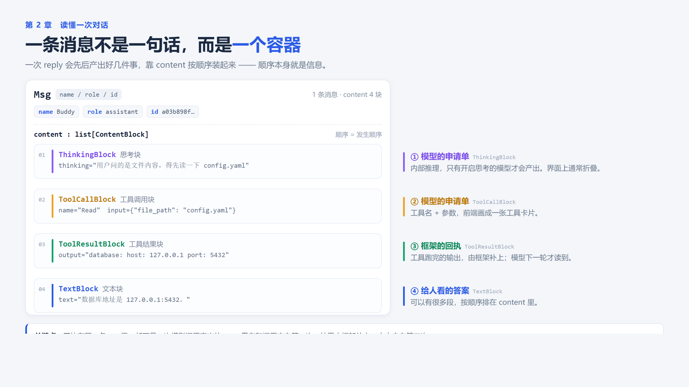

# 第 2 章　读懂一次对话：Msg / Block / Event

> 本章代码 `code/ch02/main.py`、`code/ch02/inspect_msg.py`、`code/ch02/assemble_msg.py`、`code/ch02/role_rule.py`、`code/ch02/event_ids.py`　·　读完约 17 分钟

## 2.0 上一章的 print 省略了太多信息

上一章那个循环里，每轮也只打了一行：

```python
print(reply.get_text_content())
```

把一个完整对象压缩成一个字符串，只为读取一句话。

但 `reply` 承载的信息远不止一句话：这一轮里模型推理了什么、调用了哪个工具、工具返回了什么、消耗了多少 token。这些内容都被 `get_text_content()` 一次性丢弃了。

那么本章，我们要一起来做两件事：看清一条消息的结构，看懂一次回复的过程。

前者决定数据如何存储，后者决定界面如何编写。

## 2.1 `Msg`：一条消息的结构

`Msg` 是 AgentScope 中最基础的数据结构。一次用户输入是一个 `Msg`，一次完整回复也是一个 `Msg`。

它有 11 个字段，真正需要留意的只有 `name`、`role`、`content` 三个，`metadata` 偶尔用得上：

| 字段 | 类型 | 作用 | 是否需要手动处理 |
|---|---|---|---|
| `name` | `str` | 发送方名称 | 是 |
| `role` | `"user" \| "assistant" \| "system"` | 发送方身份 | 是 |
| `content` | `list[ContentBlock]` | 消息内容（重点） | 是 |
| `id` | `str` | 唯一标识 | 自动生成 |
| `metadata` | `dict` | 自定义键值对 | 偶尔 |
| `created_at` / `finished_at` | `str` | 创建与完成时间 | 自动填充 |
| `usage` | `Usage` | token 用量（仅 assistant 消息） | 第 13 章使用 |
| `finished_reason` | `ReplyFinishedReason \| None` | 本轮的结束原因 | 第 12 章使用 |
| `structured_output` | `dict \| None` | 结构化结果 | 第 8 章使用 |
| `error` | `ErrorInfo \| None` | 错误信息 | 第 12 章使用 |

> 后半部分标注了"第 N 章使用"的字段，现在可以先忽略。
>
> 但它们的存在本身说明一件事：框架把"一次回复"视为一个完整事件——有起止时间、可能失败、可能携带结构化结果，而不是一个字符串。

### 2.1.1 用代码看一眼

先运行 `code/ch02/inspect_msg.py`，把一条用户消息逐字段打出来：

```
name              str                'user'
content           list               [TextBlock(type='text', text='用一句话说明什么是异步编程', ...)]
role              str                'user'
id                str                'a03b898f4dff42239a2ba96173391f3e'
metadata          dict               {}
created_at        str                '2026-10-28T20:45:17.760255'
usage             NoneType           None
finished_at       str                '2026-10-28T20:45:17.760255'
finished_reason   NoneType           None
structured_output NoneType           None
error             NoneType           None
```

对着这张表我们就能发现这些结论：

- 只有 3 个字段是你写的：`name`、`content`（`UserMsg` 帮你补 `role`），加上可选的 `metadata`
- `id`、`created_at` 由框架生成，用户消息的 `finished_at` 也当场填好——它没有"生成过程"
- 后 4 个字段全是 `None`，这没有关系，后面的章节会用得上

### 2.1.2 为什么 `name` 和 `role` 都是 `user`

到这里，初学者一般会有一个疑问，就是role和name到底是什么关系？

| | `role` | `name` |
|---|---|---|
| 谁定 | 协议定的，只有 3 个合法值 | 你填的，任意字符串 |
| 管什么 | 这句话按什么方式处理 | 这句话是谁说的 |
| 填错 | 立刻报错（块类型受限） | 不报错，但下游会认不出归属 |

`role` 是给模型 API 看的：它决定这条消息走哪条格式化路径——`tool_calls` 只能挂在 `assistant` 上、`thinking` 块只出现在 `assistant` 里、`usage` 只写在 `assistant` 消息上。

`name` 是给人看的：多智能体时所有 Agent 的 `role` 都是 `assistant`，只能靠 `name` 区分谁在说话。

一个类比：

```
role  = 座位号（前排/后排），只有几个固定位置，坐错会很显眼
name  = 座位上贴的名牌，随便写，但写错了别人不知道你是谁
```

`UserMsg(...)` 这个工厂函数只能帮你锁死 `role`，`name` 没有默认值，必须自己填：

```python
UserMsg(content="你好")
# TypeError: UserMsg() missing 1 required positional argument: 'name'
```

所以本教程里那个 `name="user"` 是自己写的，不是框架给的。它沿用了 OpenAI 的惯用写法，让人一眼看出"这是用户"——但它并不是规定。下面两条消息的 `role` 完全相同，模型看到的内容却不同：

```python
UserMsg(name="user", content="我读哪张表？")     # name: user
UserMsg(name="张三", content="我读哪张表？")     # name: 张三
```

格式化后分别变成：

```python
{'role': 'user', 'name': 'user', 'content': [{'type': 'text', 'text': '我读哪张表？'}]}
{'role': 'user', 'name': '张三', 'content': [{'type': 'text', 'text': '我读哪张表？'}]}
```

`role` 一模一样，`name` 变了，模型看到的名字就变了。

`name` 会原样发给模型。所以它有两个隐性约束：

- 字符集：有的模型只接受字母、数字、`_`、`-`。`"张三"` 这种本地构造不报错，但真发请求会收到 400
- 一致性：自己手写 `AssistantMsg` 时，`name` 必须等于 `agent.name`，否则框架认不出这是"我"写的，工具调用状态会更新失败、一次 reply 会裂成两条消息

至于 `role`，它是不可商量的。`UserMsg` 会把 `role` 锁死为 `"user"`，你想在用户消息里塞工具调用，构造阶段就会失败（见 2.3 节）。

## 2.2 `content` 为什么是列表

这是初学者最不习惯的一点：

```python
reply.content   # 不是 "你好"，而是 [TextBlock(...), ToolCallBlock(...), ...]
```

为什么不直接存字符串？

因为**一次回复中可能发生多件事**，这些事需要按顺序保留：



考虑这个场景：

> 你说："看看 config.yaml 里数据库地址是多少"

它内部依次发生：

1. 内部推理：需要先读文件 → 产生一个**思考块**
2. 决定调用 `Read` → 产生一个**工具调用块**
3. 工具返回内容 → 产生一个**工具结果块**
4. 基于结果作答 → 产生一个**文本块**

如果把这些内容压缩成一个字符串，第 3 步的结果就会丢失。下一轮模型会处于"记得自己读过文件，却不记得读到了什么"的状态，只能靠推测补全内容。

所以 `content` 是列表，其中包含六种块：

| 块类型 | 承载内容 | 常见来源 |
|---|---|---|
| `TextBlock` | 纯文本 | 模型回答、用户输入 |
| `ThinkingBlock` | 模型的推理过程 | 开启思考模式的模型 |
| `ToolCallBlock` | 工具名、参数、执行状态 | 模型决定调用工具时 |
| `ToolResultBlock` | 工具执行产出 | 工具执行完成后 |
| `DataBlock` | 图片、音频、视频（base64 或 URL） | 多模态输入输出 |
| `HintBlock` | 框架注入的提示（时间、任务数） | 框架自动注入 |

> 换句话说，块类型本身就是分类依据。如果全都压成一个字符串，想单独取推理过程就只能靠正则去猜。

### 2.2.1 手工拼一条 assistant 消息

把上面那个"读配置文件"的场景原样写出来，`content` 里就是四个块，顺序即发生顺序：

```python
from agentscope.message import (
    AssistantMsg, TextBlock, ThinkingBlock, ToolCallBlock, ToolResultBlock, Usage,
)
from agentscope.types import ReplyFinishedReason

msg = AssistantMsg(
    name="Buddy",
    content=[
        ThinkingBlock(thinking="用户问的是文件内容，得先读一下 config.yaml"),
        ToolCallBlock(id="call_1", name="Read", input='{"file_path": "config.yaml"}',
                      state="finished"),
        ToolResultBlock(id="call_1", name="Read",
                        output="database:\n  host: 127.0.0.1\n  port: 5432",
                        state="success"),
        TextBlock(text="数据库地址是 127.0.0.1:5432。"),
    ],
    usage=Usage(input_tokens=186, output_tokens=54),
    finished_reason=ReplyFinishedReason.COMPLETED,
)
print(msg)
```

完整脚本在 `code/ch02/assemble_msg.py`，`cd code/ch02 && python assemble_msg.py` 即可看到下面的输出。

逐个块打印，然后对比压缩后的结果：

```
[0] thinking     ThinkingBlock(type='thinking', thinking='用户问的是文件内容，得先读一下 config...')
[1] tool_call    ToolCallBlock(type='tool_call', id='call_1', name='Read', input...)
[2] tool_result  ToolResultBlock(type='tool_result', id='call_1', name='Read', o...)
[3] text         TextBlock(type='text', text='数据库地址是 127.0.0.1:5432。', ...)

get_text_content() -> '数据库地址是 127.0.0.1:5432。'
```

一次 `print(msg.get_text_content())`，前面三个块就全没了，这就是 2.0 节讲的省略的信息。智能体回复的内容很简单，但后台实际做了很多动作，包括思考，工具调用等。

## 2.3 `role` 的约束

`role` 不能随意填写，框架在构造消息时就会强制检查：

| role | 允许包含的块 |
|---|---|
| `user` | 只能 `TextBlock` + `DataBlock` |
| `system` | 只能 `TextBlock` |
| `assistant` | 全部类型 |

约束的根源不在框架，而在模型的训练方式。

所有的对话类模型是用带角色标记的语料训练出来的：工具调用只出现在 `assistant` 轮里，`user` 轮里只有文本和图片。模型从没见过"用户发起工具调用"这种序列，硬塞进去它也不知道该怎么处理。

下游 API 的校验规则，只是把这条训练时的约定写成了 schema——它拒绝的不是"不合逻辑"，而是"不在训练分布内"。

所以 `role` 不是给人看的标签，而是模型训练时学到的分段符。

> 如果不清楚大语言模型的训练方式，可以去看看Datawhale社区开源的课程《happy-llm》~~

可以现在就试：

```python
from agentscope.message import ToolCallBlock, UserMsg

UserMsg(name="user", content=[ToolCallBlock(id="c1", name="Read", input="{}")])
# ValueError: User message can only contain text blocks or data blocks.
```

注意它抛的是 `pydantic.ValidationError`（`Msg` 是 pydantic 模型），上面那句 `ValueError` 只是异常信息的一部分，要看全就用 `str(exc)`。捕获时用 `except ValidationError` 即可。

> 完整脚本在 `code/ch02/role_rule.py`，`cd code/ch02 && python role_rule.py` 即可看到这段验证。

AgentScope 里附带工厂函数，可以省去手写 `role`：

```python
from agentscope.message import UserMsg, AssistantMsg, SystemMsg

UserMsg(name="user", content="你好")           # role 自动是 user
AssistantMsg(name="Buddy", content="你好呀")    # role 自动是 assistant
SystemMsg(name="system", content="你是个助手")  # role 自动是 system
```

`role_rule.py` 的第二段就是这三行，运行后输出：

```
UserMsg       role='user'       text='你好'
AssistantMsg  role='assistant'  text='你好呀'
SystemMsg     role='system'     text='你是个助手'
```

三个工厂返回的都是 `Msg`，区别只在 `role` 和 `content`——`content` 传字符串时会被自动包装成 `TextBlock`。

## 2.4 事件：观察过程

`reply()` 只把最终答案交给你。如果你想知道"它是怎么一步步想出来、做出来的"，就换成 `reply_stream()`。

```python
# 方式一：只要结果
reply = await agent.reply(msg)
print(reply.get_text_content())

# 方式二：边做边看
async for event in agent.reply_stream(msg):
    print(event.type)
```

打个比方：`reply()` 像点完外卖一直等骑手敲门，只拿到餐，路上发生了什么一概不知；`reply_stream()` 像打开配送地图，每一步都推送一条通知。这些"通知"就是事件（event）。

底层跑的是同一个逻辑，`reply()` 只是把 `reply_stream()` 推送的事件默默收下，最后拼成一条完整消息返回。可以粗略理解为：

```
reply()  =  reply_stream()  +  自动把事件拼装成一条消息
```

那 `reply_stream()` 会推送哪些事件？一共 28 种，看着多，其实只有一条主线：**每个内容块都要经历"开始 → 增量 → 结束"三步**。

| 分组 | 事件 | 什么时候出现 |
|---|---|---|
| 一轮回复 | `REPLY_START` / `REPLY_END` | 整轮开始和结束，像一对括号 |
| 调用模型 | `MODEL_CALL_START` / `MODEL_CALL_END` | 每次向模型发请求；一轮里可能调用多次 |
| 文本 | `TEXT_BLOCK_START` / `_DELTA` / `_END` | 模型开始说话、逐字吐字、说完 |
| 思考 | `THINKING_BLOCK_START` / `_DELTA` / `_END` | 同上，只是内容是推理过程 |
| 数据 | `DATA_BLOCK_START` / `_DELTA` / `_END` | 图片、音频等二进制内容 |
| 提示 | `HINT_BLOCK` | 框架自己塞进去的提示 |
| 工具调用 | `TOOL_CALL_START` / `_DELTA` / `_END` | 模型决定调工具，参数一点点拼出来 |
| 工具结果 | `TOOL_RESULT_START` / `TOOL_RESULT_TEXT_DELTA` / `TOOL_RESULT_DATA_DELTA` / `_END` | 工具执行，结果一点点回传 |
| 人机交互 | `REQUIRE_USER_CONFIRM` / `USER_CONFIRM_RESULT` | 等待用户确认（第 7 章） |
| | `REQUIRE_EXTERNAL_EXECUTION` / `EXTERNAL_EXECUTION_RESULT` | 等待外部系统执行（第 12 章） |
| | `USER_INTERRUPT` | 用户中断（第 12 章） |
| 异常 | `EXCEED_MAX_ITERS` | 迭代次数超限，被强制终止 |
| 扩展 | `CUSTOM` | 自定义事件，框架预留 |

## 2.5 把过程打印出来


完整代码约四十行：

```python
def describe(event) -> str:
    """从事件中取出最值得关注的一个字段。"""
    for field in ("delta", "tool_call_name", "state", "finished_reason"):
        value = getattr(event, field, None)
        if value is not None:
            return f"{field}={value!r}"
    return ""

async def main() -> None:
    agent = Agent(name="Buddy", system_prompt="你叫 Buddy，回答简短。", model=build_model())

    i = 0
    async for event in agent.reply_stream(
        UserMsg(name="user", content="用一句话说明什么是异步编程"),
    ):
        kind = event.type.value
        print(f"[{i:02d}] {kind:<22} {describe(event)}")
        i += 1
```

`describe()` 做的事很简单：我们还不清楚每种事件里到底装了哪些字段，那就挨个试一遍——`delta` 有值就打印 `delta`，没有就试 `tool_call_name`，再试 `state`、`finished_reason`，全都没有就打印空字符串。

这是了解陌生事件流最快的方法：先看全貌，再针对性处理。

运行后，你会看到类似下面的输出：

```
[00] REPLY_START
[01] MODEL_CALL_START
[02] THINKING_BLOCK_START
[03] THINKING_BLOCK_DELTA   delta='异步'
[04] THINKING_BLOCK_DELTA   delta='编程'
...
[31] TEXT_BLOCK_START
[32] TEXT_BLOCK_DELTA       delta='异步编程'
[33] TEXT_BLOCK_DELTA       delta='就是'
...
[58] TEXT_BLOCK_END
[59] MODEL_CALL_END
[60] REPLY_END              finished_reason='completed'
```

这里比较难理解的是 `delta`。它不装完整内容，一个事件里只有几个字或 1 个标点符号。

比如模型回答"异步编程"：

```
TEXT_BLOCK_START
TEXT_BLOCK_DELTA   delta='异步'
TEXT_BLOCK_DELTA   delta='编程'
TEXT_BLOCK_END
```

全部的 `delta` 拼起来才是完整答案。

之所以要拆开，是因为模型是一个字一个字生成的，框架也就一个字一个字地转发——这就是"打字机效果"的来源。

> 仔细观察你会发现，像 WorkBuddy、DeepSeek、豆包这些产品，AI 回复时都是一个字一个字往外蹦，而不是一次性给全。原因在于大语言模型回答问题的时候，本质是一个自回归的过程——不断地计算下一个词的概率，这也叫"流式输出"。
>
> 这个设计的价值在第 11 章才会完全体现：前端只需要一个 `switch (event.type)`，就能同时实现打字机效果、工具卡片加载态和思考区折叠——因为它们在协议层面本来就是同一套机制。

> **注意：** 这段输出不是固定的。 使用不同模型、是否开启思考、是否装配工具，事件序列都会变化：
>
> - 未开启思考的模型（例如普通 chat 模型）不会出现 `THINKING_*` 系列事件
> - 一旦发生工具调用，中间会插入完整的 `TOOL_CALL_*` 序列，`MODEL_CALL_START` 也会出现第二次、第三次
> - `REPLY_END` 的 `finished_reason` 可能是 `completed`、`interrupted`、`exceed_max_iters` 或 `error`
>
> 不要记忆事件序列，而要理解这些事件产生的原因。

## 2.6 `reply_id` 与 `block_id` 的作用

2.5 的 `describe()` 只挑了一个字段打印，把事件上其余的东西都藏起来了。现在把一条事件原样打出来看看：

```python
from agentscope.event import TextBlockDeltaEvent

event = TextBlockDeltaEvent(reply_id="reply_0001", block_id="block_AAAA", delta="先读文件")
print(event)
```

```
id='b98a23c1...' created_at='2026-10-29T22:01:06.678716' metadata={} type=<EventType.TEXT_BLOCK_DELTA: 'TEXT_BLOCK_DELTA'> reply_id='reply_0001' block_id='block_AAAA' delta='先读文件'
```

除了 `delta`，事件上还挂着三个 id。`id` 是这条事件自己的编号（每条都不同，一般用不上），真正有用的是另外两个：

| id | 谁生成 | 作用 |
|---|---|---|
| `reply_id` | 框架，一轮回复一个 | 整轮回复的标识。前端用它判断"这是当前这轮，还是上一轮迟到的数据" |
| `block_id` | 框架，一个内容块一个 | 每个内容块的标识。前端用它把碎片归位到对应块 |
| `tool_call_id` | 框架，一次工具调用一个 | 调用与结果依靠它配对（第 3 章出现） |

看到这里，估计大家都懵了，这都是啥，太抽象了~

这里提供了一个脚本供大家学习观察，完整脚本在 `code/ch02/event_ids.py`，不需要 API key。

> 部分演示代码没有配 API key，不调用大模型，为的是把学习成本降下来、省点 token：该省省，该花花~~

脚本里的 `show()` 只做一件事：把事件类型、`reply_id`、`block_id` 和 `delta` 打在同一行，方便上下对齐着看。

### 2.6.1 同一轮里，`reply_id` 不变，`block_id` 会换

```python
events = [
    ReplyStartEvent(session_id="s1", reply_id=REPLY_ID, name="Buddy"),
    TextBlockStartEvent(reply_id=REPLY_ID, block_id=BLOCK_A),
    TextBlockDeltaEvent(reply_id=REPLY_ID, block_id=BLOCK_A, delta="先读文件"),
    TextBlockEndEvent(reply_id=REPLY_ID, block_id=BLOCK_A),
    TextBlockStartEvent(reply_id=REPLY_ID, block_id=BLOCK_B),
    TextBlockDeltaEvent(reply_id=REPLY_ID, block_id=BLOCK_B, delta="地址是"),
    TextBlockDeltaEvent(reply_id=REPLY_ID, block_id=BLOCK_B, delta="127.0.0.1"),
    TextBlockEndEvent(reply_id=REPLY_ID, block_id=BLOCK_B),
]
for event in events:
    show(event)
```

输出：

```
REPLY_START          reply_id=reply_0001   block_id=-
TEXT_BLOCK_START     reply_id=reply_0001   block_id=block_AAAA
TEXT_BLOCK_DELTA     reply_id=reply_0001   block_id=block_AAAA   先读文件
TEXT_BLOCK_END       reply_id=reply_0001   block_id=block_AAAA
TEXT_BLOCK_START     reply_id=reply_0001   block_id=block_BBBB
TEXT_BLOCK_DELTA     reply_id=reply_0001   block_id=block_BBBB   地址是
TEXT_BLOCK_DELTA     reply_id=reply_0001   block_id=block_BBBB   127.0.0.1
TEXT_BLOCK_END       reply_id=reply_0001   block_id=block_BBBB
```

`reply_id` 全程相同——它们都属于同一轮回复；`block_id` 中途换了一次——换块了。`REPLY_START` 没有 `block_id`，因为它不属于任何块。

### 2.6.2 碎片交错到达时，按顺序拼会拼错

既然 `block_id` 只是"块的编号"，为什么非要有它？因为**流式输出时，数据碎片可能交错到达**。

先打个比方。两个人在同一个群里同时说话："今天""明天""下雨""晴天"一条条刷出来。如果只按"谁先到"往下抄，会抄成"今天 明天 下雨 晴天"——两句话搅在一起，谁也读不通。正确做法是准备两张纸，看到"张三"就写到张三那张，看到"李四"就写到李四那张。`block_id` 就是这张纸的编号。

流式输出同理。一轮回复里可能有多个块同时在产出（思考块与正文块、多个并行子任务的输出、多个工具卡片的进度），而网络传输不保证"一个块的碎片全部发完，才发下一个块"，碎片完全可能交错到达：

```
TEXT_BLOCK_DELTA     block_id=block_AAAA   文件A第一行；
TEXT_BLOCK_DELTA     block_id=block_BBBB   文件B第一行；
TEXT_BLOCK_DELTA     block_id=block_AAAA   文件A第二行；
TEXT_BLOCK_DELTA     block_id=block_BBBB   文件B第二行；
```

如果按到达顺序直接拼接：

```
文件A第一行；文件B第一行；文件A第二行；文件B第二行；
```

两块内容混在一起，A 的卡片里出现了 B 的文字。

按 `block_id` 分桶归位才对：

```
block_AAAA -> 文件A第一行；文件A第二行；
block_BBBB -> 文件B第一行；文件B第二行；
```

注意，这种情况下连 `TEXT_BLOCK_START` / `TEXT_BLOCK_END` 也不能用来切分——A 的 `END` 可能排在 B 的 `START` 之后。唯一可靠的依据就是碎片自带的 `block_id`。

`event_ids.py` 里这两段拼接都写出来了，运行后可以直接对比。

> 现在似懂非懂也没关系，实在看不下去可以先跳过 2.6 节。第 11 章写前端时会真的用到这两个变量，到时候记得回头翻这一段。这里先留个伏笔，哈哈~

## 2.7 小结

- `Msg` 有 11 个字段，实际只需要处理 `name` / `role` / `content`
- `content` 是**块的列表**，因为一次回复中可能包含多件事
- `role` 有明确约束：user 与 system 不能随意放入块类型
- `reply()` 返回结果，`reply_stream()` 产出过程；过程由 28 种事件组成，按"块的生命周期"组织
- 数据碎片依靠 `reply_id` / `block_id` / `tool_call_id` 归位，不依赖顺序

> 如果你看到了这里，说明你已经学习了2个章节啦，棒棒的，鼓励一下~~

**下一章要解决的问题**：它目前只能对话。我们要让它能读你的文件、执行你的命令，那就必须给它工具。而一旦有了工具，它就会开始向框架提出请求：`"我要调用 Read，参数是 file_path='a.txt'"`。