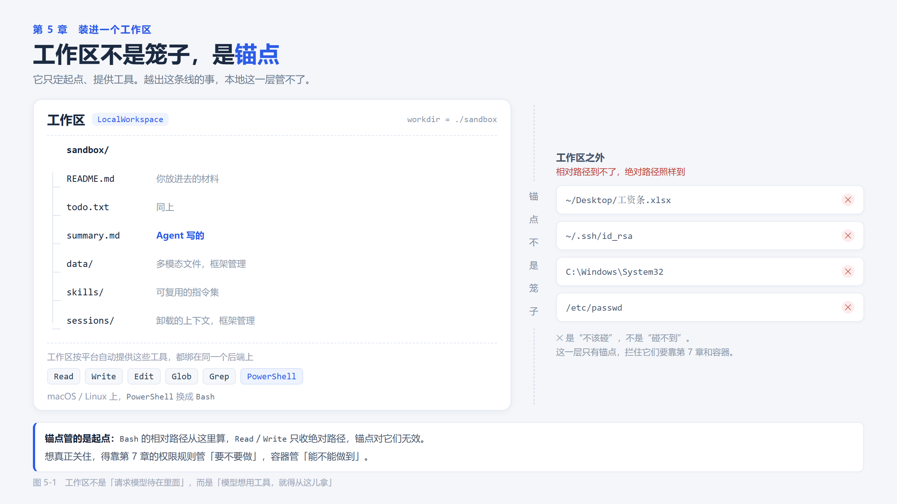

# 第 5 章　装进一个工作区：LocalWorkspace

> 本章代码 `code/ch05/main.py`　·　读完约 15 分钟

## 5.0 上一章留下的两个 bug

4.2 节讲权限时写过十来行的 `safe_path`：把模型给的路径拼回根目录，`resolve()` 展开 `..` 和软链接，再校验一次有没有越界。逻辑本身没问题，但留下两个 bug。

**第一个是 `Bash`。** 它收的不是路径，是一整条命令，`cd /` 一句就出去了。按路径校验的办法对它完全无效。

**第二个是每个工具都得自己拦一遍。** `Read`、`Write`、`Edit`、`Glob`、`Grep`，漏掉哪个，bug 就出在哪个身上。

这一章换个思路：不再让每个工具各校验一次，而是先划一块地，再让工具都在这块地里跑。

上一章那套是代码级的，工具不动，外面裹一层校验，路径进来时看一眼，越界就拒。环境级的做法，边界不写在每个工具里，而写在工具运行的那个文件系统上：`Bash` 里 `cd /` 之后看见什么，由执行环境决定，不由提示词决定。

但"环境级"只是这个概念的说法，落到具体实现上，强弱差得远。

> 企业里常把 agent 放进沙箱执行，那是同一件事的硬版本。这一章用的是轻量版。
>
> 但为了让更多人先摸清"工作区"这个概念，我们选了隔离较弱的 `LocalWorkspace`：本机开发最省事，工具成套，还带一段现成的提示词。真要隔离，换成沙箱工作区即可，API 基本一样。
>
> 如果你常用 WorkBuddy，会看到它让你选一个文件夹当"工作空间"，和这一章的工作区是同一个东西。

先看最常用的 `LocalWorkspace`，它并不能把模型关起来。

它对边界只做一件事：给工具一个锚点。`Bash` 在这个目录里启动，相对路径从这里算。所以模型敲 `ls`、敲 `python fizz.py`，看见的确实是工作区里的东西，看着挺像个笼子。

但这个笼子不结实，改一下路径就能绕过去。它管得住什么、管不住什么，5.3 会讲清楚；真要把它看住，得等第 7 章的审批；真要关严，只能换容器。

## 5.1 工作区是什么

`Workspace` 在 AgentScope 里不是"一个文件夹"，而是 Agent 的运行环境。它提供四样东西：

| 提供什么 | 落点 | 作用 |
|---|---|---|
| 工具 | `Toolkit` | 按平台给一套读写搜跑的工具，都绑在同一个后端上 |
| 技能 | `skills/` | 放 Markdown 指令集，按需查阅（第 14 章） |
| 卸载 | `sessions/` | 上下文装不下的原文落到这里，需要时再翻 |
| 提示 | `get_instructions()` | 自动生成的环境说明，要你手动拼进 `system_prompt` |

工具这条多说一句。你不再手写 `Read()`、`Write()`、`Bash()`，工作区按当前平台自动给一套，`Bash` 的 `cwd` 锚在 `workdir`，读写走工作区的后端。至于这个后端是"你家那块盘"还是"容器里的盘"，取决于你选哪种工作区。



图里画的是工作区的两侧：左边是 `workdir` 里有什么、工具有哪些，右边是它不该碰的东西。注意右边那些叉，意思是"不该碰"，不是"碰不到"，5.3 会讲清楚。

## 5.2 用起来

```python
async with LocalWorkspace(workdir="./sandbox") as workspace:
    tools = await workspace.list_tools()
    instructions = await workspace.get_instructions()

    agent = Agent(
        name="Buddy",
        system_prompt=("你叫 Buddy，是一个文件管理助手。"
                       "所有文件操作都必须在当前工作区内完成，不要访问工作区以外的路径。"
                       "\n\n" + instructions),
        model=build_model(),
        toolkit=Toolkit(tools=tools),
        offloader=workspace,
    )
```

为看清主干，这段做了压缩，完整写法见 5.5。四处关键代码逐条说：

**`async with LocalWorkspace(...)`**：工作区是异步上下文管理器。进入时只把 `skills/` 建出来，`data/` 和 `sessions/` 这时还没有；退出时只关连接，`workdir` 里的文件留在原地（5.5 会验证）。`workdir` 写相对路径时，以当前进程的工作目录为基准。

**`await workspace.list_tools()`**：异步方法，`await` 之后才拿到列表。在 Windows 上是：

```
['PowerShell', 'Edit', 'Glob', 'Grep', 'Read', 'Write']
```

macOS 和 Linux 上，`PowerShell` 换成 `Bash`。同一份代码跨平台可用，这是工作区抽象带来的好处之一。

**`await workspace.get_instructions()`**：返回自动生成的环境说明，约 3000 字符，开头是这样：

```
<workspace>You have access to a local workspace at
C:\Users\xxxx\Desktop\mini-workbuddy\code\ch05\sandbox with the following structure:
```

它把绝对路径写了进去，为的是让模型知道自己站在哪。

**`offloader=workspace`**：上下文装不下时，被挤出去的原文卸载到工作区。这一行现在看不出效果，等对话长到要卸载时才显出来。

> **为什么 instructions 要手动拼进 `system_prompt`**
>
> `Agent` 不会自己去读工作区的说明，漏了这一步，模型不知道有 `data/`、`skills/`、`sessions/` 三个目录，会在根目录下乱建文件。
>
> 提示词不是越长越好，但环境说明不能少：模型看不见你的文件系统，你告诉它什么，它的世界就有多大。

## 5.3 它能管住什么，管不住什么

`LocalWorkspace` 不在系统层面做隔离，它没有这个能力。锚点这一条也简单：`Bash` 在这个目录里启动，相对路径从这里算；对 `Read`/`Write` 无效，那两个工具只收绝对路径，传个 `README.md` 过去，它回你一句 `file_path must be an absolute path`。

另外一层是权限系统，它确实认"工作目录"，但那和 `workdir` 不是一回事：它取的是进程当前目录，加上 `working_directories` 里登记过的路径，`LocalWorkspace` 的 `workdir` 不在其中，除非你自己加。`DEFAULT` 模式下这一层也不看边界，写操作不分内外，都要问你；只有 `ACCEPT_EDITS` 会区别对待，目录内的写直接放行，目录外的照问。

一层定起点，一层定要不要问你一声。两件都拦不住硬闯的路径，笼子不在这儿。

| 想拦的 | 本地这层 | 真正靠什么 |
|---|---|---|
| 相对路径（`ls`、`python fizz.py`） | 天然落在工作区，不用拦 | 锚点 |
| `Bash` 里的 `cd /`、`cat /etc/passwd` | 拦不住 | 容器 |
| `Read` 传绝对路径 | 拦不住，工具照开 | deny 规则（第 7 章） |

回到 5.0 那两个 bug：第二个的根被拔掉了，工具不再由你手写，将来加约束只加在一处；第一个没解决，`LocalWorkspace` 这一层做不到。

5.5 的代码还顺手把模式设成了 `BYPASS`，连"问一声"也省了。命令行脚本没有确认界面，不设这一句，第一次写文件就会停在"等人点头"上。先让它跑通，这件事第 7 章再收回来。


七种后端，一套接口。换后端不必改 Agent 代码，这是抽象的好处；选哪个，取决于你多大程度不信任模型。包里还有一种是 macOS 专用的 `AppleContainerWorkspace`，没画进来。

`LocalWorkspace` 适合本地开发和教学：快、直观、生成的文件能直接用编辑器打开看。

但只要这个 Agent 会接收来自他人的输入，就该换成管控更强的隔离环境。原因很简单：容器里 `rm -rf /` 只是删掉一个容器，本机上 `rm -rf /` 是另一回事。

## 5.4 先读后写

第 3 章提过 `Write` 的"先读后写"规则，到这儿能说清它的价值了。

设想这个场景：工作区里有一份 `config.yaml`，模型要"把数据库地址改成新地址"。没有这条规则，它可能直接 `Write` 一份全新的 `config.yaml`，里面只有数据库地址，其余配置全没了。它不是故意搞破坏，只是没看过原文，以为那文件里只有地址。

有了这条规则，`Write` 会失败，模型收到"文件已存在但未读取"，于是先 `Read`，看到全部配置，再用 `Edit` 做精确替换。

这条规则把"模型必须有完整信息才能改动"写进了工具的行为里。它和 4.6 那条"能用配置解决的，不要用提示词解决"是同一件事：约束落在机制上，比落在提示词里可靠。

## 5.5 完整代码

```python
"""第 5 章：给 Agent 一个工作区。

比上一章多了什么：
  1. LocalWorkspace：给工具一个起点，并统一提供它们
  2. 工具不再是手写的，而是工作区根据平台自动提供
  3. offloader：把上下文卸载到工作区
"""

import asyncio
import os

from dotenv import load_dotenv

from agentscope.agent import Agent
from agentscope.credential import OpenAICredential
from agentscope.message import UserMsg
from agentscope.model import OpenAIChatModel
from agentscope.permission import PermissionMode
from agentscope.tool import Toolkit
from agentscope.workspace import LocalWorkspace

load_dotenv(override=True)

API_KEY = os.getenv("OPENAI_API_KEY", "")
BASE_URL = os.getenv("OPENAI_BASE_URL", "")
MODEL_NAME = os.getenv("OPENAI_MODEL", "gpt-4o-mini")

WORKDIR = "./sandbox"


def build_model() -> OpenAIChatModel:
    return OpenAIChatModel(
        credential=OpenAICredential(api_key=API_KEY, base_url=BASE_URL or None),
        model=MODEL_NAME,
    )


def prepare_files() -> None:
    """在工作区里放两份材料，供 Agent 阅读。"""
    os.makedirs(WORKDIR, exist_ok=True)
    with open(os.path.join(WORKDIR, "README.md"), "w", encoding="utf-8") as f:
        f.write(
            "# 项目说明\n\n"
            "这是一个用于演示工作区的示例项目。\n"
            "它包含三个模块：采集、清洗、导出。\n"
            "目前采集模块已完成，清洗模块在开发中。\n",
        )
    with open(os.path.join(WORKDIR, "todo.txt"), "w", encoding="utf-8") as f:
        f.write("1. 完成清洗模块\n2. 补充单元测试\n3. 写导出文档\n")


def tree(path: str) -> str:
    """打印目录树，用来确认 Agent 真的写了文件。"""
    lines = []
    for root, dirs, files in os.walk(path):
        dirs[:] = [d for d in dirs if d not in {"__pycache__"}]
        level = root.replace(path, "").count(os.sep)
        lines.append("  " * level + os.path.basename(root) + "/")
        for name in sorted(files):
            lines.append("  " * (level + 1) + name)
    return "\n".join(lines)


async def main() -> None:
    prepare_files()

    # workspace 是异步上下文管理器：进入时初始化目录，退出时只关连接
    async with LocalWorkspace(workdir=WORKDIR) as workspace:
        tools = await workspace.list_tools()
        print("=" * 70)
        print("工作区提供了这些工具：", [t.name for t in tools])
        print("=" * 70)

        instructions = await workspace.get_instructions()
        print(f"工作区还会自动写一段系统提示（共 {len(instructions)} 字符），开头是这样：")
        print("-" * 70)
        print(instructions[:260].strip() + " ……")
        print("-" * 70)
        print()

        agent = Agent(
            name="Buddy",
            system_prompt=(
                "你叫 Buddy，是一个文件管理助手。"
                "所有文件操作都必须在当前工作区内完成，不要访问工作区以外的路径。"
                "\n\n" + instructions
            ),
            model=build_model(),
            toolkit=Toolkit(tools=tools),
            offloader=workspace,  # 上下文装不下时，原文卸载到这里
        )

        # 命令行脚本没有确认界面，工作区的写操作默认会停下来等人点头。
        # 先整体放行；第 7 章会把这件事重新管起来。
        agent.state.permission_context.mode = PermissionMode.BYPASS

        question = (
            "看一下工作区里有哪些文件，把 README 的内容总结成三行，"
            "然后写入 summary.md。"
        )
        print(f">>> 你：{question}\n")
        reply = await agent.reply(UserMsg(name="user", content=question))
        print(f"<<< Buddy：{reply.get_text_content()}\n")

    # 退出 async with 会调用框架的 LocalWorkspace.close()：只关闭 MCP 连接，不删除工作区文件
    print("=" * 70)
    print(f"工作区当前结构（{WORKDIR}）：")
    print(tree(WORKDIR))


if __name__ == "__main__":
    asyncio.run(main())
```

运行结果（工具列表和目录树来自实跑，模型那句话每次都不一样）：

```
工作区提供了这些工具： ['PowerShell', 'Edit', 'Glob', 'Grep', 'Read', 'Write']
工作区还会自动写一段系统提示（共 2955 字符），开头是这样：
----------------------------------------------------------------------
<workspace>You have access to a local workspace at
C:\Users\xxxx\Desktop\mini-workbuddy\code\ch05\sandbox with the following structure:
----------------------------------------------------------------------

>>> 你：看一下工作区里有哪些文件，把 README 的内容总结成三行，然后写入 summary.md。

<<< Buddy：读过 README.md 了，三行总结已写进 summary.md。

======================================================================
工作区当前结构（./sandbox）：
sandbox/
  README.md
  summary.md
  todo.txt
  skills/
    .seed/
```

`summary.md` 是模型自己创建的，`skills/` 是进入工作区时建的。退出 `async with` 之后它们都还在，因为工作区是持久化的。

> 这里的 `__aexit__` 不在本章代码里，是 `LocalWorkspace` 从框架基类继承的：它只调 `close()`，把有状态的 MCP 连接关掉，把 `is_alive` 置成 `False`。真正会删文件的是另一个方法 `reset()`，它清掉 `skills/`、`sessions/`、`data/` 和 `.mcp`。
>
> 换成 `DockerWorkspace` 这类沙箱后端，`close()` 要做的就多了：断开网关、停掉并移除容器。本地工作区这么轻，是因为它根本没有容器可收。
>
> 到这一步，模型已经能在你指定的目录里读文件、写文件、跑命令了。

## 5.6 三个常见错误

**错误 1：忘了 `await`**

```python
tools = workspace.list_tools()      # 拿到一个协程对象
agent = Agent(..., toolkit=Toolkit(tools=tools), ...)
```

报错信息通常是 `'coroutine' object is not iterable`。`list_tools()`、`get_instructions()` 都是工作区上的异步方法，`Toolkit` 的 `get_tool_schemas()` 也一样。

**错误 2：把工作区当成安全边界**

`LocalWorkspace` 只给工具一个锚点，既不校验路径，也不隔离进程。模型通过 `PowerShell` 执行 `Get-Content C:\Users\你\Desktop\a.txt` 依然可能成功，因为那是命令，不是路径参数；就算走 `Read`，参数里填一个绝对路径也照开。

真正的隔离需要容器（`DockerWorkspace` 那类）。第 7 章的权限规则能在执行前拦住它，但那拦的是"要不要做"，不是"能不能做到"。

**错误 3：`workdir` 用了绝对路径，然后在别的机器上跑**

```python
LocalWorkspace(workdir="C:/Users/你/Desktop/sandbox")   # 换台机器就废了
```

除非你确定部署环境固定，否则用相对路径，或者从环境变量读。

## 5.7 小结

- 工作区是运行环境：提供工具和技能位，接住装不下的上下文，再生成一段环境说明
- `list_tools()` 按平台给工具：Windows 上是 `PowerShell`，macOS 和 Linux 上是 `Bash`
- 环境说明约 3000 字符，必须手动拼进 `system_prompt`，`Agent` 不会自己读
- `LocalWorkspace` 是锚点不是笼子：只定起点，不校验路径、不隔离进程；要隔离就换 Docker
- 权限系统认的"工作目录"是进程当前目录加 `working_directories`，不等于 `workdir`
- "先读后写"把约束写进了工具行为，比写在提示词里可靠

**下一章要解决的问题**：工作区给的工具是通用的，读、写、搜、跑命令。但你的业务是具体的，查内部数据库、调某个接口、按公司规则算报价。这些工具，框架没有，得你自己写。
