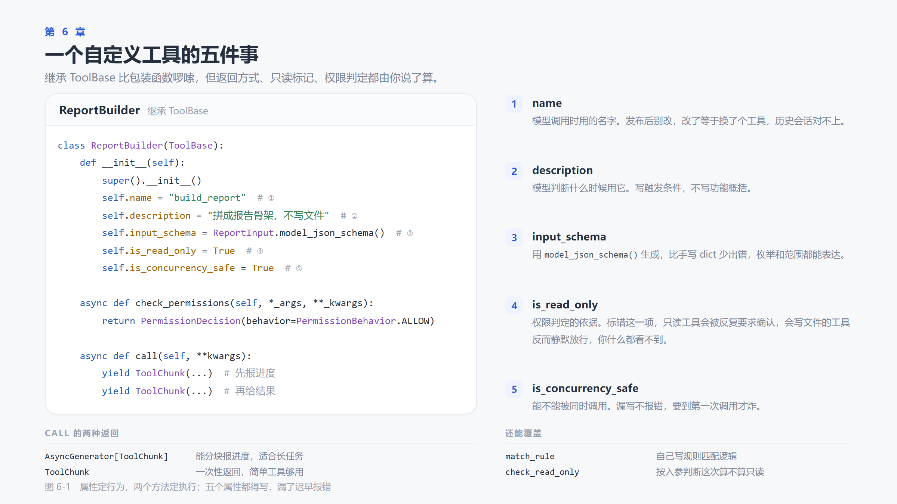

# 第 6 章　工具不够用就自己造

> 本章代码 `code/ch06/main.py`、`code/ch06/schema_demo.py`、`code/ch06/tool_demo.py`　·　读完约 14 分钟

## 6.0 什么时候需要自己造

前几章用的都是内置工具，读文件、写文件、改文件、搜索、跑命令。它们只做通用操作，不懂你的业务。

真实需求往往长这样，查内部订单、按公司规则算报价、调内部 HTTP 接口。内置工具里没有，框架也不会给，因为它不知道你的业务长什么样。

那让模型自己写脚本行不行？行，但只管一种情况，这个动作只做一次。跑完就扔，没人复用，也没人回头看它当时怎么写的。

要重复用就不一样了。同一个查订单的动作，今天 `requests`，明天 `httpx`，后天 `curl` 加管道，十次调用十份实现，字段名、超时、错误处理各不相同。出错的时候，你手上没有一份标准实现可以对照。

做成工具，换来两件东西。

**一份标准实现。** 参数定义在 schema 里，模型填错类型、漏传必填项，框架在它执行之前就拦下来，并说清错在哪。换成脚本，这层校验得你自己写，十份实现写十遍。

**一套配套能力。** 进度流、结果截断、并发标记、调用日志、权限判定，这些都是框架围着"工具"这个抽象做的。写脚本等于每次重做一遍。

所以判断标准不是"能不能做到"，而是"要不要重复做"。一次性、只读、几分钟跑完的，让模型现写脚本；要反复用、要给别人用、要审计的，才值得做成工具。

这一章讲怎么在 agent 上定义自己的工具，并让模型真的用起来。

## 6.1 两种写法

AgentScope 给了两条路。

| | `FunctionTool` | 继承 `ToolBase` |
|---|---|---|
| 代码量 | 一个函数 | 一个类，实现 `check_permissions` 和 `call` |
| 参数定义 | 从类型注解和 docstring 自动推导 | 自己写，通常由 Pydantic 生成 |
| 返回值 | 字符串 | `ToolChunk`，可以分多块返回 |
| 只读标记 | 构造时传 `is_read_only` | 在 `__init__` 里赋值 |
| 权限逻辑 | 默认要用户确认，可传 `permission` 覆盖 | 自己实现 `check_permissions` |
| 适合 | 纯计算、查表、调接口 | 耗时长、要报进度、要精细控制权限 |

怎么选，问三个问题。会不会跑超过两秒？会不会产生副作用？要不要向用户报进度？有一个"是"就用 `ToolBase`，三个都是"否"用 `FunctionTool`。

`FunctionTool` 第 3 章用过（3.2），这一章两种都写，重点在第二种。

## 6.2 写法一：一个函数就是一个工具

最省事的一种。写个普通函数，配上类型注解和 docstring，包一层 `FunctionTool` 就是工具。

```python
def word_frequency(text: str, top_n: int = 5) -> str:
    """统计一段文本里出现频率最高的词。

    Args:
        text: 待统计的文本。
        top_n: 返回前几名，默认 5。
    """
    import re
    from collections import Counter

    words = re.findall(r"[\u4e00-\u9fff]{2,}|[a-zA-Z]{3,}", text.lower())
    if not words:
        return "没有统计到有效的词。"
    counter = Counter(words).most_common(max(1, min(top_n, 20)))
    return "、".join(f"{w}×{c}" for w, c in counter)
```

第 3 章那张对照表在这儿照样成立，函数名变 `name`，docstring 摘要变 `description`，`Args:` 下的说明变参数描述，JSON 一个字都不用写。这段代码实际生成的 schema 里，`required` 只有 `text`，`top_n` 带着默认值 `5`，模型不填就由 Python 的默认值接住。

挂上去只要一行：

```python
toolkit = Toolkit(tools=[FunctionTool(word_frequency, is_read_only=True)])
```

`is_read_only=True` 得写。函数工具的权限默认是要用户确认，一个纯统计的函数每调一次弹一次确认框，没人受得了。

> 注意这个参数的性质。它是在告诉框架"这次调用不改任何东西"，框架不校验，只是相信你。所以标错了不会报错，只会静默放行，6.6 会讲后果。

## 6.3 写法二：继承 `ToolBase`

要校验参数、要报进度、要自己决定这次该不该问用户，就用类。



### 6.3.1 先用 Pydantic 定义参数

工具的参数最终就是一份 JSON Schema。手写也行，从 Pydantic 模型生成更省事，也不容易漏。`code/ch06/schema_demo.py` 不联网、不要 API key：

```python
class ReportInput(BaseModel):
    """生成报告的参数。"""

    topic: str = Field(description="报告主题，例如「本周工作」")
    sections: list[str] = Field(
        default_factory=list,
        description="报告的章节名列表，按顺序输出",
    )
    style: str = Field(
        default="markdown",
        description="输出格式，可选 markdown 或 plain",
    )
```

```bash
cd code/ch06 && python schema_demo.py
```

```text
--- 1. 生成 JSON Schema
{
  "description": "生成报告的参数。",
  "properties": {
    "topic": {
      "description": "报告主题，例如「本周工作」",
      "title": "Topic",
      "type": "string"
    },
    "sections": {
      "description": "报告的章节名列表，按顺序输出",
      "items": {
        "type": "string"
      },
      "title": "Sections",
      "type": "array"
    },
    "style": {
      "default": "markdown",
      "description": "输出格式，可选 markdown 或 plain",
      "title": "Style",
      "type": "string"
    }
  },
  "required": ["topic"],
  "title": "ReportInput",
  "type": "object"
}

--- 2. 只传必填项，其余走默认值
topic='本周工作' sections=[] style='markdown'

--- 3. 漏传必填项，校验在干活之前拦下来
1 validation error for ReportInput
topic
  Field required [type=missing, input_value={'sections': ['进展']}, input_type=dict]
```

三处值得停一下。

schema 里没有一行是你手写的。`type` 来自注解，`description` 来自 `Field`，最外层那句"生成报告的参数。"来自类的 docstring，也会一起发出去。

`sections` 的默认值没进 schema。`default_factory` 说的是"每次调用现算一个空列表"，JSON 里表达不了，所以不写；`style` 的 `default="markdown"` 是个固定值，就照原样进了 schema。

第三段输出是重点。参数错了，工具还没跑就被拦住，报错里带着字段名和传进来的值。模型拿到这条错误，能自己改参数重试。这一条是脚本给不了的。

所以参数的描述要写到点上。"报告主题"模型只能猜，"报告主题，例如「本周工作」"它就知道该往哪个方向填。格式和取值范围也写进去，日期写"格式 YYYY-MM-DD"，枚举写"可选 markdown 或 plain"。模型看不到你的 Python 代码，它收到的只有这段 JSON。

### 6.3.2 一个完整的工具类

完整文件在 `code/ch06/tool_demo.py`。为看清骨架，这里省掉 docstring：

```python
class ReportBuilder(ToolBase):
    def __init__(self) -> None:
        super().__init__()
        self.name = "build_report"
        self.description = (
            "把给定的章节名列表拼成一份报告骨架。"
            "当用户要求「生成报告」「搭个提纲」时使用。"
            "注意：本工具只生成骨架，不会写文件。"
        )
        self.input_schema = ReportInput.model_json_schema()
        self.is_read_only = True
        self.is_concurrency_safe = True

    async def check_permissions(self, *_args, **_kwargs) -> PermissionDecision:
        return PermissionDecision(
            behavior=PermissionBehavior.ALLOW,
            message="build_report 是只读工具，自动放行。",
        )

    async def call(self, **kwargs):
        args = ReportInput(**kwargs)
        ...
```

`__init__` 里五行，每行定一件事。

| 属性 | 作用 | 漏了会怎样 |
|---|---|---|
| `name` | 模型调用时用的名字 | 装配时就报错 |
| `description` | 模型判断"什么时候该用它"的全部依据 | 装配时就报错 |
| `input_schema` | 参数定义 | 装配时就报错 |
| `is_read_only` | 决定要不要走权限判定 | 装配得过，权限判定时才报错 |
| `is_concurrency_safe` | 允许被同时调用多次 | 装配得过，第一次调用才报错 |

这五行一行都不能省。`ToolBase` 里它们是类型注解，不是赋值，没有默认值可依赖，漏了都会报错，只是报错的时机不一样。

`description` 那三句是三条不同的信息。做什么，拼成骨架；什么时候用，用户要报告、提纲时；边界，只生成骨架，不写文件。最后一句最容易漏，也最容易出事。模型会以为工具已经把文件写好了，回头跟你说"已保存"。

> 工具内部抛错也一样。`raise ValueError("文件不存在")` 模型无从下手；`raise ValueError("文件不存在：docs/README.md，可用 Glob 查找目录")` 它就知道下一步。错误信息会进上下文，是写给模型看的，不是给日志看的。

`check_permissions` 必须实现，返回三种行为之一。只读返回 `ALLOW`，有副作用返回 `ASK` 等用户点确认，敏感操作返回 `DENY`。`ToolBase` 把它设成了抽象方法，不实现这个类连实例化都过不去。三种选择的后果第 7 章细讲，这里先记住只读工具该返回什么。

### 6.3.3 `call` 可以边跑边报进度

`call` 返回一个 `ToolChunk` 就结束，也可以 `yield` 多个，每块带一次进度。

```python
async def call(self, **kwargs):
    args = ReportInput(**kwargs)
    lines = [f"# {args.topic}", ""]
    for i, section in enumerate(args.sections, 1):
        ...

    # 第一块：告诉界面开始了
    yield ToolChunk(
        content=[TextBlock(text=f"正在生成 {len(args.sections)} 个章节…")],
        state="running",
        is_last=False,
    )

    await asyncio.sleep(0.05)

    # 最后一块：结果
    yield ToolChunk(
        content=[TextBlock(text="\n".join(lines))],
        state="success",
        is_last=True,
    )
```

常用的三个字段。

| 字段 | 作用 |
|---|---|
| `content` | 内容块列表，可以放文本，也可以放图片 |
| `state` | `running` / `success` / `error`，另有 `interrupted` / `denied` |
| `is_last` | 是不是最后一块 |

中间那块 `state` 写 `running`、`is_last` 写 `False`，意思是"活儿已经开始了，结果还没到"。界面见着这两句，就能先把那句话显示出来，而不是干等。

耗时的工具值得拆成两块。用户看到的是"正在生成 2 个章节…"，而不是一个转圈图标空转十秒。

## 6.4 挂到 Agent 上

两个工具写好了，挂上去让模型自己挑。`code/ch06/main.py` 的关键部分：

```python
def build_toolkit() -> Toolkit:
    return Toolkit(
        tools=[
            FunctionTool(word_frequency, is_read_only=True),
            ReportBuilder(),
        ],
    )


toolkit = build_toolkit()
agent = Agent(
    name="Buddy",
    system_prompt=(
        "你叫 Buddy。遇到报告、提纲、周报这类请求时，"
        "用 build_report 生成骨架，不要自己手写提纲。短答即可。"
    ),
    model=build_model(),
    toolkit=toolkit,
)
```

`Toolkit(tools=[...])` 里每一项都会被转成 schema 发给模型，函数和类一样对待。装配就这一步，没有别的注册动作。

`.env` 里那三个变量填好，`OPENAI_API_KEY`、`OPENAI_BASE_URL`、`OPENAI_MODEL`，直接跑：

```bash
cd code/ch06 && python main.py
```

```text
======================================================================
当前挂上的工具
  · word_frequency
  · build_report
======================================================================

>>> 你：帮我搭一份「本周工作」的报告提纲，包含进展、问题、下周计划三部分。

<<< Buddy：# 本周工作

## 1. 进展

## 2. 问题

## 3. 下周计划

骨架已经搭好，内容需要你自行补充。

======================================================================
这一轮模型实际做了什么（按时间顺序）
  -> build_report {"topic": "本周工作", "sections": ["进展", "问题", "下周计划"]}
  <- [success] 正在生成 3 个章节…# 本周工作  ## 1. 进展  ## 2. 问题  ## 3. 下周计划
======================================================================
```

三段各看一处。开头那个框是跑模型之前的自检，两个工具都在，说明装配没出问题。中间 `<<< Buddy` 是模型最后说的话，看得出它就是拿 `build_report` 的输出加了句客套。

最后那块轨迹才是这一章最该看的东西。没有它，你只能看到模型吐出一段提纲，分不清那是它自己编的还是你的代码生成的。有了 `-> build_report` 和后面那串参数，证据就齐了。

`print_trace` 本身很简单，读的是 `agent.state.context`：

```python
def print_trace(state: AgentState) -> None:
    for msg in state.context:
        for block in msg.content:
            if block.type == "tool_call":
                print(f"  -> {block.name} {block.input}")
            elif block.type == "tool_result":
                text = block_text(block.output).replace("\n", " ")
                print(f"  <- [{block.state}] {text[:100]}")
```

一轮跑完，模型发了什么、工具回了什么，全按顺序记在里面。它只读不改。

想验默认值的作用，把 `ReportInput` 里 `style` 的 `default` 改成 `"plain"` 再跑一遍，输出就从 `## 1. 进展` 变成了 `1. 进展`。提示词一个字没改，行为变了，因为参数定义变了。

> 换个模型，或者同一个模型多跑几次，`sections` 的措辞、传不传 `style` 都会有出入。工具描述能提高命中率，但不保证。

## 6.5 先单独跑通，再交给模型

`tool_demo.py` 不经过模型，直接把工具跑一遍：

```bash
cd code/ch06 && python tool_demo.py
```

```text
--- 1. 工具的基本信息
name        = build_report
is_read_only= True
params      = ['topic', 'sections', 'style']

--- 2. 问一句权限
behavior = PermissionBehavior.ALLOW
message  = build_report 是只读工具，自动放行。

--- 3. 真正调用，逐块看返回
[running] is_last=False
正在生成 2 个章节…
[success] is_last=True
# 本周工作

## 1. 进展

## 2. 问题
```

这是写工具该有的顺序。工具自己还有 bug 就去调模型，你会在"模型为什么调不明白"和"工具为什么返回错"之间来回兜圈子，两头看着都像有问题。工具能脱离模型单独跑，是它最大的好处之一，别浪费。

`word_frequency` 也一样，一句 `print(word_frequency("工作 工作 进展 进展 进展 计划"))` 就能验。

## 6.6 四个容易踩的地方

**1. `check_permissions` 的参数不能写 `**kwargs`**

框架调它的时候按位置传两个参数，源码里就是 `tool.check_permissions(tool_input, self.context)`。只写 `**_kwargs`，一个位置参数都接不住，一被问权限就报：

```text
TypeError: ReportBuilder.check_permissions() takes 1 positional argument but 3 were given
```

`*_args, **_kwargs` 是能跑通的最省事写法。哪天要按参数做判断，换成 `tool_input, context` 就行，`tool_input` 是这次调用的入参，`context` 是权限上下文。

**2. `is_read_only` 是运行时行为，不是注释**

标 `True` 但实际会写文件，用户不会收到任何提示。原因在权限引擎的执行顺序上。只读调用有一条快速通道，`is_read_only` 为 `True` 时直接返回 `ALLOW`，你写的 `check_permissions` 根本不会被调用。

所以这个字段决定的不是"判定结果"，是"要不要判定"。上面 `build_report` 那个 `*_args` 写法之所以没当场炸，就是因为它压根没走到那一步。

反过来说，一个工具需要停下来问用户，`is_read_only` 就必须是 `False`，否则那个 `ASK` 永远发不出去。

顺序上还有一层，deny 规则排在快速通道前面。所以你自己写死的 deny 仍然拦得住只读工具，快速通道不吞黑名单。

**3. `call` 必须写 `async`**

```python
def call(self, **kwargs):     # 少写了 async
    yield ToolChunk(...)
```

`ToolBase.__call__` 会先判断 `inspect.isasyncgenfunction(self.call)`，认不出来就把返回值 `await` 一下。普通函数返回的是生成器，`await` 一个生成器报：

```text
TypeError: object generator can't be used in 'await' expression
```

**4. 忘记 `super().__init__()`**

```python
def __init__(self):
    self.name = "xxx"    # 没有 super().__init__()
```

这个不会当场报错。框架在 `__call__` 里用 `getattr(self, "_middlewares", [])` 兜了底，工具照样跑。代价在以后，`ToolBase.__init__` 唯一的职责就是初始化中间件链，跳过它，以后给这个工具挂日志、挂超时、挂审计，全都会静默失效，而且不报错。查起来比报错难十倍。

## 6.7 小结

- 只做一次的活让模型现写脚本，要重复用的才做成工具
- 两秒以内、无副作用、不用报进度，用 `FunctionTool`；否则继承 `ToolBase`
- `ToolBase` 子类里，`__init__` 那几行定行为，`check_permissions` 和 `call` 定执行
- `check_permissions` 的参数按位置传入，用 `*_args` 接
- `call` 写成 `async` 生成器，可以分块报进度
- `is_read_only` 为 `True` 时权限引擎直接放行，`check_permissions` 不会被调用
- 工具能脱离模型单独跑，先测工具，再交给模型
- 模型到底调没调你的函数，回放 `agent.state.context` 就能看见

**下一章要解决的问题**：这一章我们给工具写了 `check_permissions`，但只是简单返回了 `ALLOW`。如果一个工具真的会删文件，谁来拦？拦下来之后，对话还怎么继续？
