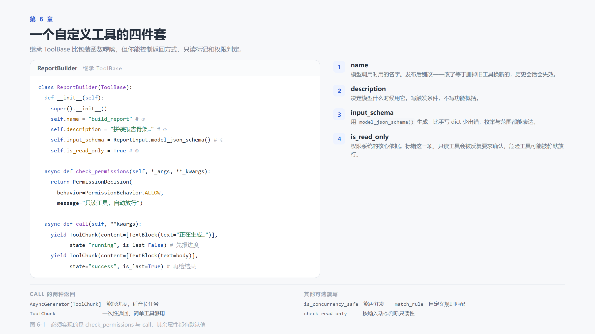

# 第 6 章　工具不够用：自己造

> 本章代码 `code/ch06/main.py`、`schema_demo.py`、`tool_demo.py`、`toolkit_demo.py`　·　读完约 24 分钟

## 6.0 上一章留下的问题

工作区给了一套通用工具：读、写、编辑、搜索、跑命令。靠这几把刀，普通任务基本能对付，可一旦碰上你的业务，就不一定保证搞定了。

我们可能遇到的真实的场景是这样的：

- 要查内部订单系统，得有 `query_order`
- 要按公司规则算报价，得有 `calc_quote`
- 要把周报按模板排版，得有 `render_weekly`
- 要调用某个内部 HTTP 接口，得有 `call_internal_api`

这些工具框架不会给你，因为它不知道你的业务长什么样。

读到这儿该有人反驳了。agent 本来就有 bash，查订单写几行 `requests`，算报价写几个 `if`，排版用字符串拼接，它自己就能干，还快。要工具的目的是什么？

> 能问出这个问题的读者，说明是真跟着做过来的哟~~

这话对，但只在很窄的范围里对。

一次性的活，写脚本就是最优解。跑完就扔，没人再用，也没人需要回头查它当时怎么写的。这本书里很多临时看一眼数据的活，我就是让模型现写一段。

一旦这个动作要用第二次，账就不一样了。

同一个查订单的动作，今天写成 `requests.get`，明天换成 `httpx`，后天顺手 `curl` 加管道。十次调用十份实现，字段名、超时、错误处理各不相同。真出了错，你手上没有一份标准实现可以对照。

其次是参数没有契约。工具的参数写死在 schema 里，模型填错类型、漏传必填项，框架在真正执行之前就会拦下来，并告诉它错在哪。脚本没有这一层，模型只能靠上下文记着这个接口要 `order_id` 还是 `orderId`，聊得久了就开始漂。

还有一层配套它也拿不到。进度流、结果截断、并发安全标记、调用日志、失败重试，这些都是框架围着"工具"这个概念做的。

写脚本等于把这些重新实现一遍，而且每次实现得都不一样。

所以判断标准不是能不能做到，而是要不要重复做。

一次性、只读、几分钟跑完的活，让智能体现写脚本，别费劲封装。要反复用、要给别人用、要审计、要控权限，才值得固化成工具。

这一章解决两件事，怎么写工具，以及工具多了之后怎么组织。

## 6.1 两种写法，先选对

AgentScope 给了两条路，适用场景完全不同：

| | `FunctionTool` | 继承 `ToolBase` |
|---|---|---|
| 代码量 | 一个函数 + docstring | 一个类，两个必实现方法 |
| 参数定义 | 默认从类型注解和 docstring 推导 | 自己写，通常接 Pydantic 模型 |
| 返回值 | 字符串（或 `ToolChunk`） | 任意 `ToolChunk`，可流式 |
| 只读标记 | 构造时传 `is_read_only` | 作为属性声明 |
| 权限逻辑 | 默认要用户确认，可在构造时传 `permission` 覆盖 | 自己实现 `check_permissions` |
| 适合 | 纯计算、查表、调接口 | 长任务、有进度、需要精细权限控制 |

判断标准很简单：

> 工具会不会执行超过两秒？会不会产生副作用？会不会需要向用户报进度？
> 三个里有一个"是"，就用 `ToolBase`。全是"否"，用 `FunctionTool`。

`FunctionTool` 第 3 章已经用过，这一章重点讲第二种。

## 6.2 用 Pydantic 定义参数

先解决参数定义。工具的参数最终就是一份 JSON Schema，可以手写，也可以从 Pydantic 模型生成，后者省事得多。

完整代码在 `code/ch06/schema_demo.py`，不依赖 API key，也不用联网，直接跑就行。

```python
import json

from pydantic import BaseModel, Field, ValidationError


class ReportInput(BaseModel):
    """生成报告的参数。"""

    topic: str = Field(description="报告主题，例如「本周工作」")
    sections: list[str] = Field(
        default_factory=list,
        description="报告的章节名列表，按顺序输出",
    )
    style: str = Field(
        default="markdown",
        description="输出格式，可选 markdown 或 plain",
    )


def main() -> None:
    print("--- 1. 生成 JSON Schema")
    print(json.dumps(ReportInput.model_json_schema(), ensure_ascii=False, indent=2))

    print("\n--- 2. 只传必填项，其余走默认值")
    print(ReportInput(topic="本周工作"))

    print("\n--- 3. 漏传必填项，校验在干活之前拦下来")
    try:
        ReportInput(sections=["进展"])
    except ValidationError as exc:
        print(exc)


if __name__ == "__main__":
    main()
```

跑 `python code/ch06/schema_demo.py`，输出是这样（Pydantic 2.13 实测）。

```text
--- 1. 生成 JSON Schema
{
  "description": "生成报告的参数。",
  "properties": {
    "topic": {
      "description": "报告主题，例如「本周工作」",
      "title": "Topic",
      "type": "string"
    },
    "sections": {
      "description": "报告的章节名列表，按顺序输出",
      "items": {
        "type": "string"
      },
      "title": "Sections",
      "type": "array"
    },
    "style": {
      "default": "markdown",
      "description": "输出格式，可选 markdown 或 plain",
      "title": "Style",
      "type": "string"
    }
  },
  "required": [
    "topic"
  ],
  "title": "ReportInput",
  "type": "object"
}

--- 2. 只传必填项，其余走默认值
topic='本周工作' sections=[] style='markdown'

--- 3. 漏传必填项，校验在干活之前拦下来
1 validation error for ReportInput
topic
  Field required [type=missing, input_value={'sections': ['进展']}, input_type=dict]
```

你看，schema 里没有一个字是手写的。`type` 来自类型注解，`description` 来自 `Field`，都是代码推出来的。最外层那句 `"description": "生成报告的参数。"` 是类的 docstring，也会一起发出去。

顺带一提，`sections` 的默认值没出现在里面。`default_factory` 不写进 schema，只有 `default=` 才写。

模型看不到你的 Python 代码，它收到的只有这段 JSON。所以 `description` 写成什么，它就理解成什么。

```text
description="主题"                       # 模型只知道这儿要填个主题，填"天气"它也照填
description="报告主题，例如「本周工作」"   # 模型知道该往"这周干了什么"那个方向填
```

格式和取值范围也该写进去，日期写 `"格式 YYYY-MM-DD"`，枚举写 `"可选 markdown 或 plain"`。这些不是给人看的注释，是模型做判断的依据。

第三段输出说明另一件事，参数错了不用等工具跑起来才发现。`ReportInput(**kwargs)` 在真正干活之前就拦下来，报错里连字段名和传进来的值都带着。模型拿到这个错误，能自己改参数重试。

## 6.3 继承 `ToolBase`



一个完整的工具类长这样（`ReportInput` 就用上节那份，完整文件在 `code/ch06/tool_demo.py`，为看清骨架省掉了 docstring 和类型注解）：

```python
class ReportBuilder(ToolBase):
    """把几段材料拼成一份报告草稿。"""

    def __init__(self) -> None:
        super().__init__()
        self.name = "build_report"
        self.description = (
            "把给定的章节名列表拼成一份报告骨架。"
            "当用户要求「生成报告」「搭个提纲」时使用。"
            "注意：本工具只生成骨架，不会写文件。"
        )
        self.input_schema = ReportInput.model_json_schema()
        self.is_read_only = True
        self.is_concurrency_safe = True

    async def check_permissions(self, *_args, **_kwargs) -> PermissionDecision:
        return PermissionDecision(
            behavior=PermissionBehavior.ALLOW,
            message="build_report 是只读工具，自动放行。",
        )

    async def call(self, **kwargs):
        args = ReportInput(**kwargs)

        lines = [f"# {args.topic}", ""]
        for i, section in enumerate(args.sections, 1):
            if args.style == "markdown":
                lines.append(f"## {i}. {section}")
            else:
                lines.append(f"{i}. {section}")
            lines.append("")

        yield ToolChunk(
            content=[TextBlock(text=f"正在生成 {len(args.sections)} 个章节…")],
            state="running",
            is_last=False,
        )

        await asyncio.sleep(0.05)

        yield ToolChunk(
            content=[TextBlock(text="\n".join(lines))],
            state="success",
            is_last=True,
        )
```

这个文件不需要模型，也不需要 API key，跑一下就全明白了。

```bash
python code/ch06/tool_demo.py
```

```text
--- 1. 工具的基本信息
name        = build_report
is_read_only= True
params      = ['topic', 'sections', 'style']

--- 2. 问一句权限
behavior = PermissionBehavior.ALLOW
message  = build_report 是只读工具，自动放行。

--- 3. 真正调用，逐块看返回
[running] is_last=False
正在生成 2 个章节…
[success] is_last=True
# 本周工作

## 1. 进展

## 2. 问题
```

输出正好分成三块，对应下面三个要单独说的点。

### 6.3.1 `check_permissions` 是必须实现的

第一次写自定义工具的人几乎都会撞上这个报错：

```
TypeError: Can't instantiate abstract class ReportBuilder
without an implementation for abstract method 'check_permissions'
```

`ToolBase` 把 `check_permissions` 设成抽象方法，不实现这个类就实例化不了。设计意图很直白，每个工具都得自己回答一次"它能不能被随便调用"。

只读工具返回 `ALLOW`，有副作用的返回 `ASK`，等用户点一下确认，敏感工具返回 `DENY`。第 7 章讲这三个选项的后果。

签名这里有个坑，值得提前讲。框架调它的时候是按位置传两个参数，`tool_input` 和 `context`，源码里就是 `tool.check_permissions(tool_input, self.context)`。所以不能只写 `**_kwargs`，那样一个位置参数都接不住，一被问权限就 `TypeError: ReportBuilder.check_permissions() takes 1 positional argument but 3 were given`。

上面那行 `*_args, **_kwargs` 是能跑通的最省事写法。等哪天要按参数做判断，把 `*_args` 换成 `tool_input, context` 就行，前者是这次调用的入参，后者是权限上下文。只读工具之所以没当场暴露这个坑，是因为它压根走不到这一步，6.3.3 会讲。

### 6.3.2 `call` 可以是异步生成器

返回 `ToolChunk` 就结束，或者 `yield` 多个 `ToolChunk` 报告进度。后者的价值在界面上，用户能看到"正在生成 2 个章节…"，而不是一个转圈图标转十秒。

`ToolChunk` 有三个关键字段：

| 字段 | 作用 |
|---|---|
| `content` | 内容块列表，可以含文本，也可以含图片 |
| `state` | `"running"` / `"success"` / `"error"`，另有 `"interrupted"` 和 `"denied"` |
| `is_last` | 是不是最后一块 |

### 6.3.3 `is_read_only` 标错会有实际后果

标成 `True` 但实际会写文件，权限系统会放行它，用户不会收到任何提示。
标成 `False` 但其实是纯计算，用户会被反复打扰。

实际后果比"放行"更彻底。权限引擎对只读调用有一条快速通道，`is_read_only` 为 `True` 时直接返回 `ALLOW`，这时候你写的 `check_permissions` 根本没有被调用过。6.3.1 那个签名坑之所以没在 `build_report` 上炸，原因就在这里。

所以这个字段的作用不是"给权限判定提供参考"，是"决定要不要走权限判定"。它也不是文档注释，是运行时行为。

## 6.4 工具组：别把所有工具摊在桌上

上一章说过一个观察，五个工具时模型选得准，三十个工具时它会挑错。

原因不神秘。工具列表每一轮都要随请求发给模型，模型挑工具的唯一依据，就是这份列表里的名字和描述。五个工具时，名字彼此分得开。三十个工具时，`word_frequency`、`count_words`、`text_stats` 三份描述讲的几乎是同一件事，选哪个都说得通，选错了就白跑一轮。加上上下文里还压着前几轮的调用结果，越往后越容易糊。

工具组的思路是按需开抽屉，桌上只摆当前这层要用的东西。


装配上只多一个参数，`tools` 里的进 `basic` 组，`tool_groups` 里的进各自的组。

```python
def build_toolkit() -> Toolkit:
    return Toolkit(
        tools=[
            FunctionTool(word_frequency),        # 进入 basic 组，常驻
        ],
        tool_groups=[
            ToolGroup(
                name="reporting",
                description="报告生成相关工具。用户提到报告、提纲、周报时启用。",
                instructions="生成的报告只是骨架，需要用户补充内容。",
                tools=[ReportBuilder()],
            ),
        ],
    )
```

`basic` 是特殊的组名，进去的工具永远激活，不受开关控制。`reporting` 组里的 `build_report` 默认不可见，模型在最开始那一轮根本不知道世界上有这件工具。

### 6.4.1 抽屉是模型自己开的

这是理解工具组最关键的一点。开抽屉的不是你，也不是框架里某个路由函数，是模型自己。

框架检测到 `tool_groups` 不为空，会往工具列表里多塞一个元工具 `reset_tools`。这个工具唯一的职责是改一个状态位，也就是记着哪些组当前算激活。这个状态位存在 agent 的 state 里，每一轮请求前，框架拿它重新算一遍工具列表。

长什么样，参数定义就能说明一切。`toolkit_demo.py` 第二段打印的就是它。

```text
--- 2. reset_tools 的参数定义
{
  "properties": {
    "reporting": {
      "default": false,
      "description": "报告生成相关工具。用户提到报告、提纲、周报时启用。",
      "type": "boolean"
    }
  },
  "type": "object"
}
```

每个组对应一个布尔值，参数名是组名，参数说明是你在 `ToolGroup` 里写的那句 description，没有第三样东西。模型判断该不该开这层抽屉，看到的全部依据就是这两样。

所以 `description` 不是给人看的注释，是功能性文本，和工具自己的 description 同等重要。它要能回答一个问题，我现在手上这个活，需不需要开这层抽屉。写成"报告生成相关工具，用户提到报告、提纲、周报时启用"能用，写成"报告工具"就悬了。

还有一个现象，光靠 description，模型开抽屉的积极性一般。它更倾向于直接回答，而不是先花一轮去调一个看起来没有产出的元工具。所以 `main.py` 的 system_prompt 里留了一句硬要求。

```python
system_prompt=(
    "你叫 Buddy。遇到报告、提纲、周报这类请求时，"
    "必须先调用 reset_tools 查看工具组、激活 reporting 组，"
    "再用 build_report 生成骨架，不要自己手写提纲。短答即可。"
)
```

这句话不是啰嗦，是把业务场景和组名之间的映射补进上下文。组一多，这段映射会跟着变长，那时候更稳的做法是把组名写进 system_prompt 的工作说明里，别指望模型每次从零推一遍。

### 6.4.2 一次完整的往返

整个过程跑一遍就清楚了。这个脚本不调模型，也不要 API key。

```bash
python code/ch06/toolkit_demo.py
```

第一段是起点。

```text
--- 1. 初始状态，模型看得见的工具
['reset_tools', 'word_frequency']
```

`build_report` 不在里面，`reset_tools` 倒是出现了，你没定义过它。

第二段刚才看过了，是 `reset_tools` 的参数定义，跳过。往下看没激活就去调会怎样。模型不知道规矩的时候会这么干，要么它上一轮见过这个名字，要么用户直接说了"用 build_report 生成"，它照着名字填。

```text
--- 3. 还没激活就去调 build_report
[error] ToolGroupInactiveError: The tool 'build_report' in group 'reporting' is currently inactive. You should first activate the group by calling the 'reset_tools' tool.
```

框架不执行，返回一条错误。这句话是写给模型看的，不是写给你的日志。它一次说清了三件事，哪个工具、在哪一组、下一步该干什么。模型拿到这条消息，下一轮就会去调 `reset_tools`。这个模式和 6.7 里"错误信息写给模型看"是同一条原则。

激活之后是这样。

```text
--- 4. 先激活 reporting，再调一次
[success] The currently activated tool group(s): reporting.
<tool-instructions>
The tool instructions are a collection of suggestions, rules and notifications about how to use the tools in the activated groups.
<group name="reporting">生成的报告只是骨架，需要用户补充内容。</group>
</tool-instructions>
激活组 = ['reporting']
可见工具 = ['reset_tools', 'word_frequency', 'build_report']
[running] 正在生成 2 个章节…
[success] # 本周工作
```

这里有两个东西要分开看。

`<tool-instructions>` 里那段，来自 `ToolGroup` 的 `instructions` 字段，只在激活那一刻交回给模型一次。`description` 回答的是要不要开，`instructions` 回答的是开了之后怎么用，两个字段别写反。

`可见工具` 那一行，是激活之后重新算出来的列表，`build_report` 真的出现了。注意顺序，先激活，下一轮才可见。激活本身不执行任何业务逻辑，只改状态位，所以这一次调用到下一次模型推理之间没有额外的网络往返，只有一次重新拼装工具列表。

第五段暴露了坑。

```text
--- 5. 传空参数，等于把所有组都关掉
[success] All tool groups are currently deactivated.
激活组 = []
可见工具 = ['reset_tools', 'word_frequency']
```

传 `{}` 进去，所有组全关。

### 6.4.3 三个坑

**坑 1，输入是最终状态，不是增量。**

上一段那个空参数不是特例。`reset_tools` 的实现是先 clear 再 extend，语义是"把工具列表设成这个样子"，不是"再加上这个"。你写三个组，模型这次只传 `{"reporting": true}`，另外两个组不管上一轮开没开，一律关掉。

框架自己的 description 里把这点写在最前面了，"The input booleans are the final state of their corresponding tool groups, not incremental changes."。模型读得到，读没读进去是另一回事，所以这个坑在真实项目里出现频率不低。表现是工具用着用着突然"不存在"了，一查状态位，是上一轮那次 reset 顺手关掉的。

**坑 2，组名写错，报错但不改状态。**

传一个不存在的组名，比如 `{"write_files": true}`，回来的是这条。

```text
Invalid group name(s): write_files. The current available groups are: reporting
```

状态位保持原样，没有被误改。

比静默接受强，但有个副作用，这时候模型往往以为自己已经开好了。它要是不回头读报错，后面会连着错好几轮。这也是为什么要给工具写清楚的 description，组的名字和业务的词对不上，模型就只能靠猜。

**坑 3，模型看不到组里有什么。**

模型能看到的是组名加一句 description，不是组里的工具清单。这点很多人会忽略，以为写个组名模型就懂。实际它对抽屉里的东西一无所知，只能靠那句描述判断。

一个可用的写法是触发条件加能力边界，"用户提到报告、提纲、周报时启用，组内能搭骨架、套模板"，比"报告工具"强得多。组名尽量用业务词，`reporting`、`billing`、`ops`，别用 `group1`、`misc`。

### 6.4.4 什么时候别用它

工具组是给工具爆炸准备的，不是默认配置。

十个以内的工具，直接摊在 `basic` 里更省事。`reset_tools` 本身也要占一份 schema，还要多烧一两轮往返去开关抽屉，工具少的时候这笔账是亏的。

一个组里只放一两个工具，也不值得单独建组，除非它们的调用时机确实完全独立。

真正该分组的信号是这两个。第一，工具总数过了二三十个，`basic` 里的描述开始互相打架。第二，有明显不相交的场景，比如"写代码"和"算报价"永远不会在同一个任务里连着用。

### 6.4.5 省下来的 token

顺带算一笔账。每个工具的 schema 都要随每次请求发出去，不管这一轮用不用得上。随手量一个，`word_frequency` 的 schema 序列化出来 295 个字符，中英混排按一百 token 上下估。三十个这个量级的工具，每轮三千 token 起步，还没算工具返回的内容。

装进组里的工具，不开就不花钱。常驻的只有 `basic` 那一层，加上当前打开的那一组，量级能压到十分之一。多轮对话里这笔钱是每轮都付的，不是一次性的。

## 6.5 先测工具，再交给模型

6.3 的 `tool_demo.py` 已经把 `ReportBuilder` 跑通了，`word_frequency` 也一样，print 一下就知道对不对。

```python
print(word_frequency("工作 工作 进展 进展 进展 计划"))
# 进展×3、工作×2、计划×1
```

这两个测试没有调用模型，是纯粹的 Python 单元测试。这是写工具时的正确姿势，先把工具本身测对，再交给模型。工具自身有 bug 却去调模型，你会在"模型为什么调不明白"和"工具为什么返回错"之间反复兜圈子。

6.4 的 `toolkit_demo.py` 是同一个思路往上一层，它验的不是某个工具算得对不对，而是装配对不对，哪个组开着，模型看得见哪些工具。这类问题如果用真实模型去查，一轮对话下来只能看到"它怎么又调错了"，看不到中间那串状态。

## 6.6 完整代码，跑一遍

工具测过了，装配也验过了，合在一起交给模型是什么样，跑一次最清楚。`code/ch06/main.py` 整份如下。

```python
"""第 6 章：工具不够用，就自己造。

比上一章多了什么：
  1. 继承 ToolBase 写一个完整工具（能流式返回、能声明只读）
  2. 用 Pydantic 定义参数 schema
  3. 工具组：让智能体运行时自己决定要不要启用
"""

import asyncio
import os
from typing import AsyncGenerator

from dotenv import load_dotenv
from pydantic import BaseModel, Field

from agentscope.agent import Agent
from agentscope.credential import OpenAICredential
from agentscope.message import TextBlock, UserMsg
from agentscope.model import OpenAIChatModel
from agentscope.permission import PermissionBehavior, PermissionDecision
from agentscope.state import AgentState
from agentscope.tool import (
    FunctionTool,
    ToolBase,
    ToolChunk,
    ToolGroup,
    Toolkit,
)

load_dotenv(override=True)

API_KEY = os.getenv("OPENAI_API_KEY", "")
BASE_URL = os.getenv("OPENAI_BASE_URL", "")
MODEL_NAME = os.getenv("OPENAI_MODEL", "gpt-4o-mini")


def build_model() -> OpenAIChatModel:
    return OpenAIChatModel(
        credential=OpenAICredential(api_key=API_KEY, base_url=BASE_URL or None),
        model=MODEL_NAME,
    )


# ---------------------------------------------------------------------------
# 一、用 Pydantic 定义参数，比裸 dict 清楚得多
# ---------------------------------------------------------------------------


class ReportInput(BaseModel):
    """生成报告的参数。"""

    topic: str = Field(description="报告主题，例如「本周工作」")
    sections: list[str] = Field(
        default_factory=list,
        description="报告的章节名列表，按顺序输出",
    )
    style: str = Field(
        default="markdown",
        description="输出格式，可选 markdown 或 plain",
    )


# ---------------------------------------------------------------------------
# 二、继承 ToolBase 的完整工具
# ---------------------------------------------------------------------------


class ReportBuilder(ToolBase):
    """把几段材料拼成一份报告草稿。

    这是一个只读工具：它只在内存里拼字符串，不写文件、不改状态。
    """

    def __init__(self) -> None:
        super().__init__()
        self.name = "build_report"
        self.description = (
            "把给定的章节名列表拼成一份报告骨架。"
            "当用户要求「生成报告」「搭个提纲」时使用。"
            "注意：本工具只生成骨架，不会写文件。"
        )
        # 用 Pydantic 模型的 JSON Schema 作为参数定义
        self.input_schema = ReportInput.model_json_schema()
        self.is_read_only = True
        self.is_concurrency_safe = True

    async def check_permissions(self, *_args, **_kwargs) -> PermissionDecision:
        """只读工具，不需要用户确认。

        框架会按位置传进 tool_input 和 context 两个参数，
        这里先用 *_args 全收下。
        """
        return PermissionDecision(
            behavior=PermissionBehavior.ALLOW,
            message="build_report 是只读工具，自动放行。",
        )

    async def call(self, **kwargs) -> AsyncGenerator[ToolChunk, None]:
        """执行逻辑。可以分多次 yield，实现进度反馈。"""
        args = ReportInput(**kwargs)

        lines = [f"# {args.topic}", ""]
        for i, section in enumerate(args.sections, 1):
            if args.style == "markdown":
                lines.append(f"## {i}. {section}")
            else:
                lines.append(f"{i}. {section}")
            lines.append("")

        # 先吐一句进度，让界面知道开始了
        yield ToolChunk(
            content=[TextBlock(text=f"正在生成 {len(args.sections)} 个章节…")],
            state="running",
            is_last=False,
        )

        # 模拟一点耗时，让流式效果可见
        await asyncio.sleep(0.05)

        yield ToolChunk(
            content=[TextBlock(text="\n".join(lines))],
            state="success",
            is_last=True,
        )


# ---------------------------------------------------------------------------
# 三、普通函数工具：轻量场景够用
# ---------------------------------------------------------------------------


def word_frequency(text: str, top_n: int = 5) -> str:
    """统计一段文本里出现频率最高的词。

    Args:
        text: 待统计的文本。
        top_n: 返回前几名，默认 5。
    """
    import re
    from collections import Counter

    words = re.findall(r"[\u4e00-\u9fff]{2,}|[a-zA-Z]{3,}", text.lower())
    if not words:
        return "没有统计到有效的词。"
    counter = Counter(words).most_common(max(1, min(top_n, 20)))
    return "、".join(f"{w}×{c}" for w, c in counter)


# ---------------------------------------------------------------------------
# 四、装配：常驻工具和按需工具分开
# ---------------------------------------------------------------------------


def build_toolkit() -> Toolkit:
    return Toolkit(
        tools=[
            FunctionTool(word_frequency),
        ],
        tool_groups=[
            ToolGroup(
                name="reporting",
                description="报告生成相关工具。用户提到报告、提纲、周报时启用。",
                instructions="生成的报告只是骨架，需要用户补充内容。",
                tools=[ReportBuilder()],
            ),
        ],
    )


# ---------------------------------------------------------------------------
# 五、回放这一轮的工具调用，让读者看见模型干了什么
# ---------------------------------------------------------------------------


def block_text(block) -> str:
    """把工具返回的内容块压成一行文本。"""
    if isinstance(block, str):
        return block
    parts = [getattr(item, "text", "") for item in block or []]
    return " ".join(p for p in parts if p)


def print_trace(state: AgentState) -> None:
    """按时间顺序打印本轮所有工具调用和返回。"""
    for msg in state.context:
        for block in msg.content:
            if block.type == "tool_call":
                print(f"  -> {block.name} {block.input}")
            elif block.type == "tool_result":
                text = block_text(block.output).replace("\n", " ")
                print(f"  <- [{block.state}] {text[:100]}")


async def main() -> None:
    toolkit = build_toolkit()

    print("=" * 70)
    print("初始状态：只有 basic 组的工具可见")
    for schema in await toolkit.get_tool_schemas():
        fn = schema.get("function", schema)
        print("  ·", fn.get("name"))
    print("=" * 70)
    print()

    agent = Agent(
        name="Buddy",
        system_prompt=(
            "你叫 Buddy。遇到报告、提纲、周报这类请求时，"
            "必须先调用 reset_tools 查看工具组、激活 reporting 组，"
            "再用 build_report 生成骨架，不要自己手写提纲。短答即可。"
        ),
        model=build_model(),
        toolkit=toolkit,
    )

    question = "帮我搭一份「本周工作」的报告提纲，包含进展、问题、下周计划三部分。"
    print(f">>> 你：{question}\n")
    reply = await agent.reply(UserMsg(name="user", content=question))
    print(f"<<< Buddy：{reply.get_text_content()}\n")

    print("=" * 70)
    print("这一轮模型实际做了什么（按时间顺序）")
    print_trace(agent.state)
    print("=" * 70)
    print("最终激活的工具组：", agent.state.tool_context.activated_groups)


if __name__ == "__main__":
    asyncio.run(main())
```

`.env` 里那三个变量配好之后，直接跑。

```bash
python code/ch06/main.py
```

输出是这样（`deepseek-chat` 实测）。

```text
======================================================================
初始状态：只有 basic 组的工具可见
  · reset_tools
  · word_frequency
======================================================================

>>> 你：帮我搭一份「本周工作」的报告提纲，包含进展、问题、下周计划三部分。

<<< Buddy：# 本周工作

## 1. 进展

## 2. 问题

## 3. 下周计划

骨架已经搭好，内容需要你自行补充。需要我调整章节顺序或增加章节，请告诉我。

======================================================================
这一轮模型实际做了什么（按时间顺序）
  -> reset_tools {"reporting": true}
  <- [success] The currently activated tool group(s): reporting. <tool-instructions> The tool instructions are a co
  -> build_report {"topic": "本周工作", "sections": ["进展", "问题", "下周计划"]}
  <- [success] 正在生成 3 个章节…# 本周工作  ## 1. 进展  ## 2. 问题  ## 3. 下周计划 
======================================================================
最终激活的工具组： ['reporting']
```

从上往下读，有三段值得停下来看。

开头那个框里是跑模型之前的自检，不花钱也不需要模型。`build_report` 不在列表里，说明工具组的装配是对的。这一步有必要，出了问题能立刻分清是装配错了还是模型没听话。

中间那段 `<<< Buddy` 是模型最后说的话，看得出它就是拿 `build_report` 的输出加了句客套。

真正有意思的是最后那块轨迹，两次工具调用，顺序和参数全摆在那里。第一次调 `reset_tools`，参数 `{"reporting": true}`，组名是你在 `ToolGroup` 里起的，布尔值就是 6.4.1 里那个开关。第二次调 `build_report`，是你自己写的那个类，`topic` 和 `sections` 从用户那句话里拆出来，`style` 没传，走默认值 `markdown`，所以输出是 `## 1. 进展` 这种格式。

想试试默认值的效果，把 `ReportInput` 里 `style` 的 `default` 改成 `"plain"` 再跑一遍，这一行立刻变成 `1. 进展`。模型一个字没动，行为的改变来自工具的参数契约。

最后一行是状态位，`['reporting']` 留在了 agent state 里。同一份 state 交给下一轮，抽屉还是开的，不用重新开一遍。

这段轨迹是这一章最该看见的东西。没有它，你只能看到模型吐出一段提纲，分不清那是它自己编的还是你的函数生成的。第 5 章用目录树证明 Agent 真的写了文件，这里用工具轨迹证明它真的调了你的代码。

`print_trace` 本身很简单，读的是 `agent.state.context`。一轮对话结束后，模型发了什么、工具回了什么，都按顺序记在里面，它只遍历、不修改。里面那个 `text[:100]` 是我为排版截的，完整内容在上下文里。第 10 章会把这类"在关键节点插手"做成正经的中间件，这里先用最笨也最直白的办法。

> 这段输出是 `deepseek-chat` 跑出来的。同一个模型多跑几次，`sections` 的措辞和传不传 `style` 都会有出入，换成别的模型，开关抽屉的时机和话术还会变，有的直接跳过 `reset_tools` 手写提纲。这就是 6.4.1 里那句 system_prompt 硬要求存在的理由。工具组的描述能提示模型，但提示不是保证。

## 6.7 好工具的四条标准

写完十几个工具之后，会总结出这几条：

**1. 描述写触发条件，不写功能概括**

"拼接字符串"是功能，"用户要求生成报告骨架时使用"是触发条件。模型需要的是后者。

**2. 参数有默认值，且默认值合理**

`top_n: int = 5` 比 `top_n: int` 好。模型忘传参数是常事，默认值让它少错一次。

**3. 错误信息写给模型看**

```python
raise ValueError("文件不存在")                         # 模型无从下手
raise ValueError("文件不存在：docs/README.md，可用 Glob 查找目录")   # 模型知道下一步
```

错误信息会进入模型上下文，它是给模型的提示，不是给你的日志。

**4. 一个工具只做一件事**

`do_everything(action: str, ...)` 这种设计，模型永远调不对，它得先猜 `action` 该填什么。拆成五个工具，每个名字自解释，模型一次就能选对。schema 是多写了几份，但省下来的是试错那几轮往返，账还是赚的。

## 6.8 三个常见错误

**错误 1：忘记调 `super().__init__()`**

```python
def __init__(self):
    self.name = "xxx"    # 没有 super().__init__()
```

这个错误不会当场报错，容易让人放松警惕。框架在 `__call__` 里用 `getattr(self, "_middlewares", [])` 兜了底，就算你没初始化，工具照样能跑起来。

代价在中间件。`ToolBase.__init__` 干的唯一一件事就是初始化那根链，跳过它，以后给这个工具挂日志、挂超时、挂审计，全都会静默失效，而且不报错。查起来比报错难十倍。

所以这是埋雷不是爆炸，习惯性写上 `super().__init__()` 就好。

**错误 2：`call` 写成普通函数**

```python
def call(self, **kwargs):     # 少写了 async
    yield ToolChunk(...)
```

`ToolBase.__call__` 里先拿 `inspect.isasyncgenfunction(self.call)` 判断一次，认不出来就 `await` 它的返回值。普通函数返回的是生成器，`await` 一个生成器报 `TypeError: object generator can't be used in 'await' expression`。

如果 `call` 里写的是 `return ToolChunk(...)` 而不是 `yield`，报错换成 `TypeError: object ToolChunk can't be used in 'await' expression`。两条报错同一个根因，`call` 少了 `async`。

**错误 3：工具组里的工具忘了写组**

```python
toolkit = Toolkit(tools=[..., ReportBuilder()], tool_groups=[...])
```

把工具同时放进 `tools` 和 `tool_groups`，它会在 `basic` 组里常驻，等于没分组。想让工具按需出现，只能放在组里。

## 6.9 小结

- 两秒以内、无副作用、不需要进度 → `FunctionTool`；否则继承 `ToolBase`
- 一次性活让模型现写脚本就行，要重复用才封装成工具
- 工具能脱离模型单独跑，先测工具，再交给模型
- `check_permissions` 必须实现，签名要用 `*_args` 接住框架按位置传的参数
- `call` 可以是异步生成器，能报进度
- `is_read_only` 是运行时行为，为 `True` 时权限引擎直接放行，连 `check_permissions` 都不问
- 工具组让模型自己开抽屉，组里的工具不激活就不花钱
- `reset_tools` 的输入是最终状态，不是增量，漏写一个组等于把它关掉
- 组的 `description` 决定模型开不开，`instructions` 决定开了之后怎么用
- 错误信息写给模型看，不是写给自己看
- 模型到底调没调你的函数，回放 `agent.state.context` 就能看见，别靠猜

**下一章要解决的问题**：第 6 章我们给工具写了 `check_permissions`，但只是简单返回了 `ALLOW`。如果一个工具真的会删文件，谁来拦？拦下来之后，对话还怎么继续？
