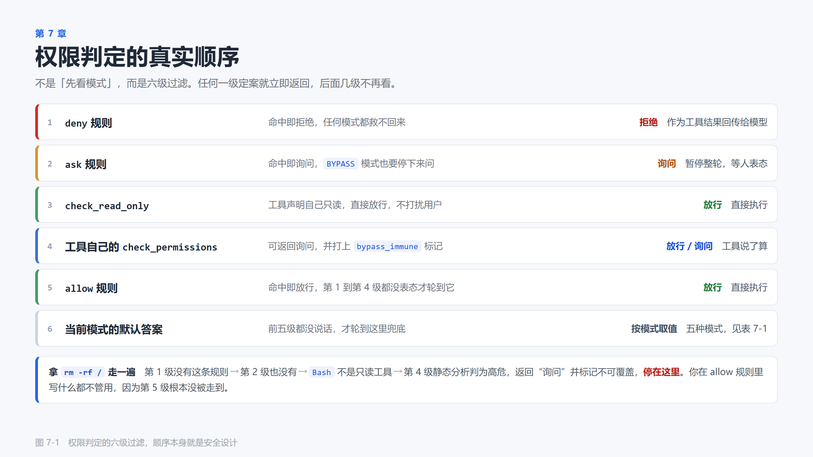
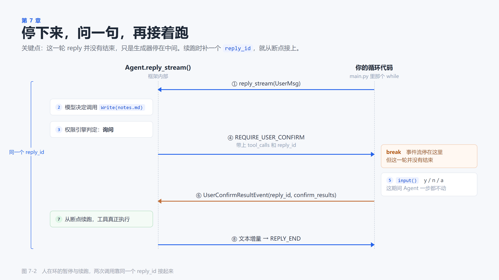

# 第 7 章　别让它乱删东西

> 本章代码 `code/ch07/main.py`、`code/ch07/probe_modes.py`　·　读完约 10 分钟

## 7.0 为什么必须先问

第 6 章结尾留了个问题：写工具时 `check_permissions` 一律返回 `ALLOW`，那真会删文件的工具摆在那儿，谁来拦？拦下来之后，对话又怎么接着走？这一章就是答案。

先看现状。第 5 章给工具划了个工作区，`Bash` 从 `./sandbox` 起步。但那个工作区只给起点，既不校验路径也不隔离进程，`Read` 里填个绝对路径照样能打开。它不是墙。

更要紧的是，为了让命令行脚本跑通，第 5 章还留了这么一行：

```python
agent.state.permission_context.mode = PermissionMode.BYPASS
```

这行等于把闸机抬起来焊死：整条链路上没有任何一处问过你。

三种"自己解决"的思路都试过，都不行。

- **靠工作区拦**：管不住。`rm -rf ./src` 就在工作区内，命令完全合规，后果是灾难性的。
- **靠工具自己拦**：`Bash` 收的是一整条命令，`ls` 和 `rm -rf` 走同一个工具，它在拿到参数之前不知道这次要干什么。
- **靠一条规则**：答不了"这次该不该问"。同一件事，你盯着屏幕看和半夜没人值守，答案不该一样。

所以判定必须放在工具之外，还得有个能停下来等人的地方。这就是本章的机制：**工具执行前先判定，需要确认就暂停整轮，等你答复再继续。**

本章回答三个问题：什么操作要问、判定按什么顺序走、你点了允许或拒绝之后怎么接着跑。

## 7.1 哪些操作需要确认

判定时其实在问三件事：

| 要判断的 | 例子 |
|---|---|
| 这个动作改不改东西 | 读不改，写会改 |
| 改的是哪一个 | `notes.md` 在工作区内，`~/.bashrc` 在外面 |
| 现在有没有人能点"允许" | 你坐在终端前，还是无人值守的定时任务 |

框架没把这三件事压成一个开关，而是分两处放：

- **模式（mode）**：大前提，一次设好整轮生效，只有五个取值，管的是"现在整体该多严"。
- **规则（rule）**：具体的例外，一条盯一类动作。"以后 `npm install` 都别问我了"就是一条规则。

判定时先看规则，规则里没写才轮到模式兜底。

先跑个实验。`code/ch07/probe_modes.py` 不要模型也不要 API key，默认模式下问三件事：

```bash
cd code/ch07 && python probe_modes.py
```

```text
--- 1. 同一套默认设置，三件事三个答案，补一条规则也盖不住
  读一下 readme.md -> allow  immune=False
  改一下 notes.md -> ask  immune=False
  往 ~/.bashrc 追加一行 -> ask  immune=True
  补一条 Bash 全放行规则，再问第三件
  往 ~/.bashrc 追加一行 -> ask  immune=True   规则没盖住
```

看一眼，放行；改文件，哪怕就在工作区里也要问；写系统配置，问得最坚决，补一条全放行规则照样没盖住。最后那个 `immune` 是 7.2 的主题。

五种模式的行为如下。

表 7-1　五种权限模式

| 模式 | 只读 | 工作区内写 | 工作区外写 | 高危命令（`rm -rf /`） | 适用 |
|---|---|---|---|---|---|
| `DEFAULT` | 放行 | 询问 | 询问 | 询问，规则无法覆盖 | 日常交互 |
| `ACCEPT_EDITS` | 放行 | 放行 | 询问 | 询问，规则无法覆盖 | 你正盯着改代码 |
| `EXPLORE` | 放行 | 拒绝 | 拒绝 | 拒绝 | 只想让它读 |
| `BYPASS` | 放行 | 放行 | 放行 | 放行 | 一次性容器 / 沙箱 |
| `DONT_ASK` | 放行 | 放行 | 拒绝 | 拒绝 | 定时任务、后台跑 |

三条容易看错的：

- **`DEFAULT` 下写工作区内也要问。** 工作区不是安全边界，别指望"在里面就没事"。
- **无人值守要用 `DONT_ASK`，不是 `BYPASS`。** 前者把该问的一律变成拒绝，后者把该问的一律变成放行。半夜没人回答时，这两个选择的后果正好相反。
- **`EXPLORE` 不查 allow 规则。** 只读保证不能被你配的规则让渡出去。另外，`ls`、`cat`、`git status` 这类已知只读命令，在任何模式下都直接放行。

## 7.2 判定顺序：谁能被豁免，谁不能

顺序不是"先看模式"，模式排在最后一位。



图 7-1　六级过滤，任何一步给出结论就立即返回

1. deny 规则命中 → 拒绝
2. ask 规则命中 → 询问
3. 只读工具 → 放行（快通道）
4. 工具自己的 `check_permissions()`
5. allow 规则命中 → 放行
6. 模式默认值

第 4 步有个字段叫 `bypass_immune`，含义是"这条判定不接受豁免"。`Bash` 会给五种情况打上这个标记：命令含 `$(...)` 这类动态展开、命中危险命令模式、`sed` 就地改敏感文件、目标落在敏感目录、`rm` 指向系统关键路径。

于是你写一条规则，想给 `rm -rf` 发张通行证：

```python
engine.add_rule(PermissionRule(
    tool_name="Bash", rule_content="rm -rf",
    behavior=PermissionBehavior.ALLOW, source="user",
))
```

结果没用：

```text
rm -rf /           -> ask   immune=True
rm -rf ./build     -> ask   immune=True
```

注意第二条，连 `./build` 也照样问。危险模式按命令形态判定，不看目标目录。

这不是 bug，是设计。**能让你一键放行一切的安全机制，等于没有安全机制。** deny 排第一、allow 排第五，中间夹着工具自检，谁也靠不上一条写在后面的规则把前面的判定翻掉。

## 7.3 授权、拒绝与续跑

判定结果是"询问"时，框架不弹窗，它往事件流里抛一个 `RequireUserConfirmEvent`，然后停住。

**停住不等于这一轮结束了。** 异步生成器停在中间，模型的上下文、已经产生的工具调用、`reply_id` 全都还活着。你答复之后，从断点接着跑。



图 7-2　同一个 `reply_id`，两次调用接起来

代码就是一个 `break` 加一个 `while True`。下面省掉了打印，完整文件在 `code/ch07/main.py`：

```python
async def run_with_confirmation(agent: Agent, question: str) -> None:
    inputs = UserMsg(name="user", content=question)

    while True:
        pending = None
        async for event in agent.reply_stream(inputs):
            if event.type == EventType.REQUIRE_USER_CONFIRM:
                pending = event
                break                    # 停在这里，不是结束
            render(event)

        if pending is None:              # 没停过，这一轮真结束了
            return

        results = []
        for tool_call in pending.tool_calls:
            answer = input("允许执行？[y] 允许 / [n] 拒绝 / [a] 始终允许 > ")
            answer = answer.strip().lower()

            rules = []
            if answer == "a":            # 记住这次决定，下次不再问
                rule = PermissionRule(
                    tool_name=tool_call.name,
                    rule_content="",
                    behavior=PermissionBehavior.ALLOW,
                    source="user",
                )
                PermissionEngine(agent.state.permission_context).add_rule(rule)
                rules.append(rule)

            results.append(
                ConfirmResult(
                    confirmed=answer in ("y", "a"),
                    tool_call=tool_call,
                    rules=rules,
                ),
            )

        inputs = UserConfirmResultEvent(
            reply_id=pending.reply_id,   # 靠它接回原处
            confirm_results=results,
        )
```

授权和拒绝走的是同一条路径，只有 `confirmed` 不同。但结果完全不一样：

| 你的答复 | 发生什么 |
|---|---|
| 允许 | 工具真的执行，结果写进上下文，同一轮继续往下跑 |
| 拒绝 | 工具**不执行**，框架把"用户拒绝"当成这次工具调用的结果交回模型，模型据此换方案或向你说明，流程不崩 |

拒绝不是报错，是一次正常返回。所以一个方案被拒之后，模型通常会改成只读的查证方式，而不是反复重试同一个调用。

四个对象的职责必须分清，写错会直接抛校验错误。

| 对象 | 关键字段 | 谁产生 |
|---|---|---|
| `RequireUserConfirmEvent` | `reply_id`、`tool_calls` | 框架 |
| `ConfirmResult` | `confirmed`、`tool_call`、`rules` | 你 |
| `UserConfirmResultEvent` | `reply_id`、`confirm_results` | 你 |
| `PermissionRule` | `tool_name`、`rule_content`、`behavior`、`source` | 你（可选） |

`ConfirmResult.tool_call` 是必填的，不能给 `None`。它带着 `id`，框架靠这个 id 把"批准"对应到具体哪一次调用。模型可能并行发起多个调用，所以 `confirm_results` 是列表，逐条对应。

## 7.4 规则：把"以后别问"记下来

一条规则四个字段：

```python
PermissionRule(
    tool_name="Write",        # 按工具分组
    rule_content="src/**",    # 匹配内容，语义随工具而变
    behavior=PermissionBehavior.ALLOW,
    source="user",            # 来源标记，便于审计
)
```

`rule_content` 的意思不统一，按工具记：

| 工具 | 含义 | 示例 |
|---|---|---|
| `Bash` / `PowerShell` | 命令字符串子串匹配 | `"npm install"` 命中 `npm install express` |
| `Read` / `Write` / `Edit` | 文件路径 glob | `"src/**"` 命中 `src/main.py` |
| 留空 `""` | 匹配一切 | 等价于"这个工具全放行" |

最后一行就是 7.3 里"始终允许"的实现：用户按下 `a`，我们给他写一条空内容的 allow 规则。

规则要通过引擎写进去，不能自己往容器里塞：

```python
engine = PermissionEngine(agent.state.permission_context)
engine.add_rule(rule)          # 立刻生效，写的就是 agent 的状态
```

> 业务上真要频繁删临时目录，别给 `rm` 写 allow 规则——7.2 已经证明那条路走不通。写一个 `clean_temp_dir` 工具，只接受白名单里的子目录名。**用工具收窄能力，别用规则放宽权限。**

## 7.5 三个坑

**1. 规则容器是字典，不是列表**

```python
context.allow_rules.append(rule)   # AttributeError: 'dict' object has no attribute 'append'
```

三个规则容器都是"工具名 → 规则列表"的字典，用 `add_rule()`。

**2. 续跑时忘了 `reply_id`**

```python
UserConfirmResultEvent(confirm_results=results)   # 缺 reply_id
```

框架找不到对应的回复上下文，表现为状态混乱或直接报错。永远从那个让你 `break` 的事件里取 `pending.reply_id`。

**3. 在循环里重新发原始问题**

```python
async for event in agent.reply_stream(UserMsg(...)):   # 每轮都是新问题
```

续跑的输入必须是 `UserConfirmResultEvent`。发原始问题，模型会以为你在重复提问，重新规划一遍，可能又发起同一个调用，形成死循环。

## 7.6 小结

- 危险操作在工具执行前判定，不由工具自己决定
- 判定看三件事：改不改、改哪里、现在有没有人能点允许
- 顺序是 deny 规则 → ask 规则 → 只读快通道 → 工具自检 → allow 规则 → 模式，模式只兜底
- `bypass_immune` 的判定不接受 allow 规则豁免，`rm -rf` 走不通后门
- 询问时用 `break` 暂停，用 `reply_id` 续跑，不是重开一轮对话
- 允许 → 执行并继续；拒绝 → 不执行，把拒绝交回模型，流程不崩
- 判定是纯本地计算，不花 token，上面每段输出都能自己跑出来

到这里，Buddy 会干活、会守边界，也知道什么时候该停下来问一句。但它只会问做不做——遇到说不清的需求，它还是先挑一个最像的答案往下做。

**下一章要解决的问题**：你还没说清要它做什么的时候，怎么让它把几种做法摆出来，你点一个？
