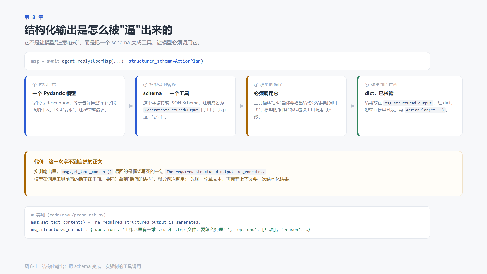

# 第 8 章　别乱猜，先问一句

> 本章代码 `code/ch08/probe_ask.py`、`code/ch08/main.py`　·　读完约 7 分钟

## 8.0 它在替你猜

模型有个习惯：需求说不清的时候，它不问你，直接挑一个最像的答案做下去。

"帮我清一清工作区"——它把 `.md` 删了。"发个摘要给老张"——它发给了另一个老张。

它猜不准不是模型笨，是那部分信息你没说，它也没有。这类活儿本来就不该由它拍板。

本章只做一件事：**拿不准的时候，让它把几种做法摆出来，你点一个。**

## 8.1 让它给选项，而不是给一段话

选项要能摆成菜单，就得是一份结构固定的数据，而不是一段看着像选项的文字。

所以不能靠"请用 JSON 回答"这种提示词，得给它一个 schema。框架会把 schema 变成一个只在这次回复里存在的工具 `GenerateStructuredOutput`，模型必须调用它，参数不合 schema 就过不去。



图 8-1　结构化输出，把 schema 变成一次强制的工具调用

先定义要什么：

```python
class ActionOption(BaseModel):
    """一个候选方案。"""

    label: str = Field(description="方案的短名，一句话以内")
    detail: str = Field(description="这个方案具体做什么，让用户看得懂后果")
    risk: str = Field(description="风险等级，涉及删除或外发时为高")


class ActionPlan(BaseModel):
    """模型给出的待拍板方案。"""

    question: str = Field(description="需要用户回答的问题")
    options: list[ActionOption] = Field(description="两到四个候选方案，按推荐程度排序")
    reason: str = Field(description="为什么这件事要交给用户决定，而不是模型自己定")
```

调用时多传一个参数：

```python
msg = await agent.reply(
    UserMsg(name="user", content="工作区里文件有点乱，帮我清一清。"),
    structured_schema=ActionPlan,
)
plan = ActionPlan(**msg.structured_output)      # structured_output 是 dict
```

四个字段各有分工，少一个用户就选不明白：

- `label` 让人一眼扫完；
- `detail` 说清后果。缺了它，"清临时文件"和"删所有 .md"在用户眼里差不多；
- `risk` 标轻重；
- `reason` 回答"你为什么现在来问我"，决定用户信不信这个菜单。

`description` 要写出边界。`risk` 那句"涉及删除或外发时为高"，就是告诉模型什么时候该标高风险——和写工具描述是一个道理。

## 8.2 把选项摆出来

拿到 `plan` 之后，剩下的都是普通代码，模型管不着：

```python
def choose_option(plan: ActionPlan) -> ActionOption | None:
    print(f"\n{plan.question}")
    print(f"模型的理由：{plan.reason}")
    for i, opt in enumerate(plan.options, 1):
        print(f"  [{i}] {opt.label}（风险 {opt.risk}）{opt.detail}")
    print("  [0] 都不做")

    raw = input("选一个编号 > ").strip()
    if raw == "0":
        return None
    return plan.options[int(raw) - 1]
```

`[0] 都不做` 这一项别省。没有它，用户被迫在几个都不想选的方案里挑一个。

`probe_ask.py` 用假模型把这段跑了两遍，不需要 API key：

```text
--- 1. 模型给三个方案，用户拍板后执行
  模型给的理由：删文件和外发都不可撤销，得你定
  模型问：工作区里有一堆 .md 和 .tmp 文件，要怎么处理？
    [1] 只列清单  风险低  列出文件名，一个都不删
    [2] 清掉临时文件  风险中  只删 .tmp，不动 .md
    [3] 全删并外发摘要  风险高  删所有 .md，摘要发到 13900001111
  用户选了：清掉临时文件
  再问一次：确认执行「清掉临时文件」？[y/N]
  用户回答：同意
  执行：只删 .tmp，不动 .md
```

第二段不再展开：同样三个方案，用户挑了风险最高的那个，确认时说了"不"，代码一步没动。

## 8.3 选了，不等于同意做

上面那段里有两次提问，很多人只做了第一次。

```text
选了"全删并外发摘要"  →  不代表他同意现在执行
```

他可能只是在比较方案。把"选哪个"和"到底做不做"压成一个 `y/n`，等于替用户做了"选了就是要做"的假设，风险最大的那个方案会直接被执行。

所以两道关：`choose_option` 回答"做哪个"，`confirm_execution` 回答"现在做不做"。

```python
option = choose_option(plan)

if option is None:
    print("[停止] 你选了都不做，代码一步没动。")
elif not confirm_execution(option):
    print("[停止] 你没同意，代码一步没动。")
    reply = await agent.reply(
        UserMsg(name="user", content="刚才那几个方案我都不做，先别动文件。"),
    )
else:
    print(f"[执行] 按「{option.label}」继续。")
    followup = await agent.reply(
        UserMsg(name="user", content=f"就按「{option.label}」这个方案做，其余别动。"),
    )
```

三种结果，三种处理：

| 用户的选择 | 代码做什么 | 模型收到什么 |
|---|---|---|
| 选了一个方案，确认执行 | 按这个方案做 | 新一句话："就按 X 做，其余别动" |
| 选了一个方案，确认时拒绝 | 一步不动 | 新一句话："这几个方案我都不做" |
| 选 `[0]` 都不做 | 一步不动 | 一般不回话，直接结束 |

拒绝不是报错。把"用户不做"当成一条普通消息交回模型，它会换个思路继续，对话不会崩。

这就是本章说的"多交互"：不是一次问答定生死，而是问一句、你答一句、它再做。

> 跟第 7 章那道闸机分清楚：第 7 章是权限引擎按工具危险等级自动拦住，属于安全层，不管你愿不愿意都会问；这里是业务层，模型主动把决定权交出来。两层可以同时存在，一个工具在业务上被批准了，落到执行时还可能被安全层再问一次。

## 8.4 完整流程

`code/ch08/main.py` 从头到尾就这几步：造 Agent → 提一个含糊的请求 → 拿结构化方案 → 摆菜单 → 两道关 → 继续对话。

那句请求故意含含糊糊又带风险：

```text
工作区里文件有点乱，帮我清一清，顺便把摘要发到 13900001111。
```

清哪些、发不发、发给谁，都没说。模型这时候不该猜，应该问。跑起来是这样：

```text
工作区里有一堆 .md 和 .tmp 文件，要怎么处理？
模型的理由：删文件和外发都不可撤销，得你定
  [1] 只列清单（风险 低）列出文件名，一个都不删
  [2] 清掉临时文件（风险 中）只删 .tmp，不动 .md
  [3] 全删并外发摘要（风险 高）删所有 .md，摘要发到 13900001111
  [0] 都不做
选一个编号 > 2
确认执行「清掉临时文件」？[y/N] y

[执行] 按「清掉临时文件」继续。
```

脚本里有一行 `agent.state.permission_context.mode = PermissionMode.BYPASS`，是有意为之：业务上的拍板已经由菜单做了，第 7 章那层安全确认在这个一口气跑完的 demo 里跳过。安全性来自 demo 专用的 sandbox 目录，换成真实环境要撤掉。

## 8.5 小结

- 说不清的需求别让模型猜，让它给方案
- 方案靠 `structured_schema` 拿，不靠提示词求它输出 JSON
- 一个能选的方案至少要有短名、后果、风险，再配一句为什么来问
- 一定给"都不做"这一项
- 选方案和批准执行是两件事，两道关都要留
- 拒绝不是错误，把结果交回模型，让它换思路
- 要正文又要结构化，就分两次调用：结构化那一轮模型不会写正文，`get_text_content()` 只会拿到框架补的一句占位话

到这里，Buddy 会干活、会守边界，也知道拿不准的时候先问一句。但这些记忆只活在进程内存里：上下文、权限规则、你交代过的偏好，全都挂在内存对象上。关掉终端更干脆，一切归零。

**下一章要解决的问题**：`Agent` 到底是有状态还是无状态？把 `agent.state` 存成 JSON 再读回来，哪些东西会坏？
