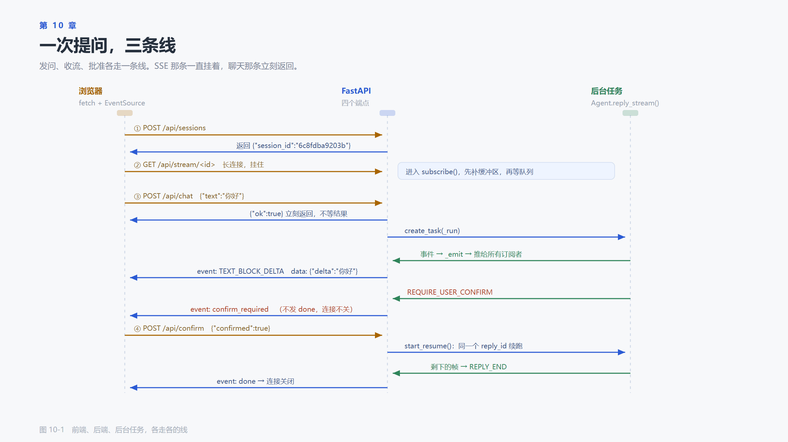

# 第 10 章　后端：把事件流出去

> 本章代码 `code/ch10/`（`main.py` / `runtime.py`）　·　读完约 9 分钟

## 10.0 长任务，短请求

第 9 章结尾留了三个问题，怎么包成 HTTP 服务，事件流怎么变成浏览器能读的 SSE，前端刷新之后后台那个 Agent 怎么办。这一章三个都答，主线是中间那个。

矛盾来自两边的时间尺度对不上。浏览器发出去的一个请求是短的，几十毫秒到几十秒，中途还隔着 Nginx 和负载均衡，默认 60 秒就掐。Agent 干一轮活是长的，多次模型调用、写文件、停下来等人确认，几分钟很正常。

硬凑成一个 `POST /chat`，等 Agent 跑完再返回，会同时坏三件事。代理先超时；用户几分钟里看不到一个字；两个人共用一个会话时，第二个请求只能干等。

所以只剩一条路，把发问和进度拆开。发问用一个立刻返回的短请求，进度用一条一直挂着的长连接往回推。

这条长连接就是 SSE（Server-Sent Events）。本章只讲它。

## 10.1 为什么是 SSE

| | SSE | WebSocket |
|---|---|---|
| 方向 | 服务端 → 客户端，单向 | 双向 |
| 协议 | 普通 HTTP，`text/event-stream` | 要 `Upgrade` 握手，独立帧协议 |
| 断线重连 | 协议自带 `id` 和 `Last-Event-ID`，浏览器会自动带 | 自己设计重连和重放 |
| 调试 | `curl -N` 直接看原始字节 | 得装工具 |

三条理由。

**一、我们只需要下行。** 上行只有三件事，发消息、批准或拒绝、中断，都是离散动作，一个 `POST` 就够。真正高频的是下行，一段段文字增量、一次次工具调用，全是从服务端往客户端走。

**二、续传是协议自带的。** SSE 定了 `id` 字段和 `Last-Event-ID` 请求头，客户端把最后收到的序号带上，服务端就知道从哪一帧往后补。WebSocket 没有这个约定，重连和补发都得自己从零设计。

浏览器的 `EventSource` 会把这件事自动做完，断了自己重连，自动带 `Last-Event-ID`。它的问题出在对"正常结束"的判断上，`done` 一发、连接一关，它当成网络故障又连回来，第 11 章细说。所以那边改用手写客户端，序号放进查询参数自己带。协议这层的好处照样能用，要补的只是几行代码。

**三、它是纯文本。** 一帧就是几行字符串，`curl -N` 能看到原始字节。前九章那些调试手段，这里继续能用。

选 SSE 不是因为它更强，是因为它更小。

## 10.2 一次提问，三条线



- `GET /api/stream/{session_id}`，长连接。有事件就写一帧，没有就等。
- `POST /api/chat`，立刻返回。返回时模型一个字都还没说，它只是启动了一个后台任务。
- `POST /api/confirm`，只在需要批准时出现，把决定送回那个暂停的会话。

一句话，长连接负责说给你听，短请求负责让我做什么。

`/api/chat` 的关键是不等结果：

```python
@app.post("/api/chat")
async def chat(body: ChatRequest):
    session = _get(body.session_id)
    if session.running:
        raise HTTPException(status_code=409, detail="上一条回复还在进行中")
    await session.start_reply(body.text)       # 内部是 create_task，不等
    return {"ok": True, "session_id": session.session_id}
```

`start_reply` 里那一句 `asyncio.create_task(self._run(...))` 就是分界线。线这边是"做事"，线那边是"看进度"。写成 `await agent.reply_stream(...)` 一路跑完再返回，10.0 里那三件事会一起回来。

那个 409 也别省。同一个会话同时只跑一轮，`running` 为真就拒掉，让人知道"上一条还没完"，别默默排队等五分钟。

会话本身也存在进程里。`Registry` 就是个 dict，每个 `Session` 包着一个 `Agent` 和一条事件缓冲。第 9 章那套落盘这里没接，服务一重启会话全没了。真要续上，把 `Session` 里的 `Agent` 换成 `store.load()` 恢复出来的那个就行，SSE 这一层一行都不用改。

## 10.3 一帧就是四行文本


```text
id: 7
event: TEXT_BLOCK_DELTA
data: {"type":"TEXT_BLOCK_DELTA","block_id":"b748fa1e","delta":"收到你的问题：「"}

```

`id` 给续传用，`event` 是类型，`data` 是内容，最后那个空行是帧的结束符，少一个都不成帧。

函数体只有两行，产出的帧是四行（`runtime.py`）：

```python
def sse_frame(seq: int, event_type: str, data: dict[str, Any]) -> str:
    payload = json.dumps(data, ensure_ascii=False, default=str)
    return f"id: {seq}\nevent: {event_type}\ndata: {payload}\n\n"
```

几个写法都有原因。

- **`data` 必须单行。** 一帧里 `data` 可以出现多次，浏览器会用换行把它们拼起来。所以 `json.dumps` 千万别加 `indent=2`，多行 JSON 会被拆成几段，前端 `JSON.parse` 直接报错。
- **`ensure_ascii=False`。** 不加也能跑，但中文全变成 `\u4f60\u597d`，`curl` 一看满屏码点，SSE 最好用的调试方式就废了。
- **结尾两个换行。** 少一个，浏览器认为这帧还没完，一直等下去。症状很迷惑，服务端日志显示已发送，页面上毫无动静。
- **`default=str` 兜底。** 事件里偶尔混进 `datetime` 这类东西，没有它会在某一次偶发事件上抛 `TypeError`，把整条流一起打断。

还有一类特殊帧。以冒号开头的是注释帧，浏览器直接忽略，什么都不显示。它唯一的用处是往流里塞一个不带数据的信号，心跳和开头那句 `: connected` 都是这么发的。

## 10.4 接到 FastAPI 上

SSE 的响应体是一个永远不结束的生成器，所以用 `StreamingResponse`：

```python
@app.get("/api/stream/{session_id}")
async def stream(session_id: str, last_event_id: int = 0) -> StreamingResponse:
    session = _get(session_id)

    async def gen():
        yield ": connected\n\n"                        # 先发一帧，让连接立刻建立
        agen = session.subscribe(from_seq=last_event_id)
        while True:
            try:
                frame = await asyncio.wait_for(agen.__anext__(), timeout=HEARTBEAT)
            except asyncio.TimeoutError:
                yield ": ping\n\n"                     # 心跳
                continue
            except StopAsyncIteration:
                return
            yield frame

    return StreamingResponse(
        gen(),
        media_type="text/event-stream",
        headers={
            "Cache-Control": "no-cache",
            "X-Accel-Buffering": "no",                 # 关掉 Nginx 缓冲
        },
    )
```

三处都要写对。

- **`media_type` 写 `text/event-stream`。** 写成 `text/plain`，`EventSource` 直接报错，它只认这个 MIME。
- **`X-Accel-Buffering: no` 不能省。** Nginx 默认攒一批再发，本地测得飞快，一上线就变成隔几秒蹦一大段。
- **那个 `timeout` 是心跳。** 15 秒没有事件就发一帧注释，让中间的代理知道连接还活着。没有它，安静一分钟的连接会被当空闲掐掉，用户看到的现象是回答到一半突然没了。

开头那行 `yield ": connected\n\n"` 也不是客套。先把一帧（哪怕是空的）送出去，连接立刻算建立，客户端不用等到第一个真实事件才进 open 状态。

## 10.5 断开连接，别杀任务

这一节是整套设计里最要紧的一条，任务的生死和连接的生死必须分开。

切标签页、手机锁屏、Wi-Fi 闪断，连接都会断。但一个已经跑了三分钟的任务不该因此作废。任务继续跑，事件继续存，用户回来从断点续上。

两个结构解决这件事，一个滚动缓冲区，一个每订阅者一个队列。

```python
def _emit(self, event_type: str, data: dict[str, Any]) -> None:
    self.seq += 1
    frame = sse_frame(self.seq, event_type, data)
    self.buffer.append(frame)                   # 存下来，给重连补发
    if len(self.buffer) > 2000:
        self.buffer = self.buffer[-2000:]       # 只留最近 2000 帧
    for queue in list(self.subscribers):
        queue.put_nowait(frame)                 # 广播给每个在线订阅者
```

`buffer` 只是个普通 list，超了从前面切掉，效果跟环形缓冲一样，没必要真去写取模下标。

订阅时先补历史，再跟实时：

```python
async def subscribe(self, from_seq: int = 0) -> AsyncGenerator[str, None]:
    queue: asyncio.Queue[str | None] = asyncio.Queue()
    self.subscribers.append(queue)
    try:
        for frame in self.buffer:                        # 先补
            seq = int(frame.split("\n", 1)[0].removeprefix("id: "))
            if seq > from_seq:
                yield frame
        while True:                                      # 再跟
            frame = await queue.get()
            if frame is None:
                return
            yield frame
    finally:
        if queue in self.subscribers:
            self.subscribers.remove(queue)               # 断开就清，别泄漏
```

`finally` 这三行别省。客户端一断，这个协程会被取消，不在这里把队列从 `subscribers` 里摘掉，跑上一天就是一堆僵尸队列，每次广播都往里塞一遍。

`from_seq` 来自查询参数，刷新之后只补没见过的帧：

```bash
curl -N "localhost:8848/api/stream/$SID?last_event_id=15"
```

这里没有用 `Last-Event-ID` 请求头。原生 `EventSource` 会自己带那个头，而第 11 章的客户端是 `fetch` 手写的，带查询参数更省事。语义一样，都是"我收到第 15 帧了，从 16 开始给我"。

顺带说个坑。本章那个验证页用的是 `EventSource`，它自动重连时请求的还是原来那个 URL，查询参数不会更新（通常根本没有），服务端于是从第 1 帧重放，页面上冒出一段重复内容。这是第 11 章把客户端换成 `fetch` 的原因之一。

还有个限制得说清楚。缓冲区只留 2000 帧，客户端要的位置比最早的还早，中间那段就真的没了，前端会看到一条中间缺字的回复。断得太久、或者这一轮特别能说，都会踩到这条线。真踩到了，要么加长缓冲，要么把帧落盘。

**为什么每个订阅者一个队列。** 共用一个队列，两个标签页会互相抢帧，谁都拼不出完整回复。

## 10.6 转发哪些事件

框架一共 28 种事件，全转发没必要。`DATA_BLOCK_*` 是结构化输出的分片，本项目根本不用，转过去只是让前端多写一堆永远走不到的分支。

白名单在 `runtime.py` 的 `FORWARD` 里，19 种。名单内编码成帧，名单外直接丢。按用途分四类。

- **一轮的边界。** `REPLY_START`、`REPLY_END`，加上 `MODEL_CALL_START`、`MODEL_CALL_END`。界面靠它们开关"生成中"的动画，也靠它们数这一轮调了几次模型。
- **三种内容块。** 文本、思考、工具结果，START、DELTA、END 全都要。流式的本体就在这里，只转 END，前端得等全部生成完才有东西可显示，那跟一次性返回没区别。
- **工具调用。** `TOOL_CALL_START` 只带工具名，参数是流式吐出来的。不给 `TOOL_CALL_DELTA`，界面上就只能显示"正在调用 Write"，看不到它在写哪个文件。
- **需要人出面的事件。** `REQUIRE_USER_CONFIRM` 和 `EXCEED_MAX_ITERS` 直接决定弹不弹框。`HINT_BLOCK` 不弹框，里面是框架给模型注入的时间提示，第 11 章会把它摊在右侧事件面板上，让人看到模型这一轮到底被喂了什么。

编码时有个坑。`state`、`finished_reason` 这些字段是枚举，`json.dumps` 处理不了，要先取 `.value`。`event_to_dict` 里那段 `hasattr(value, "value")` 就是干这个的。

还有一处边界，是两个名字长得像的东西。

框架在需要人拍板时会发 `REQUIRE_USER_CONFIRM`，然后直接结束这一轮。它不给 `REPLY_END`，也不说明为什么停。`finished_reason` 只有 `completed` 和 `interrupted` 两个值，分不出"真干完了"和"停在这儿等人"。

所以后端不能拿 `REPLY_END` 当收尾信号，得在自己的 `finally` 里判断。这一轮挂着待确认的调用，就发一帧 `confirm_required`；没挂，才发 `done`。实测这两帧长这样（省了 `ts`）：

```text
id: 5
event: REQUIRE_USER_CONFIRM
data: {"type": "REQUIRE_USER_CONFIRM", "reply_id": "ed5e12ed…", "tool_calls": [{"id": "call_1", "name": "Write", "input": "{\"file_path\": \"…note.md\", …}"}]}

id: 6
event: confirm_required
data: {"session_id": "9a21e40950e7", "reply_id": "ed5e12ed74e5445a94abe18f2327b545"}
```

大写那个是框架发的，带着完整的调用参数，前端要靠它把"要写哪个文件"显示出来。小写那个是后端自己造的，只有 `session_id` 和 `reply_id`，意思是"去弹框"。搞混了，就会拿 `confirm_required` 去解析参数，然后发现里面什么都没有。

## 10.7 实测

没有 key 也能跑。`MOCK=1` 会切到假模型，它把一段预设文本切成小片往外吐，链路照样通：

```bash
cd code/ch10 && MOCK=1 python main.py
```

另开一个终端，建会话、开流、发问，一路 `curl`：

```bash
SID=$(curl -s -X POST localhost:8848/api/sessions | jq -r .session_id)
curl -N "localhost:8848/api/stream/$SID" &
curl -s -X POST localhost:8848/api/chat \
  -H "Content-Type: application/json" \
  -d "{\"session_id\":\"$SID\",\"text\":\"你好\"}"
```

机器上没有 `jq` 也没关系，把第一条命令的返回原样看一眼，`session_id` 抄出来就行。

```text
: connected

id: 1
event: REPLY_START
data: {"type": "REPLY_START", "reply_id": "78ad983b…", "block_id": null}

id: 4
event: TEXT_BLOCK_START
data: {"type": "TEXT_BLOCK_START", "reply_id": "78ad983b…", "block_id": "f4481a70…"}

id: 5
event: TEXT_BLOCK_DELTA
data: {…, "delta": "收到你的问题：「"}

…

id: 18
event: done
data: {"session_id": "6496ed080df0"}
```

帧号 1 到 18 是连续的，没有跳号。中间那些省略了，`ts` 字段也省了。

第 2 帧是 `HINT_BLOCK`，里面是框架每次调用模型前注入的当前时间。第 9 章说恢复会话后 `cur_iter` 不清会跳过这一步，指的就是它。

5 到 14 这十帧文本增量全挂在同一个 `block_id` 上，前端拿这个 id 找到同一个气泡往后追加。这就是下一章要干的事。

## 10.8 小结

- 长任务配短请求。`POST` 发问立刻返回，SSE 收流，中间那句 `create_task` 是分界线
- 选 SSE 的理由，只要下行、续传协议自带、纯文本能 `curl` 看清
- 一帧是 `id` + `event` + `data` + 一个空行，`data` 必须单行，注释帧当心跳
- `StreamingResponse` + `text/event-stream` + `X-Accel-Buffering: no`，再加 15 秒一帧的注释心跳
- 连接可以断，任务不能停。帧进滚动缓冲区，靠 `last_event_id` 续上
- 转发走白名单，枚举取 `.value`；停着等人确认时发 `confirm_required`，别发 `done`

后端现在只会往外吐字节，还没有界面。

**下一章要解决的问题**：怎么把这一串帧拼成一条消息？并行工具调用交错到达时怎么不乱？用户滚上去看历史时，新内容还在往下流，怎么不打断他？
