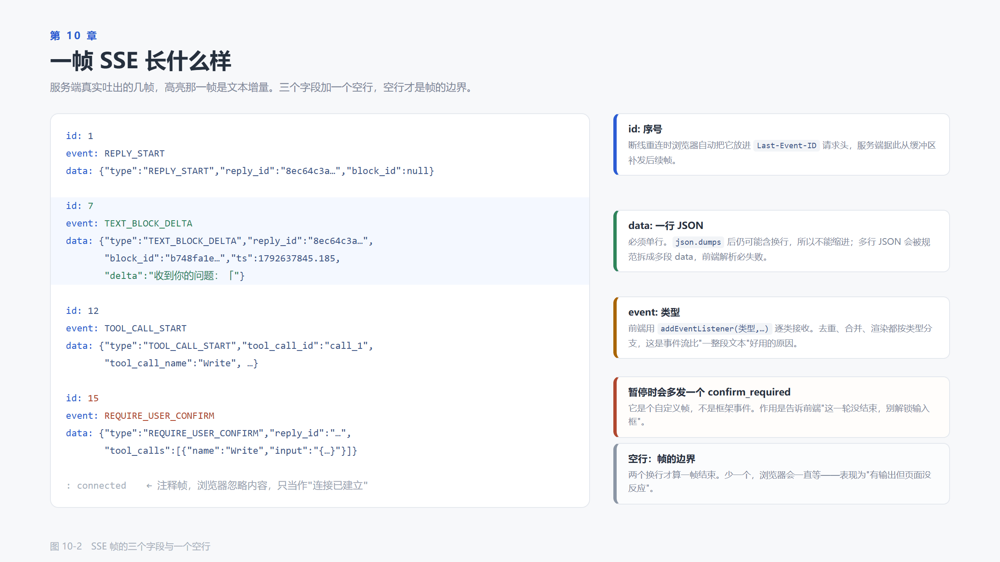

# 第 10 章　后端：把事件流出去

> 本章代码 `code/ch10/`（`main.py` / `runtime.py`）　·　读完约 9 分钟

## 10.0 长任务，短请求

第 9 章结尾留了三个问题：怎么包成 HTTP 服务、事件流怎么变成浏览器能读的 SSE、前端刷新之后后台那个 Agent 怎么办。这一章三个都答，主线是中间那个。

矛盾在这儿：浏览器发出去的请求是短的，几十毫秒到几十秒，中间还隔着 Nginx、负载均衡，默认 60 秒就掐。

Agent 干一轮活是长的：多次模型调用、写文件、停下来等人确认，几分钟很正常。

把这两件事凑成一个 `POST /chat`、等 Agent 跑完再返回，会同时坏三处：代理先超时；用户几分钟看不到一个字；两个人同时用一个会话，第二个请求只能排队。

所以只剩一条路：**发问用一个立刻返回的短请求，进度用一条一直挂着的长连接往回推。**

这条长连接就是 SSE（Server-Sent Events）。本章只讲它。

## 10.1 为什么是 SSE

| | SSE | WebSocket |
|---|---|---|
| 方向 | 服务端 → 客户端，单向 | 双向 |
| 协议 | 普通 HTTP，`text/event-stream` | 要 `Upgrade` 握手，独立帧协议 |
| 断线重连 | 浏览器自带，自动带 `Last-Event-ID` | 自己写重连和重放 |
| 调试 | `curl -N` 直接看原始字节 | 得装工具 |

三条理由：

**一、我们只需要下行。** 上行只有三件事：发消息、批准或拒绝、中断——都是离散动作，一个 `POST` 就够。真正高频的是下行：一段段文字增量、一次次工具调用。

**二、重连是白送的。** `EventSource` 断开会自动重连，并把最后收到的 `id` 放进 `Last-Event-ID` 请求头。用 WebSocket，这套逻辑得自己写。

**三、它是纯文本。** 一帧就是几行字符串，`curl -N` 能看到原始字节。前九章那些调试手段，这里继续能用。

选 SSE 不是因为它更强，是因为它更小。

## 10.2 一次提问，三条线


图 10-1　长连接只下行，短请求负责动作

- `GET /api/stream/{id}`：长连接。有事件就写一帧，没有就等。
- `POST /api/chat`：立刻返回 `{"ok": true}`。返回时模型一个字都还没说——它只是启动了一个后台任务。
- `POST /api/confirm`：只在需要批准时出现，把决定送回那个暂停的会话。

一句话：**长连接负责说给你听，短请求负责让我做什么。**

`/api/chat` 的关键是不等结果：

```python
@app.post("/api/chat")
async def chat(body: ChatRequest):
    session = _get(body.session_id)
    if session.running:
        raise HTTPException(status_code=409, detail="上一条回复还在进行中")
    await session.start_reply(body.text)       # 内部是 create_task，不等
    return {"ok": True}
```

`start_reply` 里那一句 `asyncio.create_task(self._run(...))`，就是"做事"和"看进度"的分界线。写成 `await agent.reply(...)` 再返回，前面那三处故障会一起回来。

会话本身也存在进程里：`SessionRegistry` 是个 `dict`，每个 `Session` 包着一个 `Agent` 和一条事件 buffer。第 9 章那套落盘这里没接，服务一重启会话就没了。要接着上次聊，把 `Session` 里的 `Agent` 换成 `store.load()` 恢复出来的那个即可，SSE 这一层完全不受影响。

## 10.3 一帧就是四行文本



图 10-2　四个字段，一个空行

```text
id: 7
event: TEXT_BLOCK_DELTA
data: {"type":"TEXT_BLOCK_DELTA","block_id":"b748fa1e","delta":"收到你的问题："}

```

`id` 给重连用，`event` 是类型，`data` 是内容，**最后那个空行是帧的结束符**。

编码函数只有三行，产出的帧是四行（`runtime.py`）：

```python
def sse_frame(seq: int, event_type: str, data: dict[str, Any]) -> str:
    payload = json.dumps(data, ensure_ascii=False, default=str)
    return f"id: {seq}\nevent: {event_type}\ndata: {payload}\n\n"
```

这几处选择都有原因：

- **`data` 必须单行。** 一帧里 `data` 可以出现多次，浏览器会用换行拼起来。所以 `json.dumps` 千万别加 `indent=2`，多行 JSON 会被拆段，前端 `JSON.parse` 直接报错。
- **`ensure_ascii=False`。** 不加也能跑，但中文全变成 `\u4f60\u597d`，`curl` 一看傻眼，SSE 最好用的调试方式就废了。
- **结尾两个换行。** 少一个，浏览器认为这帧还没完，一直等下去。症状是服务端日志显示已发送、页面毫无反应。
- **`default=str` 兜底。** 事件里偶尔混进 `datetime`，没有它会在一次偶发事件上抛 `TypeError`，把整条流打断。

还有一类特殊帧：以冒号开头的是注释帧，浏览器直接忽略。它唯一的用途是心跳，下一节就用上。

## 10.4 接到 FastAPI 上

SSE 的响应体是一个不结束的生成器，所以用 `StreamingResponse`：

```python
@app.get("/api/stream/{session_id}")
async def stream(session_id: str, last_event_id: int = 0) -> StreamingResponse:
    session = _get(session_id)

    async def gen():
        yield ": connected\n\n"                        # 先发一帧，让连接立刻建立
        agen = session.subscribe(from_seq=last_event_id)
        while True:
            try:
                frame = await asyncio.wait_for(agen.__anext__(), timeout=HEARTBEAT)
            except asyncio.TimeoutError:
                yield ": ping\n\n"                     # 心跳
                continue
            except StopAsyncIteration:
                return
            yield frame

    return StreamingResponse(
        gen(),
        media_type="text/event-stream",
        headers={
            "Cache-Control": "no-cache",
            "X-Accel-Buffering": "no",                 # 关掉 Nginx 缓冲
        },
    )
```

三个必须写对的地方：

**`media_type` 是 `text/event-stream`。** 写成 `text/plain`，`EventSource` 直接报错，因为它只看这个 MIME。

**`X-Accel-Buffering: no` 不能省。** Nginx 默认攒一批再发，本地测得飞快，一上线变成"隔几秒蹦一大段"。

**生成器里那个 `timeout` 是心跳。** 连着 15 秒没有事件就发一帧注释，让中间代理知道连接还活着。没有它，安静一分钟的连接会被当空闲掐掉。

## 10.5 断开连接，别杀任务

这是整套设计里最重要的一条：**任务的生死和连接的生死必须分开。**

切标签页、手机锁屏、Wi-Fi 闪断，连接都会断。但一个已经跑了三分钟的任务不该因此作废。任务继续跑，事件继续存；用户回来，从断点续上。

两个结构解决：一个环形缓冲区（只留最近 2000 帧），一个"每个订阅者一个队列"。

```python
def _emit(self, event_type: str, data: dict[str, Any]) -> None:
    self.seq += 1
    frame = sse_frame(self.seq, event_type, data)
    self.buffer.append(frame)                   # 存下来，给重连补发
    if len(self.buffer) > 2000:
        self.buffer = self.buffer[-2000:]       # 只留最近 2000 帧
    for queue in list(self.subscribers):
        queue.put_nowait(frame)                 # 广播给每个在线订阅者
```

订阅时先补历史，再跟实时：

```python
async def subscribe(self, from_seq: int = 0) -> AsyncGenerator[str, None]:
    queue: asyncio.Queue[str | None] = asyncio.Queue()
    self.subscribers.append(queue)
    try:
        for frame in self.buffer:                        # 先补
            seq = int(frame.split("\n", 1)[0].removeprefix("id: "))
            if seq > from_seq:
                yield frame
        while True:                                      # 再跟
            frame = await queue.get()
            if frame is None:
                return
            yield frame
    finally:
        if queue in self.subscribers:
            self.subscribers.remove(queue)               # 断开就清，别泄漏
```

`from_seq` 来自查询参数，刷新之后只补没见过的帧：

```bash
curl -N "localhost:8848/api/stream/$SID?last_event_id=15"
```

**为什么每个订阅者一个队列？** 共用一个队列，两个标签页会互相抢帧，谁都拼不出完整回复。

## 10.6 转发哪些事件

框架一共 28 种事件，全转发是错的：`TOOL_CALL_DELTA` 每几个字符来一次，前端根本用不上。

一张白名单就够（`runtime.py` 的 `FORWARD`），名单内才编码成帧，名单外直接丢。

编码时有个坑：`state`、`finished_reason` 这些字段是枚举，`json.dumps` 处理不了，要先取 `.value`。

还有一条边界值得记住：**框架只告诉你"这一轮停了"，不告诉你"为什么停"。** 停下来等人确认时，后端得自己发一帧 `confirm_required` 而不是 `done`，否则前端会立刻解锁输入框，用户以为活干完了。

## 10.7 实测

没有 key 也能跑，`MOCK=1` 会切到假模型：

```bash
cd code/ch10 && MOCK=1 python main.py
```

建会话、开流、发问，一路 `curl`：

```bash
SID=$(curl -s -X POST localhost:8848/api/sessions | jq -r .session_id)
curl -N "localhost:8848/api/stream/$SID" &
curl -s -X POST localhost:8848/api/chat \
  -H "Content-Type: application/json" \
  -d "{\"session_id\":\"$SID\",\"text\":\"你好\"}"
```

```text
: connected

id: 1
event: REPLY_START
data: {"type": "REPLY_START", "reply_id": "8ec64c3a…", "block_id": null}

id: 4
event: TEXT_BLOCK_DELTA
data: {"type": "TEXT_BLOCK_DELTA", "block_id": "b748fa1e…", "delta": "收到你的问题：「"}

…

id: 18
event: done
data: {"session_id": "6c8fdba9203b"}
```

十帧文本增量全挂在同一个 `block_id` 上——前端拿这个 id 找到同一个气泡往后追加。这就是下一章要干的事。

## 10.8 小结

- 长任务配短请求：`POST` 发问立刻返回，SSE 收流，`create_task` 是那个分界点
- 选 SSE 的理由：只要下行、重连白送、纯文本可 `curl`；一帧 = `id` + `event` + `data` + 一个空行，`data` 必须单行
- `StreamingResponse` + `text/event-stream` + `X-Accel-Buffering: no`，再加一个 15 秒的注释帧心跳
- 连接可以断，任务不能停；帧进环形缓冲区，靠 `last_event_id` 续上；转发走白名单，枚举取 `.value`

后端现在只会往外吐字节，还没有界面。

**下一章要解决的问题**：怎么把这一串帧拼成一条消息？并行工具调用交错到达时怎么不乱？用户滚上去看历史时，新内容还在往下流，怎么不打断他？
