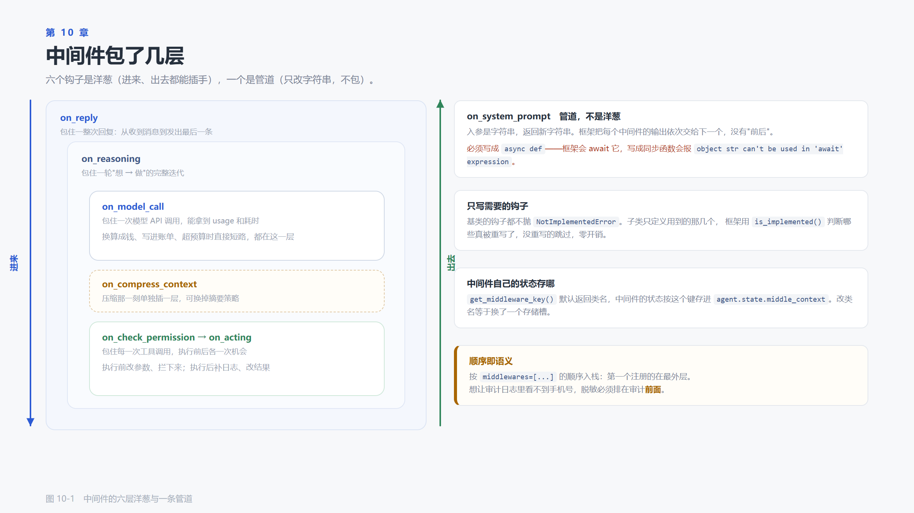

# 第 10 章　在关键节点插手

> 本章代码 `code/ch10/probe_middleware.py`、`code/ch10/middlewares.py`、`code/ch10/main.py`　·　读完约 20 分钟

## 10.0 上一章留下的问题

前 9 章每给 Buddy 加一种本事，都是去改一个具体的部件。改 system prompt、加工具、配权限、调窗口参数，改的东西各不相同，但落点都是某一个部件。

第 9 章结尾留了两个问题。工具调用前后想加日志、想脱敏、想改参数，除了改工具本身还有没有别的办法。怎么强制模型输出一段符合 schema 的 JSON。

这两个问题看着不起眼，却是全书第一次要改的东西不在某个部件里，而在"执行流程经过某个节点"这件事上。

先把插手这件事分清楚。它有两种，指向完全不同的人。

第一种是让人插手。模型读懂了你的话，准备动手，但这一步要不要做、按哪个方案做，得你点头。这种你能亲手感知到，也是人机协同真正落地的地方。本章的重点在这里。

第二种是框架在后台替你插手。想知道一次调用花了多少 token，不想让手机号进日志，预算超了就停。这些事用户看不见，也不需要看见，属于横切能力，由中间件管。它改的是框架行为，跟前一种改决策权在谁手里不是一回事。

还有一处边界要说清楚，免得后面几章读起来像重复。第 7 章已经讲过一次"同意或不同意"，那是权限引擎判出 `ASK` 之后停下来等人点头，管的是安全。第 13 章会在浏览器里给模型一个 `AskUser` 工具，让它自己列选项。本章夹在中间，用第 9 章的 `structured_schema` 让模型给出候选方案，在命令行里跑通一次最小闭环。三章讲的是同一件事的三个层面。

## 10.1 先跑一遍，模型给选项你来拍板

`code/ch10/probe_middleware.py` 全程用假模型，不需要 API key。默认跑两段，正是本章重点。

```bash
python code/ch10/probe_middleware.py
```

```text
--- 1. 模型给三个方案，用户拍板后执行
  模型给的理由：删文件和外发都不可撤销，得你定
  模型问：工作区里有一堆 .md 和 .tmp 文件，要怎么处理？
    [1] 只列清单  风险低  列出文件名，一个都不删
    [2] 清掉临时文件  风险中  只删 .tmp，不动 .md
    [3] 全删并外发摘要  风险高  删所有 .md，摘要发到 13900001111
  用户选了：清掉临时文件
  再问一次：确认执行「清掉临时文件」？[y/N]
  用户回答：同意
  执行：只删 .tmp，不动 .md

--- 2. 同样三个方案，用户不同意
  模型问：工作区里有一堆 .md 和 .tmp 文件，要怎么处理？
    [1] 只列清单  风险低  列出文件名，一个都不删
    [2] 清掉临时文件  风险中  只删 .tmp，不动 .md
    [3] 全删并外发摘要  风险高  删所有 .md，摘要发到 13900001111
  用户选了：全删并外发摘要
  再问一次：确认执行「全删并外发摘要」？[y/N]
  用户回答：不同意
  执行：无，高风险方案停在确认这一步
```

先看第一段。模型没有直接去删文件，而是先给了三个方案，每个方案都带一句后果和一个风险等级。用户挑了第二个，代码再问一次，得到"同意"两个字，这才往下走。

这里有两道关。第一道是选哪个，第二道是到底做不做。很多人把人机协同做成一个 `y/n` 就够了，其实少了第一道。用户真正想要的控制权，往往不是"允许还是拒绝"，而是"我要的是这三种里的第二种"。

第二段把第二道关单独演了一遍。用户挑了风险最高的那个，但在确认时说了"不"，代码一步没动。选方案不等于批准执行，这是两条独立的信息，别压成一个布尔值。

> 两段都没花 token，随时可以重跑。第 1 段里那个 `iter(["2", "y"])` 换成 `input()`，就是能真点的版本，`main.py` 里用的就是 `input()`。

## 10.2 七个钩子，两种形态

先把背景那类插手讲完，10.4 再回到拍板那条线。

`MiddlewareBase` 提供了七个可重写的钩子，分两种形态。



图 10-1　中间件的六层洋葱与一条管道

洋葱形态有六个。它们的入参里有 `next_handler`，调用它表示继续往下走。因为"前"和"后"各有一个位置，你可以包在调用外面，进出一共两次机会。

```python
async def on_acting(self, agent, input_kwargs, next_handler):
    # 调用前，能改参数、能拦下来
    async for chunk in next_handler():
        yield chunk
    # 调用后，能补日志、能改结果
```

管道形态只有一个，就是 `on_system_prompt`。它没有 `next_handler`，入参是字符串，返回新字符串。多个中间件按注册顺序依次传递，像流水线。10.3 开头那段审计流水，就是在这些位置记下来的。

七个钩子的分工如下。

| 钩子 | 形态 | 包住什么 | 典型用途 |
|---|---|---|---|
| `on_reply` | 洋葱 | 一整次回复 | 计时、埋点、把整轮输出落库 |
| `on_reasoning` | 洋葱 | 一轮想与做 | 限制单轮迭代次数、审计工具序列 |
| `on_model_call` | 洋葱 | 一次模型 API 调用 | 计费、缓存、换模型、超预算短路 |
| `on_acting` | 洋葱 | 一次工具执行 | 改参数、脱敏、记调用日志 |
| `on_check_permission` | 洋葱 | 一次权限判定 | 动态改判定结果，2.0.6 起 |
| `on_compress_context` | 洋葱 | 一次上下文压缩 | 换摘要策略、压缩前后对比 |
| `on_system_prompt` | 管道 | 拼装中的 system prompt | 注入版本号、A/B 提示词 |

有人会担心，不关心的钩子是不是得写一堆空实现。不用。基类的钩子都不抛 `NotImplementedError`，框架用 `is_implemented()` 检查哪些真被重写了，没重写的直接跳过，零开销。只用 `on_acting` 的中间件，实测结果是这样。

```text
on_acting      True
on_model_call  False
on_system_prompt  False
```

还有一个签名上的坑。`on_system_prompt` 看着只是字符串变换，但它必须写成 `async def`。框架会 `await` 每一个中间件的返回值，写成同步函数会报下面这个错。

```text
TypeError: object str can't be used in 'await' expression
```

这个坑我在写本章示例时真踩过一次，改一个 `async` 就好了。

还有一处容易记错。六个洋葱钩子里，`next_handler` 的形态并不统一。三个返回异步生成器，可以直接 `async for`，分别是 `on_reply`、`on_reasoning`、`on_acting`。另外三个返回 `Awaitable`，得先 `await`，分别是 `on_model_call`、`on_check_permission`、`on_compress_context`。10.8 的错误 4 就在说它。

> 这一部分的内容有点抽象，如果没看懂，可以先跳到 10.4，把拍板那条线走完再回来。

## 10.3 三个中间件，以及顺序即语义

先跑一遍，看它们各自在哪动手。还是那个脚本，加一个参数。

```bash
python code/ch10/probe_middleware.py --middleware
```

```text
--- 3. 换一个角度，中间件在旁边记流水
  回复：短信已发出。
    [model]     0ms  in=120 out=18
    [tool ] send_sms  参数={"phone": "138****5678", "text": "明天九点开会
    [done ] send_sms
    [model]     0ms  in=180 out=12

--- 4. 只换注册顺序，审计记下的是哪个号码
  先审计，后脱敏：{"phone": "13812345678", "text": "
  先脱敏，后审计：{"phone": "138****5678", "text": "
```

`code/ch10/middlewares.py` 里有三个中间件，都不到 40 行。第 4 章的"审计记录"和第 7 章的"脱敏"在这里第一次有了统一落点。

### 10.3.1 审计中间件

在 `on_model_call` 里包一层计时，顺手从响应里取 `usage`，在 `on_acting` 里记录工具名和参数。

```python
async def on_model_call(self, agent, input_kwargs, next_handler):
    start = time.time()

    def record(usage) -> None:
        self.records.append({
            "kind": "model_call",
            "elapsed_ms": round((time.time() - start) * 1000),
            "input_tokens": getattr(usage, "input_tokens", None),
            "output_tokens": getattr(usage, "output_tokens", None),
        })

    return tap_usage(await next_handler(), record)
```

`tap_usage` 是本章自己写的十行小工具，它处理了这一节唯一的坑。

```python
def tap_usage(response, on_usage):
    if not hasattr(response, "__aiter__"):
        on_usage(getattr(response, "usage", None))      # 非流式，直接读
        return response

    async def wrapped():
        last = None
        async for chunk in response:
            last = chunk
            yield chunk
        on_usage(getattr(last, "usage", None))          # 流式，等最后一片

    return wrapped()
```

模型默认是流式的。`next_handler()` 交回来的东西带 `__aiter__`，此刻一个分片都还没产生，`response.usage` 必然是 `None`。真正的 `usage` 挂在最后一个分片上，也就是 `is_last=True` 那一片，输入、输出、缓存命中数都在里面。

中间件又不能替调用方把流走完，那会把内容全吞掉，前端一个字都收不到。所以流式这一支返回一个包装生成器，分片原样往下传，等最后一个分片经过时再记账。

这个细节不修的话，程序不报错，只是审计日志永远显示 `in=None out=None`、预算永远显示用量 0。静默错误比异常危险，因为它在演示时看起来很正常。第 14 章做可观测时会换一条路记账，但坑是同一个。

### 10.3.2 脱敏中间件

在 `on_acting` 里改掉工具入参。

```python
async def on_acting(self, agent, input_kwargs, next_handler):
    tool_call = input_kwargs.get("tool_call")
    raw = getattr(tool_call, "input", "") or ""

    masked, count = PHONE.subn(
        lambda m: m.group(0)[:3] + "****" + m.group(0)[-4:], raw,
    )
    if count:
        tool_call.input = masked        # 直接改 pydantic 字段

    async for chunk in next_handler():
        yield chunk
```

`input_kwargs["tool_call"]` 是一个 `ToolCallBlock`，本身是 pydantic 模型，字段可以直接赋值。改完再调 `next_handler()`，工具拿到的就是掩码后的参数。10.3 开头那段流水里审计记下掩码号码，走的就是这条路径。

这里还藏着一个跨章的坑。`ToolCallBlock.input` 是字符串，不是对象。想读里面的字段得先 `json.loads`，第 12 章拼工具时间线时会再撞一次。

### 10.3.3 预算中间件

预算中间件写在 `main.py` 里，因为另外两个示例不需要它。它在调用前判断、调用后扣减。

```python
async def on_model_call(self, agent, input_kwargs, next_handler):
    if self.used >= self.limit:
        raise RuntimeError(f"预算已用尽：{self.used}/{self.limit} tokens")

    def charge(usage):
        if usage is None:
            return
        tokens = usage.input_tokens + usage.output_tokens
        self.used += tokens
        self.spent += tokens / 1000 * self.price_per_k

    return tap_usage(await next_handler(), charge)
```

用抛异常而不是返回空响应，是因为预算耗尽属于"不该继续"的状态。异常会一路冒到调用方，由你的程序决定怎么处理。回一句"今天额度用完了"然后落库退出，比让模型继续胡说安全。

接真模型跑一次 `python main.py`，第一个问题产生两轮模型调用，中间夹一次工具调用。

```text
中间件记录：
  [model]  1367ms  in=4141 out=118
  [tool ] PowerShell  参数={"command": "Get-ChildItem -Path \"C:\\U
  [done ] PowerShell
  [model]   821ms  in=4351 out=58
预算： 用量 8668/60000 tokens，估算花费 0.0173 元
```

两轮输入只差 210 token，多出来的正是第一轮的回答加上工具输出。预算也照着这个数往上走，`tap_usage` 起作用了。

### 10.3.4 顺序即语义

这是本章最容易埋雷的地方。`middlewares=[a, b, c]` 里，`a` 在最外层。`on_acting` 的执行顺序是 `a` 的前置 → `b` 的前置 → `c` 的前置 → 工具 → `c` 的后置 → `b` 的后置 → `a` 的后置。

10.3 开头第二段把这件事跑了两遍。同一段代码，只换注册顺序。

```python
middlewares=[audit, redact, stamp]
```

```text
先审计，后脱敏：{"phone": "13812345678", "text": "
```

手机号原样进了日志。因为 `audit` 在外层，它的前置代码先跑，那时参数还没被脱敏。反过来注册。

```python
middlewares=[redact, audit, stamp]   # 先脱敏，审计看到的就已经是掩码
```

```text
先脱敏，后审计：{"phone": "138****5678", "text": "
```

这才是想要的结果。推广成一句工程原则，想让日志记录"实际执行的参数"，就把改数据的中间件放外层、写日志的放内层。反过来，日志在外层先跑，记下的是原始输入，工具真正收到的却是改过的输入，两者对不上，排查问题时会被误导。

`main.py` 用的就是后一种顺序，`[redact, audit, budget, stamp]`。注释里写了原因，免得后来的人顺手调整。

## 10.4 结构化输出，不是要求格式而是强制调用工具

现在回到主线。模型要给出能被点选的选项，前提是你得拿到一份结构确定的数据，而不是一段看着像 JSON 的文字。

最常见的做法是把"请用 JSON 格式回答"写进提示词。这不可靠，你得到的是大概率是 JSON、偶尔多一句解释、字段名偶尔拼错。生产环境不能这么干。

框架的做法完全不同。它把你的 schema 变成一个工具，让模型必须调用它。


图 10-2　结构化输出，把 schema 变成一次强制的工具调用

调用只有一个参数。

```python
msg = await agent.reply(
    UserMsg(name="user", content="把今天的会总结一下"),
    structured_schema=MeetingSummary,
)
```

`structured_schema` 的类型是 `Type[BaseModel]`。框架把它转成 JSON Schema，注册成名为 `GenerateStructuredOutput` 的工具，只在这一次回复里存在。模型的回答就是这次工具调用的参数，参数不合适，校验就过不去。

结果放在 `msg.structured_output`，是一个 `dict`。

```python
summary = MeetingSummary(**msg.structured_output)
```

代价是这一轮模型不会生成正文，只会生成一次 `GenerateStructuredOutput` 工具调用。框架把工具参数放进 `msg.structured_output`，再给这条消息补一句占位正文。

```text
The required structured output is generated.
```

所以 `msg.get_text_content()` 拿不到自然语言，不是模型没说完，而是这一轮它本来就没写正文。

如果既要一段可读的总结，又要结构化字段，就把两件事拆成两次调用。第一轮正常对话，让模型把正文说清楚。第二轮基于同一段上下文，只要 `structured_output`，不再依赖正文。

## 10.5 从判断到选项，让模型给出能挑的方案

结构化输出最实用的场景不是提取信息，而是在动手之前先让模型把话说清楚，然后由代码和人来接管。

上一版代码在这里只做了任务分级。模型给出一个 `risk=high`，代码打印一句"转人工审批"就结束了。那句话其实没发生任何事，读者读到这儿会觉得被糊弄。

真正该做的是让模型一次给出多个方案。看 `code/ch10/probe_middleware.py` 里的两个模型。

```python
class ActionOption(BaseModel):
    """一个候选方案。"""

    label: str = Field(description="方案的短名，一句话以内")
    detail: str = Field(description="这个方案具体做什么")
    risk: str = Field(description="风险等级，低 / 中 / 高")


class ActionPlan(BaseModel):
    """模型给出的待拍板方案。"""

    question: str = Field(description="需要用户拍板的问题")
    options: list[ActionOption] = Field(description="两到四个候选方案，按推荐程度排序")
    reason: str = Field(description="为什么这件事要交给用户决定")
```

拿到结果之后，代码把它摊开给人看。

```python
plan = ActionPlan(**plan_msg.structured_output)
option = choose_option(plan)          # 摆出选项，让用户挑一个
```

这三个字段各有分工，少一个用户就选不明白。`label` 让人一眼扫完，`detail` 说清后果，`risk` 标出轻重。缺了 `detail` 的话，"清掉临时文件"和"删掉所有 .md"在用户眼里差不多，点下去才知道区别，那就不是拍板而是赌博。

`reason` 这一项看着多余，其实决定了用户信不信这个选项。10.1 第一段里那句"删文件和外发都不可撤销，得你定"，直接说清了为什么此刻要打断他。模型把理由写出来，用户才知道这次提问不是走流程。

`description` 写得越具体，分级越稳。"风险等级：low / medium / high"这种写法不够，得补一句"涉及删除或外发时为 high"，模型才知道边界在哪。这跟写工具 docstring 是一个道理，描述要回答"什么情况下该这样"，而不只是"这是什么"。

还有一点要注意。选项数量要写在 `description` 里，比如"两到四个候选方案"。放任模型自由发挥，它会给出五六个差不太多的方案，用户盯着一屏字反而更难选。

## 10.6 用户拍板，选一个再同意一次

模型给了选项，接下来要把它们变成能点的东西。`probe_middleware.py` 里这两个函数不到十行。

```python
def choose(plan: ActionPlan, answers: Iterator[str]) -> ActionOption | None:
    """把模型给的选项摆出来，让用户挑一个。"""
    print(f"  模型问：{plan.question}")
    for i, opt in enumerate(plan.options, 1):
        print(f"    [{i}] {opt.label}  风险{opt.risk}  {opt.detail}")
    raw = next(answers).strip().lower()
    if raw in ("0", "n", "no"):
        return None
    return plan.options[int(raw) - 1]


def confirm(option: ActionOption, answers: Iterator[str]) -> bool:
    """同意或不同意，第 7 章那道闸机在命令行里的样子。"""
    print(f"  再问一次：确认执行「{option.label}」？[y/N]")
    return next(answers).strip().lower() == "y"
```

`answers` 是一个迭代器。离线脚本里塞 `iter(["2", "y"])`，不用人守着。`main.py` 里换成 `input()`，读者就能真点。同一份逻辑，两种跑法。

两道关缺一不可。`choose` 回答"做哪个"，`confirm` 回答"到底做不做"。10.1 第二段里用户挑了风险最高的方案，却在 `confirm` 这里说了不，代码一步没动。把这两件事合成一个 `y/n`，就等于把选择权又收回到模型手里。

这里要跟第 7 章分清楚。第 7 章那道闸机是权限引擎根据工具危险等级自动触发的，属于安全层，长成 `REQUIRE_USER_CONFIRM` 事件。这里的确认是业务层，是模型主动交出来的决策权。两者可以同时存在。一个工具在业务上被批准了，落到执行时还可能被安全层再问一次。

`main.py` 里有一行 `agent.state.permission_context.mode = PermissionMode.BYPASS`，放在这儿是有意为之。业务上的拍板由菜单做了，第 7 章那层安全确认在这个一口气跑完的 demo 里跳过。第 7 章说过 `BYPASS` 只该用在容器或完全信任的场合，这里的信任来自 demo 专用的 sandbox 目录。真要上生产，这行得撤掉。

选完之后怎么续跑，本章用的是最朴素的做法。把用户的选择拼成一句新的 `UserMsg` 发回去。

```python
followup = await agent.reply(
    UserMsg(name="user", content=f"就按「{option.label}」这个方案做，其余别动。"),
)
```

代价是模型会重新规划一遍，有概率又给出一份方案。第 13 章会看到更优雅的做法，用 `ConfirmResult` 把答案直接回填进工具参数，接着原来那一轮跑，不重新规划。那一套需要 `reply_id` 和 HTTP 通道，命令行阶段先不引入。

## 10.7 完整代码走读

`code/ch10/main.py` 把四个中间件挂在一起，跑两段对话。第一段是普通对话，验证中间件真的在记账，跑完打印 `audit.dump()` 和 `budget.report()`。第二段是本章的主线。

```python
plan_msg = await agent.reply(
    UserMsg(name="user", content=risky),
    structured_schema=ActionPlan,
)
plan = ActionPlan(**plan_msg.structured_output)
option = choose_option(plan)

if option is None:
    print("\n[停止] 你选了都不做，代码一步没动。")
elif not confirm_execution(option):
    print("\n[停止] 你没同意，代码一步没动。")
else:
    print(f"\n[执行] 按「{option.label}」继续。")
    followup = await agent.reply(
        UserMsg(name="user", content=f"就按「{option.label}」这个方案做，其余别动。"),
    )
```

第二段刻意用了一个含糊又带风险的请求。

```text
工作区里文件有点乱，帮我清一清，顺便把摘要发到 13900001111。
```

模型给出的方案里有"全删并外发摘要"这一项，风险标成高。但用户选不选、同意不同意，都握在手里。这个例子的意义在于，模型读懂了意图，也给出了办法，但没有获得执行权。

## 10.8 四个常见错误

**错误 1，选项只给名字，不给后果**

```python
options: list[str] = Field(description="候选方案")   # 不够
```

用户看到三个短词，不知道点下去会删什么。至少要有 `detail` 说明具体动作，`risk` 标出轻重。方案列表不是给模型交差的，是给人做决定的。

**错误 2，把选方案当成批准执行**

```python
option = choose_option(plan)
execute(option)      # 少了 confirm_execution
```

10.1 第二段里用户挑了风险最高的方案，却在确认时说了不。把这两步并成一步，等于替用户做了"选了就是要做"的假设。

**错误 3，`on_system_prompt` 写成同步函数**

```python
def on_system_prompt(self, agent, current_prompt: str) -> str:
    return current_prompt + "..."
```

报 `TypeError: object str can't be used in 'await' expression`。加一个 `async` 即可。管道形态的钩子虽然语义是同步变换，调用约定仍是异步。

**错误 4，把 `on_model_call` 的返回值当生成器**

```python
async for chunk in next_handler():     # on_model_call 里
```

`on_model_call` 的 `next_handler` 是 `Awaitable`，要先 `await`。`on_acting` 和 `on_reasoning` 的可以直接 `async for`。混用会报 `TypeError: 'async for' requires an object with __aiter__`。

反过来也不保险。`await` 之后拿到的东西是不是生成器取决于模型是否流式。默认流式时它是异步生成器，用假模型或 `stream=False` 时它是 `ChatResponse`。想同时兼容这两种，就按 `hasattr(response, "__aiter__")` 分两支，这就是 `tap_usage` 干的事。

## 10.9 小结

- 插手有两种，把决策权交给人的是人机协同，本章重点，框架在后台干的叫中间件
- 先跑 `probe_middleware.py` 看选项与拍板，加 `--middleware` 看中间件记流水
- 选方案和批准执行是两道关，别压成一个布尔值
- 结构化输出是把 schema 变成强制调用的工具，拿到的 `structured_output` 是 dict
- 一个能让人挑的方案至少要有短名、具体动作、风险等级，再配一句为什么要问
- 拿结构就拿不到自然正文，两者要分开两次调用
- 让模型出方案、让用户拍板、让代码执行，这是本章的人机协同骨架
- 本章用新一轮 `UserMsg` 把选择交回去，第 13 章会看到不用重新规划的做法
- 六个洋葱钩子里三个要先 `await`（`on_model_call`、`on_check_permission`、`on_compress_context`），三个可以直接 `async for`（`on_reply`、`on_reasoning`、`on_acting`）
- 拿到响应后是生成器还是 `ChatResponse` 取决于模型是否流式，读 `usage` 要按 `__aiter__` 分两支
- 注册顺序即嵌套顺序，改数据的放外层、写日志的放内层，否则日志记的不是实际参数

到这里，后端该有的都有了，循环、工具、边界、权限、记忆、持久化，还有一次真正把决策权交给人。但它们全在终端里。

**下一章要解决的问题**：怎么把这一整套能力包成一个 HTTP 服务？事件流怎么变成浏览器能读的 SSE？前端刷新之后，后台那个正在跑的 Agent 怎么办？
