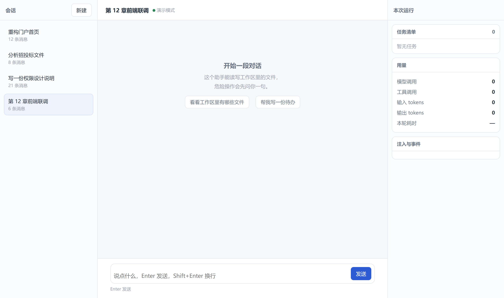
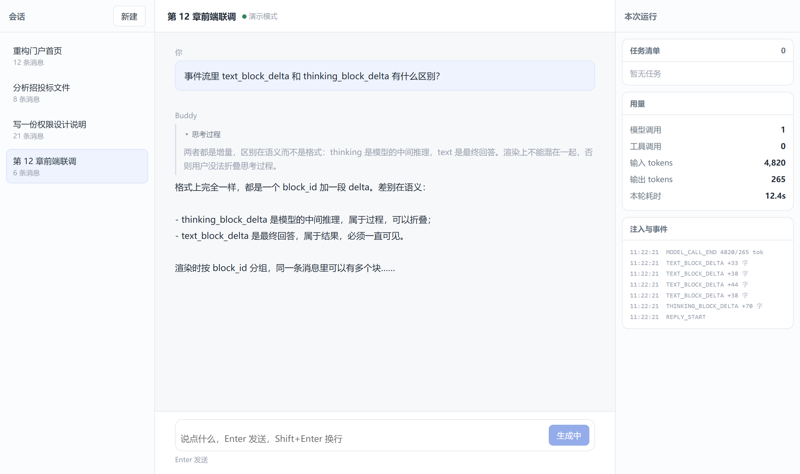
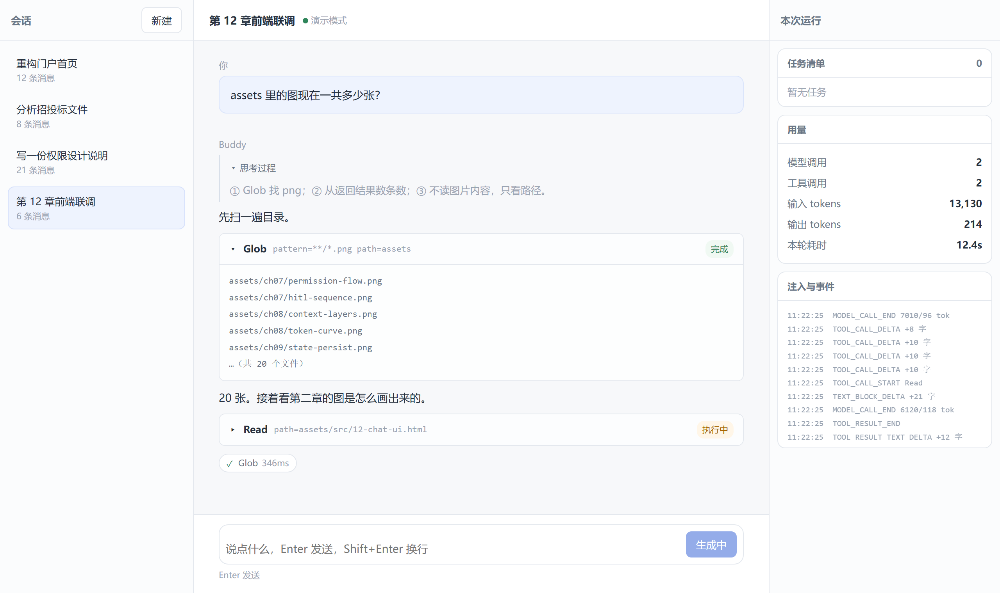
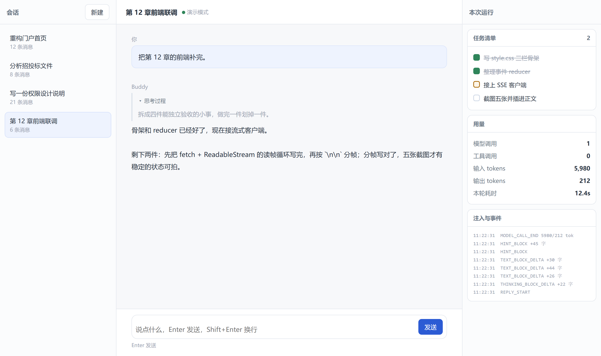
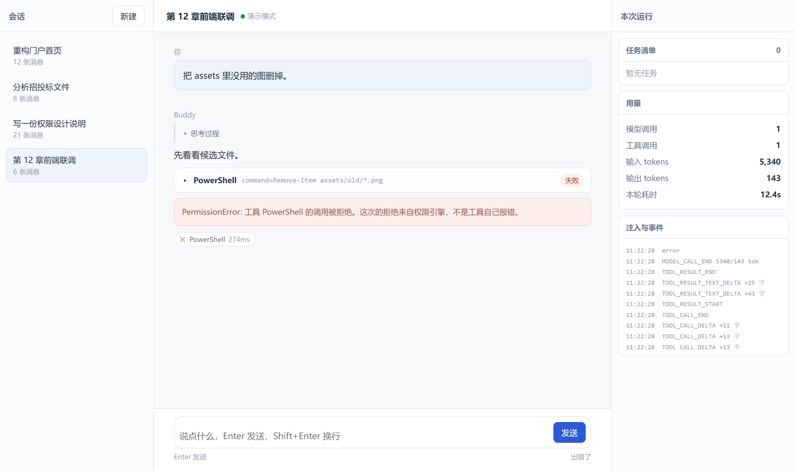

# 第 11 章　前端：把事件流拼成界面

> 本章代码 `code/ch11/`（`index.html` / `app.js` / `style.css` / `mock.html` / `mock_data.js` / `main.py`）　·　读完约 15 分钟

## 11.0 上一章留下的问题

第 10 章结束时，后端已经在往外吐事件了。用 `curl -N` 能看到这样的字节：

```
id: 1
event: REPLY_START
data: {"type": "REPLY_START", "reply_id": "a59289d2…", "ts": 1792639244.61}

id: 2
event: HINT_BLOCK
data: {"type": "HINT_BLOCK", "hint": "<current-time>2026-10-22T03:20:44</current-time>", ...}

id: 3
event: TEXT_BLOCK_DELTA
data: {"type": "TEXT_BLOCK_DELTA", "block_id": "96bb7d6d…", "delta": "先扫一遍目录。"}
```

管道通了，但读得下去的人只有愿意敲 curl 的你。产品要面对的是用户。

一个常见的误解是这活只是"把字符串接到页面上"，于是代码写成每收到一个 `delta` 就把整段对话用 `innerHTML` 重画一遍。两轮对话、一句话的规模下它跑得动，一旦页面上出现思考块、工具卡片、折叠面板，立刻散架。折叠好的块自己弹开，滚动条跳回顶部，用户选中的文字消失。

前端真正的任务不是显示文字，是把十几个并发到达的事件归位到各自的格子里。这一章就做这件事。

## 11.1 先跑起来

后端一行没改。`main.py` 只有三十几行，干两件事，把第 10 章的目录挂进 `sys.path`，把静态目录换成整个 `ch11/`。

```python
HERE = pathlib.Path(__file__).resolve().parent
sys.path.insert(0, str(HERE.parent / "ch10"))

import main as ch10            # 第 10 章的 app / 路由 / build_agent
app = ch10.app

# 第 10 章在 "/" 上挂了它自己的验证页；本章要把根路径让给真正的界面，
# 所以先摘掉那条路由，再把整个目录挂到 "/" 上。
app.router.routes = [r for r in app.router.routes if getattr(r, "path", "") != "/"]
app.mount("/", StaticFiles(directory=str(HERE), html=True), name="ui")
```

`StaticFiles(html=True)` 让访问 `/` 时自动返回目录里的 `index.html`，访问 `/app.js` 时返回那个文件，不必为每个静态资源写一条路由。

三种跑法，看手上有什么条件：

| 跑法 | 命令 | 用的是什么 |
|---|---|---|
| 只看界面 | 双击 `mock.html` | 一份写死的事件流（`mock_data.js`） |
| 前后端联调 | `cd code/ch11 && MOCK=1 python main.py` | 真后端 + 假模型（第 10 章的 `MockModel`） |
| 真实对话 | 配好 `.env` 后 `cd code/ch11 && python main.py` | 真后端 + 真模型 |

第一种连服务器都不用起。它也不是偷懒的产物，前后端对接最省事的顺序就是先让前端在假事件流上跑通，接口一好直接切真数据，切换只动一个 `MOCK` 开关。`mock.html?scene=tool` 这类查询串能指定演示哪个场景，本章后文的截图都是从这几个场景里拍的。



三栏从左到右，会话列表、对话流、本次运行。

右边这条栏值得单独说。它显示的不是装饰性指标，而是前几章做出来的能力：

- **任务清单。** Agent 把计划写进 `agent.state.tasks_context`，喂给这里的 `renderTasks()`。写进去却看不见，等于没写
- **用量。** 第 10 章的 `MODEL_CALL_END` 带着 `input_tokens` / `output_tokens`，不显示就只能等月底账单
- **注入与事件。** `HINT_BLOCK` 是模型看到的额外信息，默认用户不可见，这里把它摊开

## 11.2 事件的归位表

整个前端只做一件事，把事件映射成界面动作。这张表是本章的骨架。

| 事件 | 界面动作 |
|---|---|
| `REPLY_START` | 新建一个助手气泡，标记为"运行中" |
| `THINKING_BLOCK_DELTA` | 按 `block_id` 找思考块，追加文字 |
| `TEXT_BLOCK_DELTA` | 按 `block_id` 找正文块，追加文字 |
| `TOOL_CALL_START` | 新建工具卡片，状态"执行中" |
| `TOOL_CALL_DELTA` | 拼接工具参数（是 JSON 片段，不是完整对象） |
| `TOOL_RESULT_TEXT_DELTA` | 拼接工具返回的正文 |
| `TOOL_RESULT_END` | 卡片状态改为成功或失败，算出耗时，刷新时间线 |
| `MODEL_CALL_END` | 累加调用次数与 token |
| `HINT_BLOCK` | 只进右侧事件日志，不打扰对话 |
| `REQUIRE_USER_CONFIRM` | 气泡标记"等待中"，准备确认界面 |
| `error` | 插一条红色告警 |
| `REPLY_END` / `done` | 收尾，解锁输入框 |

两个键决定这一切能不能对齐：

- `reply_id`，一轮回复里所有事件共用，靠它找到该往哪个助手气泡里放
- `block_id` / `tool_call_id`，同一轮里的不同内容块，靠它找到该往哪个格子里放

一旦按这两个 id 归位，就再也不会想整段重绘了。

## 11.3 四十行的 SSE 客户端

浏览器自带 `EventSource`，五行代码就能连上 SSE。这里不用它，两个原因都是硬伤。

**第一，它发不了 POST。** 发起一轮对话要带上 `session_id` 和文本，`EventSource` 只会 GET，把这些塞进查询串既难看又受长度限制。

**第二，连接一结束它就自动重连。** 一轮回复跑完，后端发 `done` 然后关连接，`EventSource` 认为这是网络故障，两秒后重连，后端再发一遍 `done`，如此循环。网络面板里会看到一条永不停止的请求。

所以手写。核心是一个按 `\n\n` 分帧的循环：

```js
async function readStream(url, { onFrame, onOpen, signal }) {
  const res = await fetch(url, { signal, headers: { Accept: "text/event-stream" } });
  if (!res.ok || !res.body) throw new Error(`HTTP ${res.status}`);
  if (onOpen) onOpen();

  const reader = res.body.getReader();
  const decoder = new TextDecoder("utf-8");
  let buf = "";

  while (true) {
    const { value, done } = await reader.read();
    if (done) break;
    buf += decoder.decode(value, { stream: true });

    let idx;
    while ((idx = buf.indexOf("\n\n")) !== -1) {
      const raw = buf.slice(0, idx);
      buf = buf.slice(idx + 2);          // 注意：切掉，别清空
      const frame = parseFrame(raw);
      if (frame) onFrame(frame);
    }
  }
}
```

五个地方容易写错，每一个都值得看一眼。

**① `decoder.decode(value, { stream: true })`。** 中文在 UTF-8 里占三个字节，网络分片完全可能从这三个字节中间切开。不加 `stream: true`，半个字会被解成替换字符 `�`，而且一出现就无法复原。这个参数的意思是"后面还有，先攒着"。

**② `buf` 是切掉不是清空。** 一次 `read()` 可能收到三帧半，前三次循环把整帧取走，第四次 `indexOf` 返回 -1，剩下的半帧必须留在 `buf` 里等下一片数据。写成 `buf = ""` 会随机丢帧，症状是偶尔少半句话，很难查。

**③ 注释帧要跳过。** 心跳是 `: ping\n\n`，按规约以冒号开头，没有 `data` 行。`parseFrame` 里那句 `if (!line || line.startsWith(":")) continue;` 就是为它准备的，不跳过会拿到空 `data`，`JSON.parse("")` 直接抛异常。

**④ 不要靠 `done` 中断读取。** `done` 看着像"结束"，很容易顺手写成哨兵异常：

```js
class StopStream extends Error {}

onFrame: (frame) => {
  if (frame.event === "done") throw new StopStream();   // 看着合理，其实有坑
}
```

实时对话里它能用，一打开历史会话就露馅。服务端会把缓冲区里的帧全部补发一遍，而缓冲区里每轮回复都有一个 `done`，碰到第一个就停，后面几轮永远渲染不出来。症状是刷新页面后只剩第一问第一答，界面上没有任何报错，翻后端日志也查不出问题，因为前端根本没报错，它只是提前退出了。

收尾交给服务端更省事。它发完 `done` 就关连接，`read()` 返回 `done: true`，循环自然退出。

**⑤ 每轮发送之后要重新连接。** 服务端在 `done` 之后会把这条流的订阅队列关掉，所以它是一次性的，`send()` 的最后一句必须是 `connect()`。同时用 `state.connecting` 做去重，避免连点两次发送时开出两条流去抢同一批帧。

```js
onFrame: (frame) => {
  if (frame.id) state.lastEventId = frame.id;
  handle(frame.event, frame.data);      // done 也照常交给 reducer
}
```

真正需要重连的只剩网络故障。外层 `catch` 里，`AbortError` 是用户主动断开，直接退出；其余情况等三秒重连，这一次会带上 `last_event_id`，后端从环形缓冲区把断线期间的帧补发过来。这就是第 10 章留那个缓冲区的用处。

## 11.4 reducer：把增量放进格子里

数据结构只有三层，消息数组、消息里的块数组、块对应的 DOM 节点。块和节点用 `block.el` 直接挂着，收到增量时不必再 `querySelector` 一次。

```js
function ensureBlock(msg, blockId, kind) {
  const key = blockId || `${kind}-${msg.blocks.length}`;
  let block = msg.blocks.find((b) => b.key === key);
  if (!block) {
    block = { key, kind, text: "" };
    msg.blocks.push(block);
  }
  return block;
}
```

有个容易忽略的设计，`kind` 只在新块创建时用一次。后续事件全靠 `block_id` 命中，不靠"第几个块"。因为一轮回复里模型的输出顺序不可预期，可能先思考、再调工具、回来再思考一次。

于是正文的追加变得很无聊，而无聊正是这里想要的：

```js
case "TEXT_BLOCK_DELTA": {
  const msg = findByReply(d.reply_id) || currentMessage();
  if (!msg) break;
  const block = ensureBlock(msg, d.block_id, "text");
  block.text += d.delta || "";
  appendText(msg, block);      // 只改这一个节点的 textContent
  break;
}
```

`appendText` 里只做 `block.el.textContent = block.text`，不碰其他节点，滚动位置、折叠状态、用户选中的文字全部保住。流式输出本该如此。



图里能看出三段内容的层次，折叠的思考过程、正文段落、右侧逐条到达的事件日志。日志第一行是 `REPLY_START`，最新的在最下面，和对话流同向，两栏不会打架。

## 11.5 工具参数是流式拼出来的

这是本章最容易踩空的地方。

直觉上，工具调用事件该长这样：

```json
{"tool_call": {"name": "Glob", "input": {"pattern": "**/*.png"}}}
```

实际不是。翻一下事件类的字段定义就清楚了：

```
ToolCallStartEvent   : reply_id, tool_call_id, tool_call_name
ToolCallDeltaEvent   : reply_id, tool_call_id, delta
ToolCallEndEvent     : reply_id, tool_call_id
```

`ToolCallStartEvent` 里没有参数，只有工具名。参数在随后的一串 `TOOL_CALL_DELTA` 里，而且是未经解析的 JSON 字符串片段：

```
TOOL_CALL_DELTA  {"pattern"
TOOL_CALL_DELTA  : "**/*.png", "pa
TOOL_CALL_DELTA  th": "assets"}
```

原因和文字流式输出一样，模型一个 token 一个 token 地生成这些参数，框架按到达顺序转成增量。前端只能自己拼：

```js
case "TOOL_CALL_DELTA": {
  const block = ensureBlock(msg, d.tool_call_id, "tool");
  block.input = (block.input || "") + (d.delta || "");
  renderTool(msg, block);      // 拼完之前只做展示，不要 JSON.parse
  break;
}
```

卡片头部展示参数时，`formatArgs` 里那个 `try / catch` 就是为此准备的。拼到一半的 JSON 一定解析失败，此时退回显示原始片段。等 `TOOL_CALL_END` 到达，参数才算完整。

工具的返回正文同理，走 `TOOL_RESULT_TEXT_DELTA`，也是一个字一个字回来。第 10 章的白名单里专门留了这两行（理由在 10.6 说过），少一个，页面上的工具卡片就只剩一个名字：

```python
EventType.TOOL_CALL_DELTA,
EventType.TOOL_RESULT_TEXT_DELTA,
```

**实践教训：白名单该按"界面需要什么"来定，不是按"后端觉得什么重要"来定。**



图里第一个调用已经完成，展开能看到返回的路径列表；第二个 `Read` 还在跑，橙色标着"执行中"；它上面那条时间线只有一枚 `✓ Glob 346ms`。

## 11.6 工具时间线

这是本项目最值得抄走的一个小设计。

一轮回复里可能发生十几次工具调用，只把它们做成卡片竖着排，用户看到的是十张长得差不多的盒子，判断不出"它到底干了多少事"。时间线把同一轮的调用压成一行横向徽章：

```
✓ Glob 346ms   ✕ PowerShell 274ms   ◌ Read
```

三段信息一眼可读，做了什么、成不成、花了多久。三段都来自已经收到的事件，名字来自 `TOOL_CALL_START`，成败来自 `TOOL_RESULT_END` 的 `state`，耗时是两次事件的时间差。

耗时用哪个时钟算，这里有个细节。初版用的是 `performance.now()`，浏览器本地时钟，看着没问题，但起止都取在"事件被前端收到"那一刻，服务端处理时间和两次网络往返全混进了"工具执行时间"，一个 20ms 的工具能显示成 400ms。改成用帧里的 `ts`：

```js
block.elapsed = (d.ts ? d.ts * 1000 : performance.now()) - block.startedAt;
```

`ts` 是后端 `time.time()` 打的戳，两端都用它，算出来才是真的"工具执行了多久"。这也是第 10 章在 `event_to_dict` 里塞 `ts` 的原因，不是为了好看。



右侧任务清单的三种状态，已完成、进行中、待办，数据来自 `TaskList` 工具写进 `tasks_context` 的数组（第 3 章 3.4 节列过）。这里只做一件事，把 `task.state` 映射成颜色。注意字段名是 `state` 不是 `status`，这个不一致从后端一路带到前端，只能照着接。

## 11.7 三个细节

**滚动吸底，用户往回看时不要抢位置。** 流式输出每来一段文字都要滚到底，但用户手动往上翻历史时必须停手。判断方法不复杂：

```js
messagesEl().addEventListener("scroll", () => {
  const box = messagesEl();
  const gap = box.scrollHeight - box.scrollTop - box.clientHeight;
  state.stick = gap < 40;      // 离底部 40px 以内才算"贴着"
});
```

`gap < 40` 而不是 `=== 0`，是因为滚动有亚像素误差，四舍五入之后很难正好等于 0，40px 给了一个容差窗口。

**输入框自增高。** 固定 `rows="1"` 装不下三行的问题，直接给个高盒子又难看。`input` 事件里先把高度设成 `auto`（这样才能缩回去），再设成 `scrollHeight`，封顶 140px。

**出错要说清楚是谁的错。** 页面上的红色告警有两种来源，工具自己返回的错误（`TOOL_RESULT_END` 的 `state == "error"`，卡片变红但流程继续），和整轮回复失败（`error` 帧，流程终止）。



图里这两件事同时发生了，工具卡片是红的，说明工具层面失败；下面那条告警是整轮的，权限引擎拒绝了调用，回复到此为止。第 10 章的 `_run` 在 `except` 里发 `error`、`finally` 里发 `done`，所以输入框会解锁，用户换一句话就能接着问。

## 11.8 三个常见错误

| 错误 | 症状 | 原因与对策 |
|---|---|---|
| 用 `EventSource` | 同一条流不断重连，内容重复出现 | `done` 关连接被它当成故障，两秒后就重连。改用 `fetch` + `ReadableStream` 手写，每轮发送结束后再 `connect()` |
| 每个 `delta` 都重绘整段 | 思考块自己弹开，滚动条跳回顶部，选中的文字消失 | `innerHTML` 会销毁重建全部子节点。按 `block_id` 找到节点，只改 `textContent` |
| 去 `TOOL_CALL_START` 里取参数 | 参数一直空着，或显示 `undefined` | 那个事件只有 `tool_call_id` 和 `tool_call_name`。参数要在 `TOOL_CALL_DELTA` 里累加，`TOOL_CALL_END` 之后才 `JSON.parse` |

## 11.9 小结

这一章把事件流变成了界面，四件事。

1. **归位靠 id。** `reply_id` 找气泡，`block_id` / `tool_call_id` 找格子，不靠顺序
2. **手写 SSE 客户端。** `EventSource` 不能发 POST，且会在 `done` 后无限重连
3. **流式的不只是文字。** 工具参数和工具返回值都是增量，必须自己拼完整再解析
4. **只更新变化的那一小块。** 重绘整段会破坏折叠状态、滚动位置和选区

下一章补最后一块，交互闭环。第 10 章的后端已经能发 `REQUIRE_USER_CONFIRM`、能收 `POST /api/confirm`，界面上却只有一行"（第 12 章接上按钮）"。另有两件事根本没有通道，模型想反过来问用户一句话，用户想中途叫停。确认、提问、中断补齐，对话才算完整。
