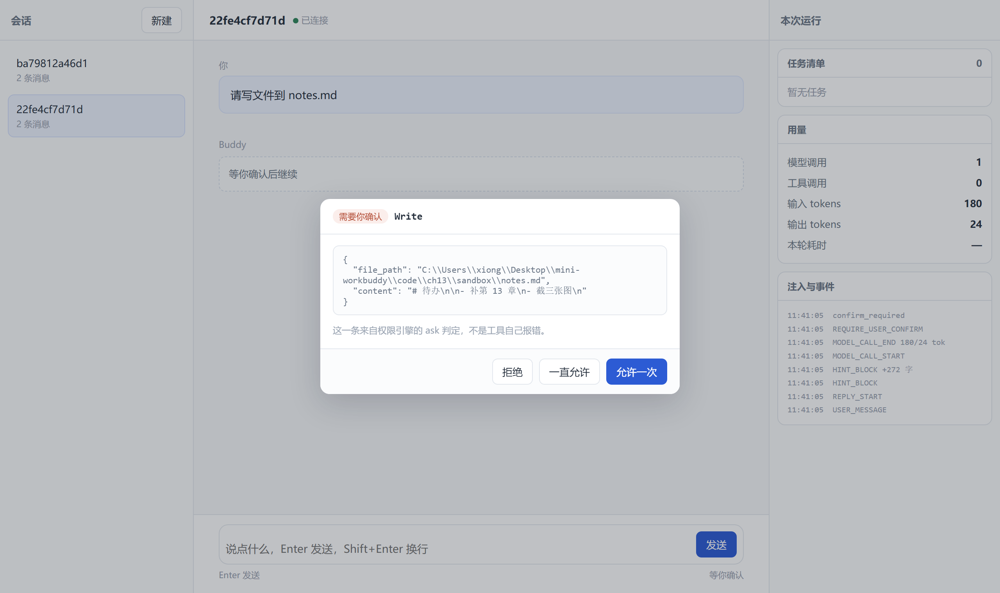
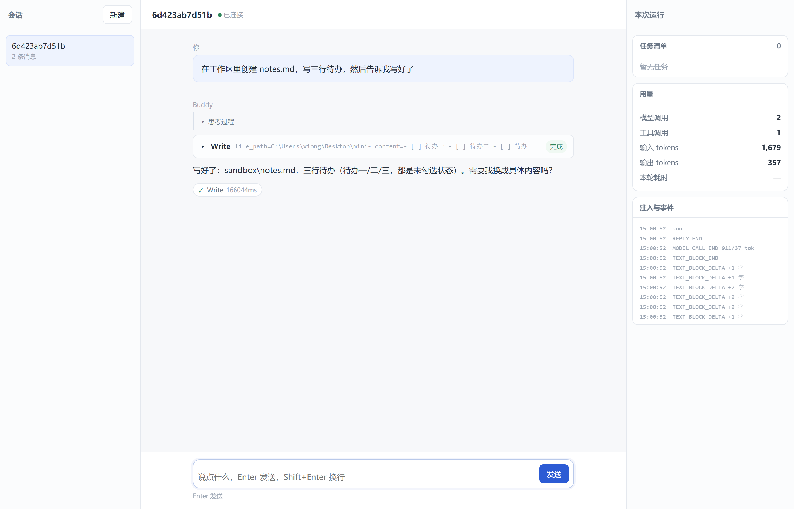
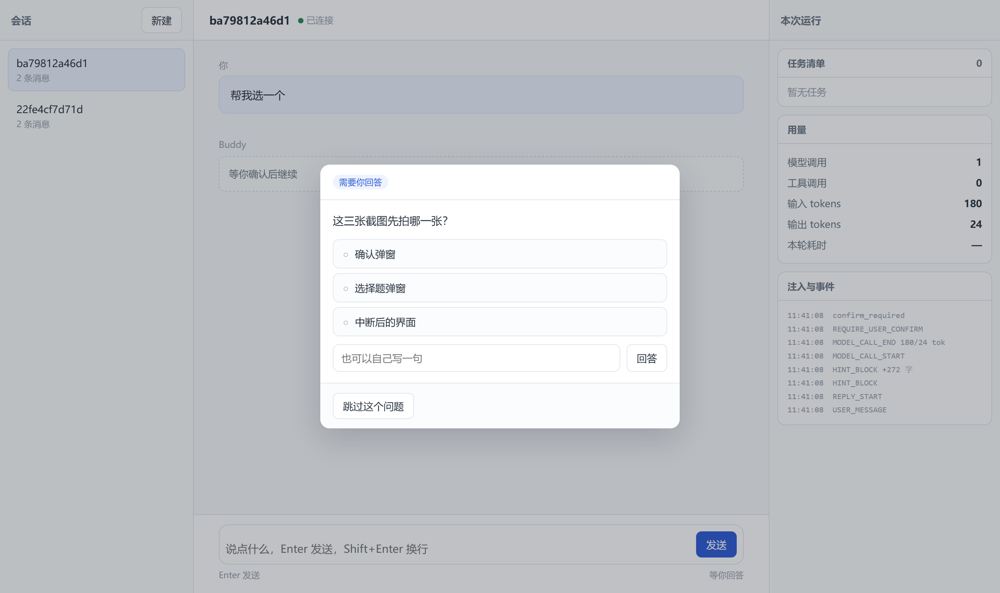
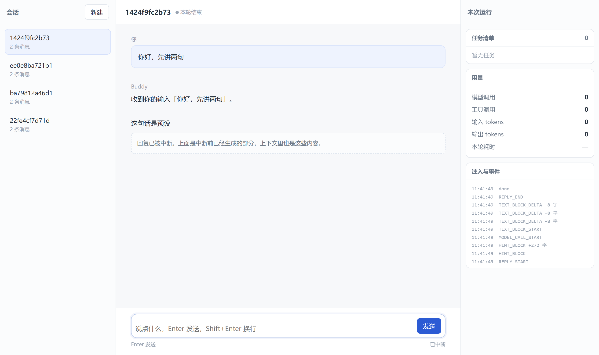

# 第 12 章　交互闭环：确认、提问、中断

> 本章代码 `code/ch12/`（`main.py` / `server.py` / `ask_user.py` / `fake_model.py` / 前端三件套）　·　读完约 15 分钟

## 12.0 上一章留下的问题

第 11 章的界面已经能把一轮回复渲染完整。但它只能看，不能答。

后端从第 10 章起就会发 `REQUIRE_USER_CONFIRM`，前端收到之后只写一行字：

```js
text: `需要确认：${names}（第 12 章接上按钮）`
```

权限系统辛苦拦下来的危险操作，到界面上就成了一句没有下文的话。另外两件事连通道都没有。

- **模型想提问。** "这三个文件你要删哪一个"这种话，模型只能写进正文，然后这一轮就结束了，用户下一句还得从头说起
- **用户想叫停。** 唯一的办法是关掉标签页。后端那个 `asyncio` 任务并不知道人已经走了，它会把这一轮跑完，把工具调完，把 token 烧完

这三件事在协议层面是两类。确认和提问共用同一条通道，中断走另一条。

| 动作 | 谁发起 | 协议 | 服务端要做的 |
|---|---|---|---|
| 确认 | 权限引擎 | `REQUIRE_USER_CONFIRM` → `POST /api/confirm` | 回填 `ConfirmResult`，续跑 |
| 提问 | 工具（借权限通道） | 同上 | 把答案塞进参数，续跑 |
| 中断 | 用户 | `POST /api/interrupt` | 分两种情况，发事件或取消任务 |

## 12.1 确认：三种回执，不是一个布尔值

第 10 章的 `/api/confirm` 只收 `confirmed: true | false`。它能跑，但把三种不同的意图压成了一个。

- 这次允许，下次还问
- 允许，以后同类操作都别再问
- 拒绝

中间那种决定了这东西能不能长期用下去。一个反复问同一件事的助手，用户问到第三次就会把确认功能整个关掉，然后所有保护一起失效。

所以请求体改成带 `decision` 的形式：

```python
class ConfirmRequest(BaseModel):
    session_id: str
    tool_call_id: str
    decision: str = "allow"              # allow / always / deny
    input: dict[str, Any] | None = None  # 用户改过的参数
```

`always` 要做的事就是把一条 allow 规则装进回执：

```python
rules: list[PermissionRule] = []
if body.decision == "always":
    rules.append(PermissionRule(
        tool_name=target.name,
        rule_content="",                 # 空字符串 = 匹配这个工具的所有调用
        behavior=PermissionBehavior.ALLOW,
        source="user",
    ))
```

两个细节。

**规则随回执交回，不要自己往 `permission_context` 里写。** 框架处理 `ConfirmResult` 时会拿 `rules` 里的每一条去调 `add_rule`。你要是两边都写一遍，同一条规则会在 `allow_rules` 里存两份。只走回执还有个好处，回执和规则一起到，恢复会话时不会出现"回执还在、规则丢了"的中间态。

**`rule_content` 是空字符串。** 第 7 章讲过它的语义随工具而变，`Bash` 是子串匹配，`Read` / `Write` 是 glob。空字符串的意思是"这个工具的所有调用都算命中"，用户点"一直允许"要的就是这个粒度。

回执必须带完整的 `tool_call`，不能只带 id：

```python
result = ConfirmResult(
    confirmed=body.decision != "deny",
    tool_call=ToolCallBlock(
        type="tool_call",
        id=target.id,
        name=target.name,
        input=json.dumps(args, ensure_ascii=False),
    ),
    rules=rules,
)
```

`input` 是 JSON 字符串，不是 `dict`。要读里面的字段，先 `json.loads`。



参数是摊开显示的，没有藏进"查看详情"的折叠里。理由很实在，用户要判断的是这一次操作的具体内容，不是工具名。看到 `Write` 就点允许的人，和看到 `notes.md` 这个路径才点允许的人，承担的风险不是一回事。

三个按钮的权重也不同。主色给了"允许一次"，"一直允许"是次要按钮。默认的那一下就应该是反悔成本最低的那一下。

点下"允许一次"，框架重新进入刚才暂停的那一轮，把 `ConfirmResult` 当作外部执行结果交回去，工具真正落盘，模型接着把剩下的半句话说完。



这一轮接的是真模型（`deepseek-v4.1-flash`），两个数字值得留意。输入 1679 token、输出 357 token，模型调用了 2 次。第一次生成工具调用，第二次拿到工具结果后组织回复。第二轮调用的输入带着第一轮的全部上下文和工具输出，所以它大得多，长会话的成本就是这么涨上去的（第 13 章给它记账）。

图里还有一处细节。工具卡片上的 `file_path` 是一整条绝对路径，不是 `./sandbox/notes.md`。内置的 `Write` 只认绝对路径，相对路径会被直接拒绝（第 5 章 5.3 说过），所以提示词里要给出绝对目录，否则模型会理所当然地拼一个相对路径出来。

## 12.2 提问：借一条现成的通道

从 2.0.9 起，`agentscope` 自带官方的 `AskUser` 工具，TUI 里也能直接用。本书的基线是 2.0.5，所以这里自己写一个，不依赖高版本。这个写法本身也值得一看，它把框架里"人机协同"的最小骨架摊开了。

框架里能让 Agent 停下来的机制只有一个，权限系统判定 `ASK`。那就借它。

```python
class AskUser(ToolBase):
    def __init__(self) -> None:
        super().__init__()
        self.name = "ask_user"
        self.description = (
            "当信息不足、或需要在几个方案之间做选择时，向用户提问并等待回答。"
            "把可能的选项写进 options，用户点击比你猜要快得多。"
            "不要在能自己判断的时候调用它——提问会中断当前一轮。"
        )
        self.input_schema = AskUserInput.model_json_schema()
        self.is_read_only = False      # 见 12.5 错误 1
        self.is_concurrency_safe = False

    async def check_permissions(self, tool_input, context) -> PermissionDecision:
        return PermissionDecision(
            behavior=PermissionBehavior.ASK,
            message="需要用户回答后才能继续",
            bypass_immune=True,
        )

    async def call(self, **kwargs) -> AsyncGenerator[ToolChunk, None]:
        answer = str(kwargs.get("answer") or "").strip()
        ...
        yield ToolChunk(
            content=[TextBlock(text=f"用户对「{args.question}」的回答：{answer}")],
            state="success",
            is_last=True,
        )
```

`is_read_only = False` 和 `bypass_immune=True` 是两处非写不可的防御，理由都在第 7 章的判定顺序里。

- **只读工具走"只读放行"快通道**（第 3 步），`check_permissions()` 根本不会被调用。一个声明只读的 `ask_user` 永远不会问，它会直接执行，然后因为拿不到答案而返回错误。这条是踩出来的，见 12.5 错误 1
- **`bypass_immune`** 让这条 `ASK` 不被 allow 规则盖过去。用户在提问弹窗上可能点过"一直允许"，那就留下了一条覆盖 `ask_user` 的 allow 规则。没有这个标记，第二次提问会被规则直接放行，工具空着手执行，返回"用户没有作答"。提问不是安全检查，不该被批量放行。这个标记只在 `DEFAULT` / `ACCEPT_EDITS` 下有效，`BYPASS` 模式按设计跳过工具自检发出的 `ASK`，那种模式下 `ask_user` 照样问不出来



弹窗里的选项只是快捷方式。下面那条输入框随时能用，`options` 留空的时候它就顶上来，模型没必要把题目硬编成几选一。"跳过这个问题"走的是 `deny`，模型收到的是一条被拒绝的工具结果，不是"用户没回答"。

### 12.2.1 答案是怎么回去的

这是全章最巧的一处。`ConfirmResult` 里带回来的 `tool_call` 会覆盖原始参数，框架源码里的注释写得很直白。

```python
# Update name and  input in case user modification is allowed
tool_call.name = confirmation.tool_call.name
tool_call.input = confirmation.tool_call.input
```

也就是说，"用户确认时顺手改参数"是官方支持的行为。那么提问就可以搭这趟车：

1. 工具被调用时，模型只填 `question` 和 `options`
2. 前端把题目渲染成按钮
3. 用户点了一个，前端把这个选项写进 `input.answer`，连同 `decision: "allow"` 一起提交
4. 后端把 `answer` 合并进原始参数，回填给框架
5. 框架执行工具，`call()` 拿到 `answer`，把它作为工具结果交回模型

实测的工具入参是这样的：

```
[工具收到的参数] {'question': '这三张截图先拍哪一张？',
                'options': ['确认弹窗', '选择题弹窗', '中断后的界面'],
                'answer': '确认弹窗'}
```

模型看到的下一条消息是 `用户对「这三张截图先拍哪一张？」的回答：确认弹窗`，然后接着往下推理。

还有一层要知道，`answer` 不在 `input_schema` 里。模型看不到这个字段，也就不会想着自己去填。schema 是给模型看的说明书，不是参数白名单，多出来的键会原样传到 `call()`。

## 12.3 中断：两种卡点，两条路

"中断"这个词在代码里对应两种完全不同的状态，把它们混为一谈是本章最容易犯的错。

| 此刻的状态 | `running` | `task` | 正确做法 | 做错的后果 |
|---|---|---|---|---|
| 正在生成 / 正在跑工具 | `True` | 活着 | `task.cancel()` | — |
| 停在确认，等你点击 | `False` | 已结束 | `UserInterruptEvent` | `cancel()` 无效，什么也不会发生 |

第二种状态很反直觉。停在确认的时候，那一轮的 `asyncio` 任务其实已经结束了，生成过程退出了，只是有一个工具调用被标成 `ASKING`，等外部输入。所以没有任务可取消。

```python
async def interrupt(self) -> str:
    if self.confirm_pending is not None:
        pending, self.confirm_pending = self.confirm_pending, None
        await self.start_resume(UserInterruptEvent(reply_id=pending.reply_id))
        return "已放弃本次确认"

    if self.task is not None and not self.task.done():
        self.task.cancel()
        return "已取消本次回复"

    return "当前没有进行中的任务"
```

两条路的终点一样，事件序列不一样。

**取消任务**时，框架捕获 `CancelledError`，补一个 `finished_reason` 为 `interrupted` 的 `REPLY_END`，然后 `_run` 的 `finally` 照常发 `done`：

```
event: TEXT_BLOCK_DELTA      ← 已经吐出去的字收不回来
event: TEXT_BLOCK_DELTA
event: REPLY_END
data: {"finished_reason": "interrupted"}
event: done
```

这里不会出现 `error` 帧。取消是用户主动做的事，框架在内部处理掉了，界面上只留一条中断说明。

**停在确认时发中断事件**，框架会把待确认的调用补成一条"被中断"的工具结果，再收尾：

```
event: TOOL_RESULT_START
event: TOOL_RESULT_TEXT_DELTA
event: TOOL_RESULT_END
data: {"tool_call_id": "write_1", "state": "interrupted"}
event: REPLY_END
data: {"finished_reason": "interrupted"}
event: done
```

### 12.3.1 中断之后，上下文是一致的

这是必须验证的一件事。被取消的回复只留下半句话，模型下一轮看到的是一个说到一半就断掉的助手回合，它会顺着这个断点当作既成事实往下接。

实测下来，取消之后紧接着再问一句，`context` 从 2 条涨到 4 条，第二轮正常完成，`finished_reason` 是 `completed`。原因在 `Agent` 内部，中断收尾时它会先把没完成的工具调用逐个关闭（`state=interrupted`），再结束这一轮，所以消息列表里不会出现"有 `tool_call` 没有 `tool_result`"的残缺配对。一旦出现这种残缺，下一次模型调用会直接报校验错误。



被中断的回复保留已经生成的部分，末尾补一条说明。不要把它整段删掉，用户看到的内容、上下文里的内容、账单上的内容应该是同一份。删掉界面上的半句话，只会让人以为那部分 token 没花。

## 12.4 前端增量

前端这边只加了三样东西，都不大。

**一个弹窗，两种长相。** `pending.name === "ask_user"` 时渲染题面和选项，其余情况渲染参数和三个按钮。遮罩层共用，`sendConfirm()` 也共用。

**一个停止按钮。** 只在生成过程中出现。它只调 `/api/interrupt`，不关心后端走的是哪条路。

**用户消息也编成一帧。** 这一条是被截图逼出来的。第 11 章的前端在本地插入用户那句话，服务端的事件流里只有助手侧的内容。后果是打开历史会话（`?session=xxx` 回放缓冲区）时，画面里只剩助手在自言自语。

```python
async def start_reply(self, text: str) -> None:
    self._emit("USER_MESSAGE", {"session_id": self.session_id, "text": text})
    await super().start_reply(text)
```

前端收到这一帧默认插一条，本地已经插过同样的内容就跳过。本地先渲染是为了点下去立刻有反馈，不能为了这一帧让用户等一个网络往返。

`?session=xxx` 这个入口别删。事件都在服务端的环形缓冲区里，带上 id 打开就能完整回放。调试、截图、给同事发一个"你看这个问题"的链接，都靠它。

## 12.5 四个常见错误

**错误 1：`ask_user` 声明成只读，永远不会提问。**

```python
self.is_read_only = True     # 错
```

现象：界面上没有弹窗，工具直接执行，返回"用户没有作答"。日志里 `REQUIRE_USER_CONFIRM` 一次都没出现。

原因：第 7 章的判定顺序是 deny 规则 → ask 规则 → 只读放行 → 工具自检 → allow 规则 → 模式默认。只读放行排在工具自检前面，`check_permissions()` 压根没被调用过。

对策：`is_read_only = False`。语义上它确实不写任何东西，但"只读"在这个框架里不只是个描述，它还是一个会改变判定路径的开关。

**错误 2：`check_permissions` 签名写成 `**kwargs`。**

```python
async def check_permissions(self, **kwargs) -> PermissionDecision:   # 错
```

现象：`TypeError: AskUser.check_permissions() takes 1 positional argument but 3 were given`。

原因：引擎按位置调用 `tool.check_permissions(tool_input, context)`，位置参数进不了 `**kwargs`。

对策：写成 `async def check_permissions(self, tool_input, context)`。只读工具撞不上这个错，因为它们的这个方法从来不会被调用，所以这个错误往往要等工具改成非只读的那一刻才暴露。

**错误 3：`done` 之后不重新连流，第二轮没有反应。**

现象：第一轮对话正常，第二轮发出去之后界面一片空白，右上角一直"连接中"。

原因：`done` 到达时后端关闭订阅队列，这条流就作废了。如果 `send()` 只发 `POST /api/chat` 而没重新 `connect()`，第二轮的帧会堆在服务端缓冲区里，没人来取。第 11 章的 `send()` 末尾已经调了 `connect()`，所以它能连续对话；自己实现时别漏这一步。

对策：每次发起请求（发消息、提交确认、请求中断）之后都调一次 `connect()`，带上 `last_event_id` 续传。同时用一个 `connecting` 标志去重，否则连点两次发送会开出两条流，两个读循环抢同一批帧，表现出来是气泡里的文字重复。

**错误 4：打开历史会话，只出现第一轮。**

现象：一轮一轮聊完，刷新页面带上 `?session=xxx` 回放，界面上只剩第一问第一答，事件计数停在十几。没有报错，没有红色告警，后端日志里 `/api/stream` 返回 200。

原因：第 11.3 节那个"`done` 来了就抛异常退出读循环"的写法，在实时对话里看不出问题，因为一轮只有一个 `done`。回放时服务端把整个缓冲区补发一遍，而缓冲区里每轮回复都有一个 `done`，碰到第一个就退出，后面几轮的帧全部丢掉。

对策：不要在 `done` 上做跳转，把它当普通帧交给 reducer，让服务端关连接来结束这次读取。这个坑烦人的地方在于它不产生任何错误信息，只表现为"少了一段内容"，很容易被误判成后端没存下来。排查这类问题，先数一下服务端缓冲区里到底有多少帧，再去怀疑前端。

## 12.6 小结

三件事，两个通道，一套收尾。

1. **确认**是三种回执。`always` 生成一条空 `rule_content` 的 allow 规则，随回执一起交回
2. **提问**借用权限通道。`ASK` 让这一轮停下，答案从"用户可修改参数"这个官方行为回填进工具入参
3. **中断**分两条路。跑着就取消任务，停在确认就发 `UserInterruptEvent`。两条路的终点都是 `finished_reason=interrupted`，上下文都完整
4. **每轮结束后要重连**。后端在 `done` 时关流，这是 SSE 单轮模型必然的代价

到这里，产品在功能上算是齐了。能对话、能干活、能被管住、能被叫停、能中途反问你。

但有一类问题还没答案，而且是更要命的那类。这一轮花了多少钱，慢在哪一步，昨天下午那次为什么出错。现在这些信息全在内存里，重启进程归零，日志刷过去就没了。下一章把它们落盘。
